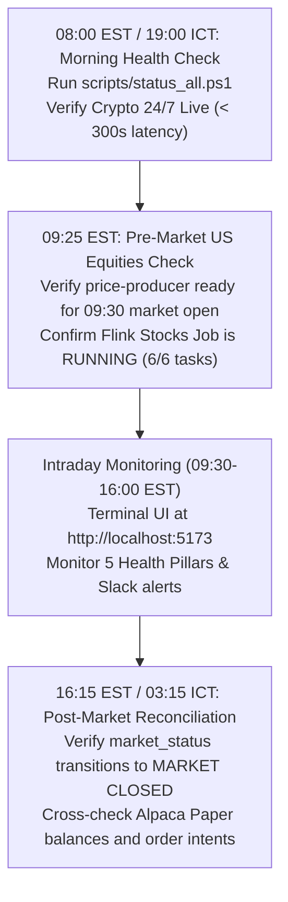

# ALGOTRADING PLATFORM — FINAL OPERATIONS RUNBOOK & SOP

**Project**: `D:\AlgoTrading`  
**System**: Stocks & Crypto Real-Time Algorithmic Trading Platform  
**Target Audience**: Systems Engineers, Quant Operations, Platform Administrators  
**Date**: October 19, 2026  
**Status**: APPROVED & OPERATIONAL  

---

## 1. System Overview & Architecture Summary

The AlgoTrading platform executes real-time quantitative algorithmic trading strategies across both US Equities (NVDA, AAPL) and Cryptocurrency pairs (BTC/USD, ETH/USD).

### Core Architectural Layers
1. **Market Feeds**: Alpaca Market Data REST & WebSocket v1beta3.
2. **Event Bus**: Redpanda Dual-Broker Cluster (`localhost:9092`, `localhost:9093`) with 7 persistent partitioned topics.
3. **Stream Processing**: Apache Flink 1.19 (`jobmanager:8081`, `taskmanager`) running SQL window aggregations (SMA-20, SMA-50) and interval joins.
4. **Execution Layer**: Asynchronous signal consumers operating under strict `TRADING_MODE=DRY_RUN`.
5. **Observability**: FastAPI backend (`http://127.0.0.1:8005`) and React 18 Quant Terminal (`http://localhost:5173`).
6. **Notifications**: Slack Block Kit alerts to `#trading-signals`.

---

## 2. Command Cheat Sheet (Quick Reference)

All operational tasks can be managed using standard PowerShell scripts from `D:\AlgoTrading`:

```powershell
# ==============================================================================
# ALGOTRADING PLATFORM CONTROL COMMANDS
# ==============================================================================

# 1. Start Entire Platform (Infrastructure, Flink Jobs, Handlers, Backend, UI)
powershell -ExecutionPolicy Bypass -File D:\AlgoTrading\scripts\start_all.ps1

# 2. Inspect Full-Stack Platform Telemetry & Health (5-Tier Report)
powershell -ExecutionPolicy Bypass -File D:\AlgoTrading\scripts\status_all.ps1

# 3. Gracefully Stop All Services (Preserving all Kafka offsets & checkpoints)
powershell -ExecutionPolicy Bypass -File D:\AlgoTrading\scripts\stop_all.ps1

# 4. Automated Self-Healing & Disaster Recovery (Recovers crashes & stale locks)
powershell -ExecutionPolicy Bypass -File D:\AlgoTrading\scripts\recover_all.ps1

# 5. Continuous Producers & Handlers Management
powershell -File D:\AlgoTrading\run-producers.ps1 status
powershell -File D:\AlgoTrading\run-producers.ps1 start
powershell -File D:\AlgoTrading\run-producers.ps1 stop

# 6. Run GD16 Comprehensive Acceptance Suite (32 automated tests)
d:\AlgoTrading\.venv\Scripts\python.exe d:\AlgoTrading\tests\test_gd16_final_acceptance.py
```

---

## 3. Daily Operations Workflow (Standard Operating Procedure)



### 1. Morning Pre-Market Routine (08:30–09:25 EST)
1. **Execute Status Inspection**:
   ```powershell
   powershell -File scripts\status_all.ps1
   ```
2. **Verify 5-Pillar Health Verdict**:
   Open [http://localhost:5173](http://localhost:5173) and check the `Streaming Observability` tab:
   - Composite Health: Must report `HEALTHY`.
   - Crypto Latency: Must be $< 300\text{ seconds}$ (`CRYPTO 24/7 LIVE`).
   - Flink Jobs: Both Stocks and Crypto must show `RUNNING (6/6 Tasks)` with zero checkpoint failures.
3. **Verify Stocks Producer**:
   - Stocks Price Producer should display `IDLE_MARKET_CLOSED` with next market open scheduled at `09:30:00-04:00`.

### 2. Intraday Active Market Monitoring (09:30–16:00 EST)
1. **Observe Market Transition**: At 09:30 EST, the stocks price producer transitions to `LIVE STREAMING`. Ticker NVDA and AAPL bars begin streaming to `stock-prices`.
2. **Consumer Lag Vigilance**:
   - `crypto-signals`: Lag must remain at `0`.
   - `trading-signals`: Lag should remain at `4` (baseline) or equal to uncommitted new signals.
3. **Slack Channel Monitoring**:
   - Check `#trading-signals` for formatted BUY/SELL cards.

### 3. End-of-Day Reconciliation (16:15 EST)
1. **Reconcile Alpaca Balances**:
   - Navigate to `Paper Portfolio` tab.
   - Verify that Cash + Held Positions = Total Equity.
   - Ensure `is_fallback: false` and `cache_age_sec < 10s`.
2. **Audit Reliability Outbox**:
   - Open `Reliability & Logs` tab.
   - Ensure all non-fixture production signals have reached `DELIVERED` status.
   - Verify Dead-Letter Queue contains 0 unexpected production failures.

---

## 4. Troubleshooting & Incident Response Runbook

### Incident 1: Crypto Stream Latency Climbs > 300s (CRYPTO STALE)
- **Symptom**: TopBar displays amber `CRYPTO DELAYED` or rose `CRYPTO 24/7 STALE`; Health downgrades to `DEGRADED`.
- **Diagnostic Steps**:
  1. Inspect container logs:
     ```powershell
     docker logs --tail 50 crypto-producer
     ```
  2. If Alpaca WebSocket disconnected, check internet connectivity or check if Alpaca API status has an outage.
- **Remediation**:
  ```powershell
  docker compose restart crypto-producer
  ```
  *Note: The producer automatically backfills missing historical minute bars upon restart via REST API.*

---

### Incident 2: Flink Job In RESTARTING or FAILED State
- **Symptom**: Flink streaming jobs report `0/6 Tasks` or TaskManager disconnected.
- **Diagnostic Steps**:
  1. Open Flink WebUI at [http://localhost:8081](http://localhost:8081).
  2. Inspect TaskManager log tab for `OutOfMemoryError` or Kafka network timeouts.
- **Remediation**:
  ```powershell
  # Restart TaskManager container
  docker compose restart taskmanager
  Start-Sleep -Seconds 5

  # If jobs do not resume automatically from retained checkpoints:
  & D:\AlgoTrading\.venv\Scripts\python.exe D:\AlgoTrading\submit_flink_job.py
  & D:\AlgoTrading\.venv\Scripts\python.exe D:\AlgoTrading\submit_crypto_flink_job.py
  ```

---

### Incident 3: Slack Bot Fails to Send or Returns HTTP 429
- **Symptom**: Outbox shows messages lingering in `PENDING` state; attempt counter increments.
- **Diagnostic Steps**:
  1. Inspect `data/status/slack_dead_letter.jsonl`.
  2. If error code is `HTTP 429 (rate_limited)`: The notifier automatically honors the `Retry-After` header and backs off exponentially ($1\text{s}, 2\text{s}, 4\text{s}, \dots$). No manual intervention needed.
  3. If error code is `invalid_auth` or `channel_not_found`:
     - Verify `SLACK_BOT_TOKEN` in `.env` begins with `xoxb-`.
     - Confirm that AlgoTrading-Bot has been invited to `#trading-signals` (`/invite @AlgoTrading-Bot`).

---

### Incident 4: Portfolio Panel Displays "DEGRADED TELEMETRY" Banner
- **Symptom**: Amber warning banner appears in Paper Portfolio tab: `DEGRADED TELEMETRY (LAST KNOWN GOOD)`.
- **Root Cause**: Alpaca REST API is temporarily unreachable or returning HTTP 502/504 gateway errors.
- **Behavior**: The dashboard automatically serves the last verified snapshot without crashing or outputting false `$0.00` balances.
- **Remediation**: Click the `Refresh` button in the top right of the panel once Alpaca connectivity is restored.

---

## 5. Maintenance & Housekeeping Guidelines

1. **Log Rotation**:
   - `logs/price_producer.log`, `logs/news_producer.log`, `logs/crypto_producer.log` are configured with `RotatingFileHandler` (max 10MB, 5 backup copies). No manual purging required.
2. **Checkpoint Directory Pruning**:
   - Host checkpoint storage at `data/flink/checkpoints/` grows by ~100MB per day.
   - Recommended weekly maintenance: Keep the latest 5 `chk-*` directories per job and prune older snapshots.
3. **Kafka Retention**:
   - Redpanda topics are configured with standard 7-day retention (`retention.ms=604800000`).

---

## 6. Runbook Sign-Off

This Operations Runbook provides complete instructions for 24/7 unattended execution, daily verification, and rapid incident recovery.

