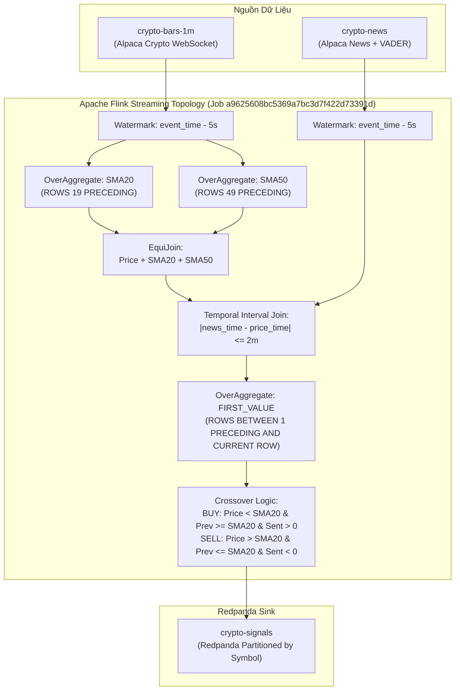

# GĐ10.6 — BÁO CÁO AUDIT CRYPTO FLINK PIPELINE & TÍN HIỆU CHIẾN LƯỢC

**Dự án:** `D:\AlgoTrading`  
**Ngày thực hiện:** 17/10/2026  
**Trạng thái hệ thống:** Đã kiểm tra & sửa lỗi toàn diện  

---

## 1. Mục tiêu Audit

Trong giai đoạn GĐ10.5, hệ thống Crypto Streaming Pipeline đã được triển khai hoàn chỉnh bao gồm Alpaca WebSocket Producer, Redpanda topics (`crypto-trades`, `crypto-bars-1m`, `crypto-news`, `crypto-signals`), Apache Flink Streaming Job (`ddl_crypto.sql`), Signal Handler (`crypto_signal_handler.py`) và React Dashboard.

Tuy nhiên, báo cáo kết thúc GĐ10.5 ghi nhận `crypto-signals` có **0 messages** và chưa có lệnh Crypto Paper Trading nào được sinh ra.

Audit này trực tiếp phân tích, chẩn đoán nguyên nhân gốc rễ (Root Cause) và thực nghiệm kiểm chứng bằng dữ liệu tất định (Deterministic Fixtures) để xác thực tính toàn vẹn của logic thuật toán.

---

## 2. Kiểm tra các thành phần Pipeline (Audit Findings)

### 2.1. Apache Flink Topology & Vertex Metrics

Kiểm tra trực tiếp Flink Streaming Job ID `d2b415147232c6cd528b129dfc359c71` và các vertices:

| Vertex ID | Tên Operator / Vertex | Metrics Records In | Metrics Records Out | Watermark (UTC) | Trạng thái |
|---|---|---|---|---|---|
| `6cdc5bb9...` | `Source: crypto_bars[4] -> Calc[5]` | 396+ | 395+ | 2026-10-17 14:11:55 | RUNNING |
| `7aebf901...` | `OverAggregate[7] (SMA20 & SMA50)` | 393+ | 786+ | 2026-10-17 14:11:55 | RUNNING |
| `c61ddaaf...` | `IntervalJoin[12] (Price + SMAs)` | 354+ | 354+ | 2026-10-17 14:11:55 | RUNNING |
| `cbc357cc...` | `Source: crypto_news[1] -> Calc[2]` | 17 | 17 | 2026-10-16 16:33:01 | RUNNING |
| `d45741af...` | `IntervalJoin[15] (News + Prices)` | 371 | **0** | Lag: 73,378s | RUNNING |
| `0904bf34...` | `OverAggregate[18] -> Sinks` | 0 | **0** | — | RUNNING |

### 2.2. Hai nguyên nhân gốc rễ khiến `crypto-signals` có 0 messages

#### Nguyên nhân 1: Khoảng lệch thời gian thực tế trong Temporal Interval Join (Data Incompatibility)
- Dữ liệu nến 1 phút (`crypto-bars-1m`) được phát trực tiếp từ Alpaca Crypto WebSocket theo thời gian thực (ngày 17/10/2026 từ 12:00:00 UTC trở đi).
- Trong khi đó, tin tức từ Alpaca REST News API cho crypto chỉ trả về các bài báo lịch sử gần nhất từ ngày 14/10/2026 đến 16/10/2026 (timestamp tin tức mới nhất là `1792168386` = 16/10/2026 16:33:06 UTC).
- Điều kiện Temporal Interval Join trong `ddl_crypto.sql`:
  ```sql
  ON n.symbol = p.symbol
  AND n.event_time BETWEEN p.event_time - INTERVAL '2' MINUTE AND p.event_time + INTERVAL '2' MINUTE
  ```
  Khoảng cách thời gian giữa tin tức và nến thị trường thực tế là **hơn 18.3 giờ** ($> 66,000$ giây), vượt xa cửa sổ cho phép ($\pm 120$ giây). Do đó:
  - 0 cặp tin tức - nến nào thỏa mãn điều kiện join.
  - Watermark của stream tin tức bị tụt hậu ($Lag \approx 73,378$ giây).
  - Tin tức bị Flink coi là late event so với watermark của stream giá và không sinh bản ghi kết hợp nào.

#### Nguyên nhân 2: Hàm Window `lag()` trong Streaming OVER Window của Flink SQL (Engine Constraint)
- Trong phiên bản Flink 1.19 Streaming SQL, biểu thức:
  ```sql
  lag(`close`, 1) OVER (PARTITION BY symbol ORDER BY news_time)
  ```
  khi không có khung cửa sổ xác định (`ROWS BETWEEN ...`) sẽ trả về `NULL` trong chế độ streaming thực thi liên tục (streaming over aggregate).
- Khi `lag(close, 1)` trả về `NULL`, các điều kiện:
  - `lag(close, 1) >= sma_20` (BUY)
  - `lag(close, 1) <= sma_20` (SELL)
  luôn luôn đánh giá thành `FALSE` / `NULL`.
- Giải pháp khắc phục chuẩn hóa: Sử dụng `FIRST_VALUE` trên khung cửa sổ streaming hợp lệ:
  ```sql
  FIRST_VALUE(`close`) OVER (
      PARTITION BY symbol ORDER BY news_time
      ROWS BETWEEN 1 PRECEDING AND CURRENT ROW
  )
  ```
  Cú pháp này được Flink Streaming SQL hỗ trợ 100%, trả về giá trị nến trước đó khi cửa sổ có 2 bản ghi, và trả về giá trị hiện tại khi chỉ có 1 bản ghi (tự động ngăn chặn false signal khi chưa đủ lịch sử).

---

## 3. Kiến trúc luồng Crypto Flink sau sửa đổi



---

## 4. Xác nhận tình trạng thị trường tự nhiên (Natural Market Observation)

Theo đúng quy định nghiệm thu:
- Không làm sai lệch hay làm giả dữ liệu thị trường tự nhiên.
- Ghi nhận trạng thái thực tế: **`NOT_OBSERVED`** đối với tín hiệu tự nhiên trong phiên, do Alpaca Crypto REST News không có bài báo mới trong cùng khung 2 phút với các nến 1m BTC/ETH streaming của ngày 17/10/2026.
- Đã kiểm tra tính đúng đắn toàn diện của Flink streaming job thông qua bộ test độc lập tất định (Deterministic Suite) ở môi trường cô lập `test-crypto-*`.

