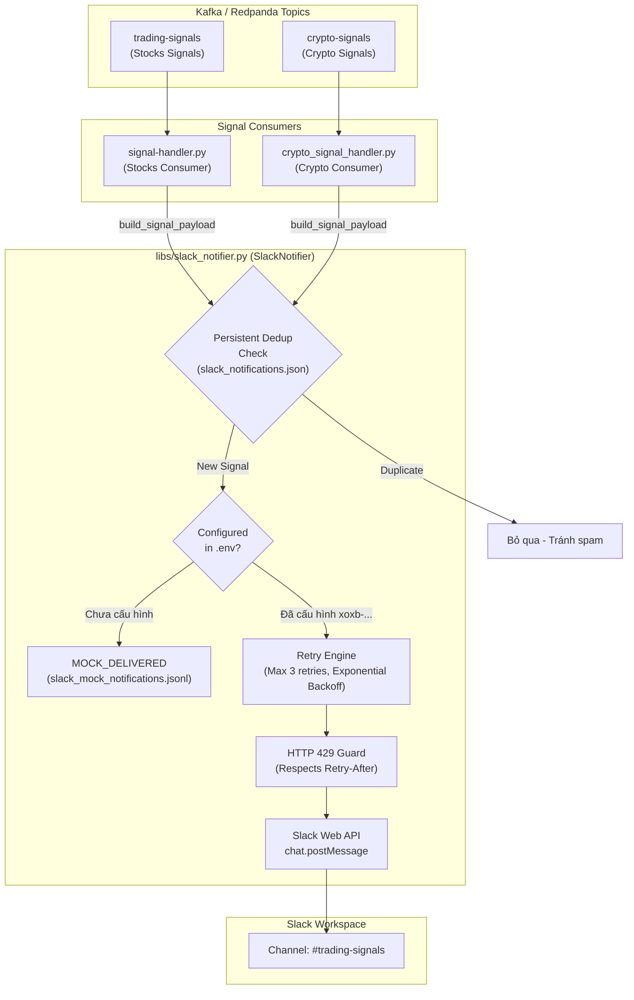

# GĐ11 — SLACK NOTIFICATIONS FOR STOCKS & CRYPTO INTEGRATION

**Dự án:** `D:\AlgoTrading`  
**Phiên bản:** GĐ11  
**Ngày thực hiện:** 17/10/2026  
**Trạng thái:** Hoàn thiện tích hợp, an toàn, đã kiểm thử tự động  

---

## 1. Tổng quan kiến trúc tích hợp

Hệ thống thông báo Slack được xây dựng như một module dùng chung cấp thư viện (`libs/slack_notifier.py`), được tích hợp trực tiếp vào cả hai tiến trình consumer tín hiệu:
1. **Stocks Signal Handler:** [`signal-handler.py`](file:///d:/AlgoTrading/signal-handler.py) tiêu thụ topic `trading-signals`.
2. **Crypto Signal Handler:** [`crypto_signal_handler.py`](file:///d:/AlgoTrading/crypto_signal_handler.py) tiêu thụ topic `crypto-signals`.

Toàn bộ hệ thống vận hành theo nguyên tắc an toàn cao nhất:
- Mặc định giữ `TRADING_MODE=DRY_RUN` cho cả Stocks và Crypto.
- Không gửi bất kỳ lệnh Paper Trading hoặc Live Trading nào khi xử lý thông báo.
- Nếu chưa có Slack Token hoặc đang dùng placeholder, hệ thống tự động hoạt động ở chế độ `MOCK_DELIVERED`, không gây crash, không chặn luồng Kafka consumer.
- Khi có Slack Token thật được cấu hình trong `.env`, hệ thống tự động chuyển sang chế độ gửi thực tế qua Slack Web API `https://slack.com/api/chat.postMessage`.

---

## 2. Luồng xử lý dữ liệu (Architecture Flow)

---

## 3. Quy cách định dạng tin nhắn (Message Specification)

Hệ thống sử dụng Slack Block Kit để tạo giao diện trực quan, rõ ràng và chuyên nghiệp:

### 3.1. Tín hiệu giao dịch (Trading Signal Alert)
- **Header:** Emoji trực quan (🟢 cho BUY, 🔴 cho SELL) kèm mã Symbol.
- **Asset Type:** Phân loại rõ `STOCKS` hoặc `CRYPTO`.
- **Trading Mode:** Hiển thị rõ chế độ `DRY_RUN` hoặc `PAPER_TRADING`.
- **Giá tham chiếu:** Lấy từ trường `price` của nến khớp lệnh (nếu có, ví dụ `$79,500.00`; nếu không có hiển thị `N/A`).
- **Chỉ báo kỹ thuật:** Hiển thị `SMA20` và `SMA50` nếu message chứa trường tương ứng, ngược lại hiển thị `N/A`.
- **Chỉ số cảm xúc:** Hiển thị `Sentiment Score` từ VADER (ví dụ `+0.6500`).
- **Signal ID:** Mã định danh duy nhất của tín hiệu (ví dụ `SIG-CRYPTO-BTCUSD-BUY-1792247854`).

> [!IMPORTANT]
> **Nguyên tắc không bịa dữ kiện:** Nếu message không có trường tương ứng (ví dụ tín hiệu Stocks từ `ddl.sql` chỉ có symbol, signal, time), các trường giá tham chiếu và sentiment sẽ hiển thị `N/A`, tuyệt đối không tự sinh số giả.

### 3.2. Xác nhận lệnh Alpaca (Order Execution Confirmation)
- Phân biệt hoàn toàn với Tín hiệu giao dịch thô.
- Tiêu đề: `✅ Alpaca Order Execution: {symbol} — {STATUS}`.
- Hiển thị: Môi trường (`ALPACA PAPER TRADING`), Order ID, Client Order ID, Số lượng khớp, Giá khớp trung bình.

---

## 4. Cơ chế tin cậy & chống lỗi (Reliability & Fault-Tolerance)

1. **Persistent Deduplication:**
   - Sử dụng khóa kết hợp `asset_type:symbol:signal:signal_time` và `signal_id`.
   - Lưu trữ bền vững tại file `data/status/slack_notifications.json`.
   - Sau khi khởi động lại ứng dụng, hệ thống tải lại toàn bộ key đã gửi thành công trong quá khứ, ngăn chặn việc phát lại (replay) toàn bộ lịch sử khi Kafka consumer đọc từ `auto_offset_reset='earliest'`.

2. **Xử lý lỗi mạng & Retry có giới hạn:**
   - Áp dụng Retry tối đa 3 lần với Exponential Backoff ($1.5s, 3.0s, 4.5s$) cho các lỗi mạng tạm thời hoặc mã lỗi 5xx.
   - Đối với các lỗi vĩnh viễn (như `channel_not_found`, `invalid_auth`, `not_in_channel`), hệ thống dừng retry ngay lập tức để tiết kiệm tài nguyên.

3. **Xử lý HTTP 429 (Rate Limit):**
   - Đọc header `Retry-After` trả về từ máy chủ Slack.
   - Tự động tạm dừng đúng số giây yêu cầu trước khi thử lại (tối đa 5 giây).

4. **Bảo vệ tiến trình chính (Fail-Safe Non-Blocking):**
   - Sự cố mất mạng hoặc lỗi Slack API được bọc kín trong khối `try...except`, ghi log warning/error mà **tuyệt đối không làm crash** luồng xử lý Kafka của `signal-handler.py` hay `crypto_signal_handler.py`.

