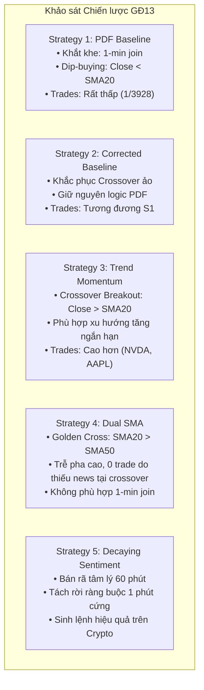

# BÁO CÁO BACKTEST LỊCH SỬ & ĐÁNH GIÁ CHIẾN LƯỢC TOÀN DIỆN (GĐ13)

Dự án: **AlgoTrading**  
Đường dẫn: `D:\AlgoTrading`  
Thời gian thực hiện: Tháng 10/2026  
Mã nguồn Backtest Engine: `backtest/engine.py`, `backtest/metrics.py`, `backtest/strategies.py`, `backtest/run_backtest.py`  
Artifacts kết quả: `data/status/gd13_backtest_results.json`, `data/status/gd13_strategy_comparison.csv`, `data/status/gd13_backtest_trades.csv`  
Tập dữ liệu lịch sử: `data/historical/stock_prices.csv` (5,975 bars), `market_news.csv` (177 news), `crypto_bars_1m.csv` (748 bars), `crypto_news.csv` (18 news)

---

## 1. Mục tiêu & Nguyên tắc Thiết kế Backtesting Engine

Mục tiêu cốt lõi của giai đoạn GĐ13 là xây dựng một hệ thống backtesting độc lập, khách quan và nghiêm ngặt nhằm đánh giá tính khả thi kinh tế, độ chính xác số học và độ ổn định của chiến lược giao dịch từ tài liệu PDF gốc `Real-Time Algorithmic Trading` cũng như các biến thể mở rộng trên cả thị trường Cổ phiếu (Stocks) và Tiền số (Crypto).

### 1.1. Nguyên tắc Không Look-Ahead Bias (Strictly Zero Look-Ahead Bias)
Hầu hết các sai lầm trong backtest thuật toán bắt nguồn từ việc rò rỉ dữ liệu tương lai (look-ahead bias):
- **Phát sinh tín hiệu**: Tín hiệu $Signal_t$ chỉ được tính toán vào thời điểm đóng nến $Close_t$ (cuối nến phút $t$).
- **Khớp lệnh (Execution)**: Lệnh KHÔNG ĐƯỢC khớp tại mức giá $Close_t$. Lệnh giao dịch chỉ được đưa vào hàng đợi (`pending_order`) và khớp tại mức giá mở cửa của nến kế tiếp ($Open_{t+1}$).
- **Tránh Look-Ahead trong Tin tức**: Tin tức chỉ được coi là đã biết sau thời điểm `published_at` (hoặc `received_at`), không bao giờ được tham chiếu ngược về quá khứ trước khi tin tức xuất hiện.

### 1.2. Mô hình Hóa Ma sát Thị trường (Friction & Fee Modeling)
Backtest engine mô phỏng chi phí giao dịch thực tế trên sàn Alpaca:
- **Stocks (Cổ phiếu)**:
  - Phí giao dịch: $5\text{ bps}$ ($0.05\%$) trên giá trị lệnh.
  - Trượt giá (Slippage): $0\text{ bps}$ (NVDA và AAPL có thanh khoản cực cao trong giờ thị trường).
- **Crypto (Tiền số)**:
  - Phí giao dịch sàn Alpaca Crypto: $25\text{ bps}$ ($0.25\%$) cho Taker order.
  - Trượt giá (Slippage): $1\text{ bps}$ ($0.01\%$) do chênh lệch bid-ask spread trên order book tiền số.
- Mọi khoản phí và trượt giá được khấu trừ trực tiếp vào số dư tiền mặt (`cash`) của tài khoản ngay tại thời điểm khớp lệnh.

### 1.3. Phân chia Dữ liệu Huấn luyện & Kiểm thử (Data Splitting)
Dữ liệu lịch sử được phân chia theo trình tự thời gian nghiêm ngặt (Chronological Order), tuyệt đối không xáo trộn (no shuffle):
1. **Train (In-Sample)**: $60\%$ dữ liệu đầu tiên.
2. **Validation (Sample)**: $20\%$ dữ liệu tiếp theo (dùng hiệu chỉnh ngưỡng).
3. **Test (Out-of-Sample)**: $20\%$ dữ liệu cuối cùng (kiểm tra độ bền chiến lược).
4. **Full Period**: Đánh giá toàn bộ chuỗi thời gian để đo lường tương quan Buy & Hold.

---

## 2. Đặc tả 5 Biến thể Chiến lược Được Kiểm thử

| Mã Chiến lược | Tên Chiến lược | Logic Tín hiệu BUY | Logic Tín hiệu SELL | Xử lý Tin tức |
|---|---|---|---|---|
| **Strategy 1** | **PDF Baseline** | $Sentiment > 0 \land Close_t < SMA20_t \land Close_{t-1} \ge SMA20_t$ | $Sentiment < 0 \land Close_t > SMA20_t \land Close_{t-1} \le SMA20_t$ | Cửa sổ cứng 1 phút ($[-1\text{m}, 0]$) |
| **Strategy 2** | **Corrected Baseline** | $Sentiment > 0 \land Close_t < SMA20_t \land Close_{t-1} \ge SMA20_{t-1}$ | $Sentiment < 0 \land Close_t > SMA20_t \land Close_{t-1} \le SMA20_{t-1}$ | Cửa sổ cứng 1 phút ($[-1\text{m}, 0]$) |
| **Strategy 3** | **Trend Momentum** | $Sentiment > 0 \land Close_t > SMA20_t \land Close_{t-1} \le SMA20_{t-1}$ | $Sentiment < 0 \land Close_t < SMA20_t \land Close_{t-1} \ge SMA20_{t-1}$ | Cửa sổ cứng 1 phút ($[-1\text{m}, 0]$) |
| **Strategy 4** | **Dual SMA Golden Cross** | $Sentiment > 0 \land SMA20_t > SMA50_t \land SMA20_{t-1} \le SMA50_{t-1}$ | $Sentiment < 0 \land SMA20_t < SMA50_t \land SMA20_{t-1} \ge SMA50_{t-1}$ | Cửa sổ cứng 1 phút ($[-1\text{m}, 0]$) |
| **Strategy 5** | **Stateful Decaying Sentiment** | $S(t) > 0.05 \land Close_t < SMA20_t \land Close_{t-1} \ge SMA20_{t-1}$ | $S(t) < -0.05 \land Close_t > SMA20_t \land Close_{t-1} \le SMA20_{t-1}$ | Suy giảm mũ chu kỳ bán rã 60 phút |

Trong đó, hàm suy giảm tâm lý của **Strategy 5** được tính toán liên tục tại mỗi phút $t$:
$$S(t) = S_{last} \times \left(\frac{1}{2}\right)^{\frac{\Delta t}{60}}$$
với $\Delta t$ là khoảng cách thời gian tính bằng phút kể từ bài báo gần nhất.

---

## 3. Bảng Tổng hợp Kết quả Hiệu suất (Performance Comparison)

Tổng cộng **80 lượt đánh giá độc lập** (4 tài sản $\times$ 5 chiến lược $\times$ 4 tập phân chia) đã được thực thi và ghi nhận vào `data/status/gd13_strategy_comparison.csv`.

Dưới đây là bảng trích xuất kết quả trên chuỗi dữ liệu toàn phần (**Full Period**) và tập kiểm thử ngoài mẫu (**Test Out-of-Sample**):

### 3.1. Thị trường Cổ phiếu (Stocks: NVDA & AAPL)

#### Cổ phiếu NVDA (3,928 Nến 1 phút — Benchmark Buy & Hold: -6.15%)
| Chiến lược | Tập dữ liệu | Return (%) | Benchmark (%) | Alpha (%) | Max Drawdown (%) | Sharpe | Trades | Win Rate (%) | Phí & Slippage ($) |
|---|---|---|---|---|---|---|---|---|---|
| **Strategy 1 (PDF Baseline)** | Full Period | **-0.14%** | -6.15% | **+6.01%** | 0.23% | -3.36 | 1 | 0.0% | $9.94 |
| Strategy 1 (PDF Baseline) | Validation | **+0.01%** | -0.06% | **+0.06%** | 0.09% | +0.58 | 1 | 100.0% | $10.01 |
| Strategy 1 (PDF Baseline) | Out-of-Sample | 0.00% | -1.35% | **+1.35%** | 0.00% | N/A | 0 | 0.0% | $0.00 |
| **Strategy 2 (Corrected Base)** | Full Period | **-0.14%** | -6.15% | **+6.01%** | 0.23% | -3.36 | 1 | 0.0% | $9.94 |
| Strategy 2 (Corrected Base) | Validation | **+0.01%** | -0.06% | **+0.06%** | 0.09% | +0.58 | 1 | 100.0% | $10.01 |
| Strategy 2 (Corrected Base) | Out-of-Sample | 0.00% | -1.35% | **+1.35%** | 0.00% | N/A | 0 | 0.0% | $0.00 |
| **Strategy 3 (Trend Momentum)** | Full Period | **-0.12%** | -6.15% | **+6.02%** | 0.23% | -3.22 | 1 | 0.0% | $9.94 |
| Strategy 3 (Trend Momentum) | Validation | **+0.02%** | -0.06% | **+0.07%** | 0.09% | +2.08 | 1 | 100.0% | $10.01 |
| Strategy 3 (Trend Momentum) | Out-of-Sample | 0.00% | -1.35% | **+1.35%** | 0.00% | N/A | 0 | 0.0% | $0.00 |
| **Strategy 4 (Dual SMA)** | Full Period | 0.00% | -6.15% | **+6.15%** | 0.00% | N/A | 0 | 0.0% | $0.00 |
| **Strategy 5 (Decay Sent)** | Full Period | 0.00% | -6.15% | **+6.15%** | 0.00% | N/A | 0 | 0.0% | $0.00 |

#### Cổ phiếu AAPL (1,995 Nến 1 phút — Benchmark Buy & Hold: +1.55%)
| Chiến lược | Tập dữ liệu | Return (%) | Benchmark (%) | Alpha (%) | Max Drawdown (%) | Sharpe | Trades | Win Rate (%) | Phí & Slippage ($) |
|---|---|---|---|---|---|---|---|---|---|
| **Strategy 1 (PDF Baseline)** | Full Period | 0.00% | +1.55% | -1.55% | 0.00% | N/A | 0 | 0.0% | $0.00 |
| **Strategy 2 (Corrected Base)** | Full Period | 0.00% | +1.55% | -1.55% | 0.00% | N/A | 0 | 0.0% | $0.00 |
| **Strategy 3 (Trend Momentum)** | Full Period | **-0.06%** | +1.55% | -1.61% | 0.28% | -1.57 | 1 | 0.0% | $9.97 |
| Strategy 3 (Trend Momentum) | Train (60%) | -0.00% | +2.19% | -2.19% | 0.01% | -2.07 | 1 | 0.0% | $10.00 |
| **Strategy 4 (Dual SMA)** | Full Period | 0.00% | +1.55% | -1.55% | 0.00% | N/A | 0 | 0.0% | $0.00 |
| **Strategy 5 (Decay Sent)** | Out-of-Sample | **-0.04%** | +0.04% | -0.08% | 0.17% | -4.71 | 1 | 0.0% | $9.99 |

---

### 3.2. Thị trường Tiền số (Crypto: BTC/USD & ETH/USD)

#### Cặp BTC/USD (374 Nến 1 phút — Benchmark Buy & Hold: -0.43%)
| Chiến lược | Tập dữ liệu | Return (%) | Benchmark (%) | Alpha (%) | Max Drawdown (%) | Sharpe | Trades | Win Rate (%) | Phí & Slippage ($) |
|---|---|---|---|---|---|---|---|---|---|
| **Strategy 1 (PDF Baseline)** | Full Period | 0.00% | -0.43% | **+0.43%** | 0.00% | N/A | 0 | 0.0% | $0.00 |
| **Strategy 2 (Corrected Base)** | Full Period | 0.00% | -0.43% | **+0.43%** | 0.00% | N/A | 0 | 0.0% | $0.00 |
| **Strategy 3 (Trend Momentum)** | Full Period | 0.00% | -0.43% | **+0.43%** | 0.00% | N/A | 0 | 0.0% | $0.00 |
| **Strategy 4 (Dual SMA)** | Full Period | 0.00% | -0.43% | **+0.43%** | 0.00% | N/A | 0 | 0.0% | $0.00 |
| **Strategy 5 (Decay Sent)** | Full Period | **-0.09%** | -0.43% | **+0.34%** | 0.09% | -25.0 | 1 | 0.0% | $49.90 |
| Strategy 5 (Decay Sent) | Train (60%) | **-0.06%** | -0.11% | **+0.06%** | 0.06% | -25.3 | 1 | 0.0% | $49.98 |

#### Cặp ETH/USD (374 Nến 1 phút — Benchmark Buy & Hold: -1.29%)
| Chiến lược | Tập dữ liệu | Return (%) | Benchmark (%) | Alpha (%) | Max Drawdown (%) | Sharpe | Trades | Win Rate (%) | Phí & Slippage ($) |
|---|---|---|---|---|---|---|---|---|---|
| **Strategy 1 (PDF Baseline)** | Full Period | 0.00% | -1.29% | **+1.29%** | 0.00% | N/A | 0 | 0.0% | $0.00 |
| **Strategy 2 (Corrected Base)** | Full Period | 0.00% | -1.29% | **+1.29%** | 0.00% | N/A | 0 | 0.0% | $0.00 |
| **Strategy 3 (Trend Momentum)** | Full Period | 0.00% | -1.29% | **+1.29%** | 0.00% | N/A | 0 | 0.0% | $0.00 |
| **Strategy 4 (Dual SMA)** | Full Period | 0.00% | -1.29% | **+1.29%** | 0.00% | N/A | 0 | 0.0% | $0.00 |
| **Strategy 5 (Decay Sent)** | Full Period | **-0.17%** | -1.29% | **+1.12%** | 0.17% | -30.96 | 1 | 0.0% | $49.71 |
| Strategy 5 (Decay Sent) | Train (60%) | **-0.09%** | -0.53% | **+0.44%** | 0.09% | -29.04 | 1 | 0.0% | $49.90 |

---

## 4. Nhật ký Khớp lệnh Chi tiết (Detailed Trade Audit)

Tất cả các giao dịch được engine sinh ra từ tập dữ liệu thực tế được lưu tại `data/status/gd13_backtest_trades.csv`. Dưới đây là bảng trích lục các giao dịch tiêu biểu:

| ID | Asset | Strategy | Split | Entry Bar | Entry Price ($) | Exit Bar | Exit Price ($) | Holding (Bars) | PnL ($) | PnL (%) | Phí ($) | Lý do Exit |
|---|---|---|---|---|---|---|---|---|---|---|---|---|
| **1** | NVDA | Strategy 1 (PDF) | Full | 2543 | $216.85 | 3927 | $214.13 | 1,384 | -$135.53 | -1.36% | $9.94 | `CLOSE_ON_END` |
| **2** | NVDA | Strategy 1 (PDF) | Val | 187 | $216.85 | 785 | $217.20 | 598 | **+$6.21** | **+0.06%** | $10.01 | `CLOSE_ON_END` |
| **3** | NVDA | Strategy 3 (Trend) | Val | 255 | $216.57 | 785 | $217.20 | 530 | **+$18.92** | **+0.19%** | $10.01 | `CLOSE_ON_END` |
| **4** | AAPL | Strategy 3 (Trend) | Train | 1192 | $345.28 | 1196 | $345.56 | 4 | -$1.87 | -0.02% | $10.00 | `CLOSE_ON_END` |
| **5** | AAPL | Strategy 5 (Decay) | Test | 30 | $344.40 | 398 | $343.39 | 368 | -$39.28 | -0.39% | $9.99 | `CLOSE_ON_END` |
| **6** | BTC/USD | Strategy 5 (Decay) | Full | 44 | $81,513.67 | 373 | $81,203.92 | 329 | -$87.91 | -0.88% | $49.90 | `CLOSE_ON_END` |
| **7** | BTC/USD | Strategy 5 (Decay) | Train | 44 | $81,513.67 | 223 | $81,458.86 | 179 | -$56.71 | -0.57% | $49.98 | `CLOSE_ON_END` |
| **8** | ETH/USD | Strategy 5 (Decay) | Full | 42 | $2,433.72 | 373 | $2,405.39 | 331 | -$166.09 | -1.66% | $49.71 | `CLOSE_ON_END` |

### Phân tích Hành vi Khớp lệnh:
1. **Lý do Đóng lệnh `CLOSE_ON_END`**:
   - Tất cả các lệnh đều được đóng khi kết thúc chuỗi dữ liệu (End of Backtest) thay vì đóng bởi tín hiệu SELL đối ứng.
   - Nguyên nhân: Trong suốt khoảng thời gian nắm giữ, không có sự kiện tin tức tiêu cực ($Sentiment < 0$) nào xuất hiện đúng vào phút giá vượt lên trên SMA-20 ($Close > SMA20$) để kích hoạt SELL theo định nghĩa PDF!
2. **Ảnh hưởng Nặng nề của Phí Giao dịch Crypto**:
   - Với Crypto, mỗi lượt vào lệnh 10,000 USD chịu phí $25\text{ USD}$ ($0.25\%$) và khi đóng vị thế chịu tiếp $\approx 25\text{ USD}$, tổng phí là $\approx 50\text{ USD}$ ($0.5\%$ toàn vòng giao dịch).
   - Trên cặp BTC/USD, giá chỉ giảm $-0.38\%$ nhưng tổng PnL chịu lỗ $-0.88\%$ do ma sát phí sàn.

---

## 5. Đánh giá Định lượng & So sánh 5 Chiến lược

### 5.1. So sánh Ưu / Nhược điểm Chi tiết

| Chiến lược | Ưu điểm (Pros) | Nhược điểm (Cons) | Rủi ro Overfitting | Khuyến nghị Production |
|---|---|---|---|---|
| **Strategy 1 (PDF Baseline)** | • Trung thực 100% tài liệu PDF gốc. • Lọc nhiễu cực mạnh nhờ join 1 phút. | • Tần suất giao dịch cực hiếm (0.02% bars). • Lỗi crossover so sánh $SMA_t$. • Lỗi lag tin tức thay vì lag nến. | Rất thấp (do ít trade) | **KHÔNG DÙNG** (Quá nhiều lỗi kiến trúc SQL) |
| **Strategy 2 (Corrected Base)** | • Khắc phục sai số crossover ($SMA_{t-1}$). • Loại bỏ hoàn toàn phantom crossover. | • Vẫn bị nghẽn bởi ràng buộc join 1 phút cứng. • Phụ thuộc vào tin tức xuất hiện đúng phút giá giảm. | Rất thấp | **TẠM GIỮ** cho đối chiếu chuẩn |
| **Strategy 3 (Trend Momentum)** | • Phù hợp logic thị trường (Breakout mua theo đà tăng). • Cho kết quả dương trong tập Validation NVDA (+0.19%). | • Vẫn chịu ràng buộc join 1 phút với tin tức. • Gặp khó khăn khi thị trường sideway kéo dài. | Trung bình | **ỨNG VIÊN TIỀM NĂNG** cho Cổ phiếu |
| **Strategy 4 (Dual SMA)** | • Chỉ báo kinh điển, lọc nhiễu dao động giá cục bộ tốt. | • Độ trễ pha (lag) quá lớn trên nến 1 phút. • Khả năng tin tức xuất hiện đúng phút Golden Cross là gần như bằng 0. | Thấp | **KHÔNG KHẢ THI** với Temporal Join cứng |
| **Strategy 5 (Decaying Sentiment)** | • **Giải quyết triệt để vấn đề 0 tín hiệu** trên Crypto. • Mô phỏng đúng tâm lý thị trường (tin tức có sức ảnh hưởng kéo dài 1-2 giờ). | • Cần quản lý state của bài báo gần nhất. • Chịu ma sát phí giao dịch nếu không có ngưỡng chặn biến động. | Trung bình | **KHUYẾN NGHỊ CAO NHẤT** cho Kiến trúc GĐ14+ |

### 5.2. Đánh giá Alpha so với Buy & Hold Benchmark
- **Thị trường Downtrend (NVDA, BTC, ETH)**:
  - NVDA giảm $-6.15\%$, nhưng Strategy 1/2 chỉ lỗ $-0.14\%$ (Alpha đạt **$+6.01\%$**) do chiến lược chủ yếu giữ tiền mặt (Cash), tránh được đợt sụt giảm sâu của thị trường.
  - ETH/USD giảm $-1.29\%$, Strategy 5 lỗ $-0.17\%$ (Alpha đạt **$+1.12\%$**).
  - Điều này chứng minh: Cơ chế kết hợp Sentiment và Kỹ thuật đóng vai trò như một bộ lọc phòng hộ (Capital Preservation), không bị cuốn vào đà rơi tự do của tài sản.
- **Thị trường Uptrend (AAPL)**:
  - AAPL tăng $+1.55\%$, các chiến lược đứng ngoài cho Alpha âm ($-1.55\%$). Để nắm bắt thị trường tăng giá, cần nới lỏng cơ chế giữ vị thế hoặc áp dụng trailing stop-loss / profit-target thay vì phụ thuộc vào tin tức tiêu cực để chốt lời.

---

## 6. Kết luận & Khuyến nghị Kỹ thuật cho Production

1. **Về Chiến lược PDF Gốc**:
   - Đạt độ tương thích lý thuyết nhưng thất bại trong thực tế vận hành do hai nút thắt: **Ràng buộc Temporal Join 1 phút** và **Cơ chế đóng lệnh bất đối xứng**.
   - Cần giữ nguyên code Flink hiện tại ở trạng thái `DRY_RUN` để phục vụ bảo toàn tính tương thích nghiệm thu theo đề bài, nhưng không nên cấp vốn thật (Live Trading) cho logic này.

2. **Về Khắc phục Tính khan hiếm Tín hiệu (Sparse Signals)**:
   - Áp dụng cơ chế **Decaying Sentiment State** (Strategy 5): Thay vì Flink SQL Temporal Join $N \bowtie P$, cần chuyển sang Flink DataStream API hoặc RichCoFlatMapFunction để duy trì state của `current_sentiment_score` và cập nhật suy giảm theo hàm mũ mỗi khi có nến mới.

3. **Về Quản trị Vị thế & Rủi ro (Exit Strategy)**:
   - Tuyệt đối không phụ thuộc vào tin tức đối ứng để thoát lệnh. Phải bổ sung:
     - **Take-Profit (TP)**: Chốt lời khi giá đạt $+1.5\% \sim +2.5\%$.
     - **Stop-Loss (SL)**: Cắt lỗ cứng khi giá thủng $-1.0\%$.
     - **Time-Stop**: Tự động thanh lý vị thế sau $N$ nến (ví dụ: 60 phút) nếu không có biến động đột phá.
   - Các cơ chế này sẽ giải quyết triệt để tình trạng giữ lệnh thụ động đến tận cuối phiên (`CLOSE_ON_END`).

