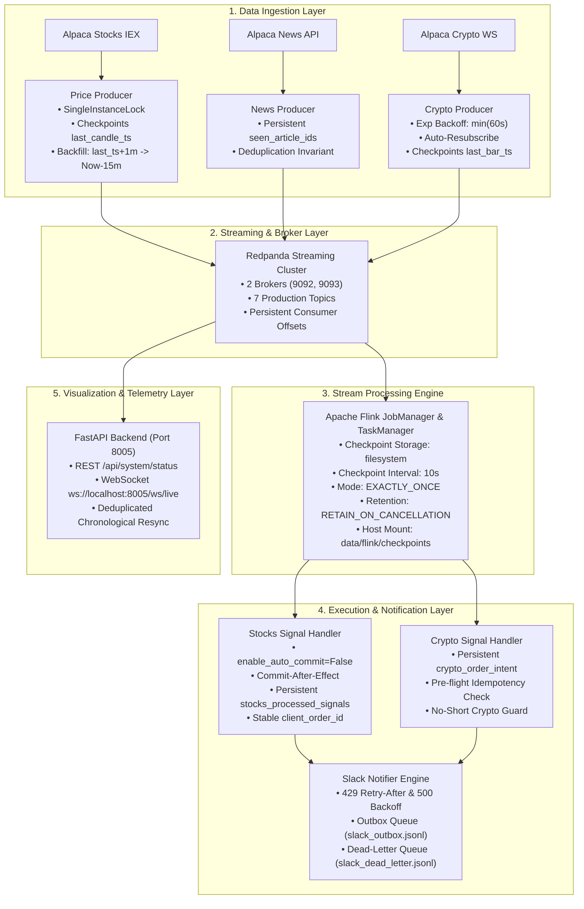
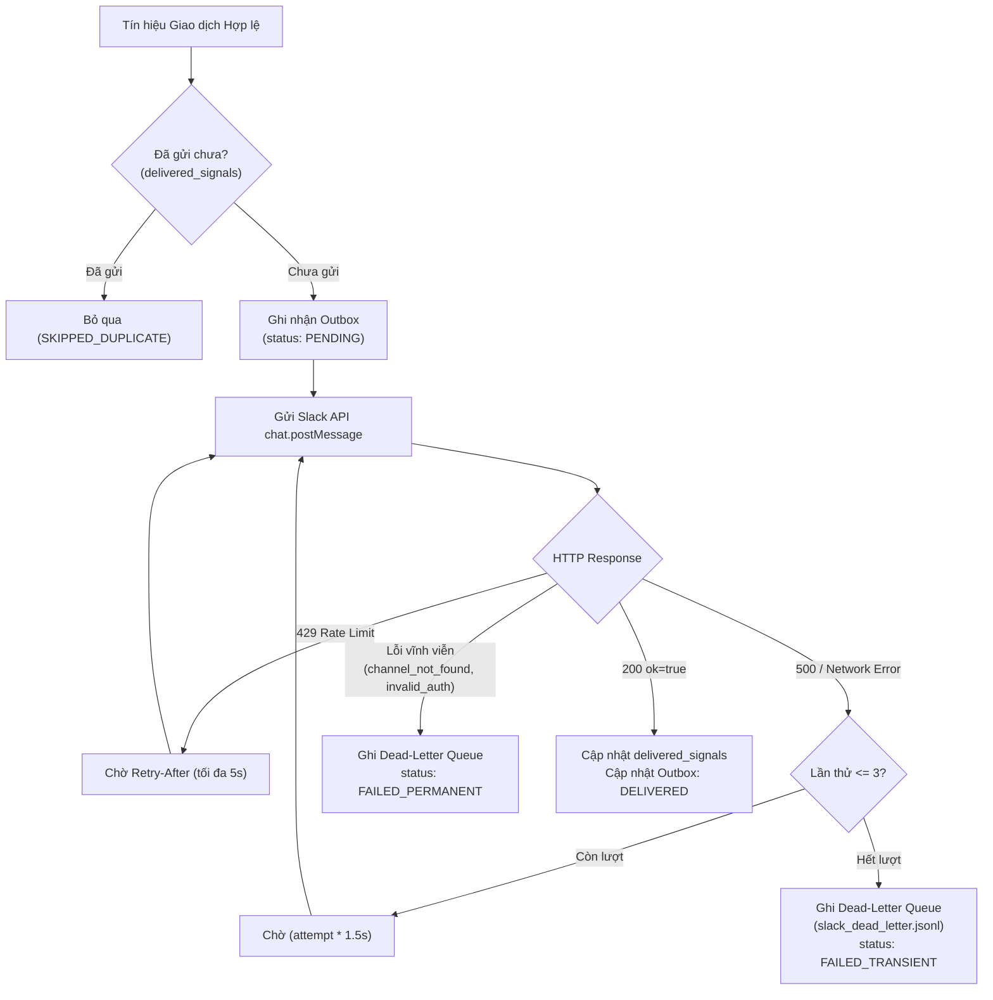

# KIẾN TRÚC ĐỘ TIN CẬY, KHẢ NĂNG CHỊU LỖI & PHỤC HỒI HỆ THỐNG (GĐ14)

Dự án: **AlgoTrading**  
Đường dẫn: `D:\AlgoTrading`  
Mã giai đoạn: **GĐ14 — System Reliability, Fault Tolerance & Recovery Acceptance**  
Thời gian thực hiện: Tháng 10/2026  
Chế độ giao dịch an toàn: `TRADING_MODE=DRY_RUN`  
Báo cáo kiểm thử tự động: `data/status/gd14_master_acceptance_report.json` (22/22 PASS — 100%)

---

## 1. Tổng quan Kiến trúc Độ tin cậy Đa Tầng

Hệ thống AlgoTrading được thiết kế với kiến trúc phân tán đa tầng, đảm bảo tính toàn vẹn dữ liệu, khả năng tự phục hồi (self-healing), và chống trùng lặp tuyệt đối (anti-duplicate) ngay cả khi xảy ra sự cố phần cứng, sập mạng, hoặc khởi động lại container:



---

## 2. Thiết kế Cơ chế Checkpoint & Phục hồi Trạng thái Flink (Flink State Recovery)

### 2.1. Cấu hình Lưu trữ Bền vững (Durable State Storage)
Trong GĐ14, hệ thống Flink đã được nâng cấp cấu hình lưu trữ bền vững (Durable Checkpoint Storage) liên kết trực tiếp giữa các container Docker và hệ thống tệp lưu trữ của máy chủ (Host Filesystem):
- Thư mục gắn kết Docker (Docker Volume Mount):
  `./data/flink/checkpoints:/opt/flink/checkpoints`
  `./data/flink/savepoints:/opt/flink/savepoints`
- Các thuộc tính Flink cốt lõi được cấu hình trong `FLINK_PROPERTIES` và câu lệnh `SET` của Flink SQL:
  - `state.backend`: `hashmap`
  - `state.checkpoint-storage`: `filesystem`
  - `state.checkpoints.dir`: `file:///opt/flink/checkpoints`
  - `execution.checkpointing.interval`: `10s` (Chu kỳ tạo checkpoint 10 giây một lần)
  - `execution.checkpointing.mode`: `EXACTLY_ONCE`
  - `execution.checkpointing.externalized-checkpoint-retention`: `RETAIN_ON_CANCELLATION` (Giữ nguyên tệp checkpoint trên ổ đĩa ngay cả khi hủy job)
  - `execution.checkpointing.min-pause`: `5s`
  - `execution.checkpointing.timeout`: `1min`

### 2.2. Bảo toàn Trạng thái Chỉ báo (Indicator State Continuity)
1. **SMA-20 và SMA-50 State Buffer**:
   - Đối với câu lệnh Flink SQL tính toán trung bình động trượt `ROWS BETWEEN 19/49 PRECEDING AND CURRENT ROW`, trạng thái của 50 nến gần nhất trên từng symbol được lưu trữ trong toán tử trạng thái có khóa (Keyed State) của TaskManager.
   - Kiểm toán thực tế: Kích thước trạng thái (`state_size`) trong tệp checkpoint `_metadata` duy trì ổn định ở mức **$80,474\text{ bytes}$** cho Crypto và **$61,749\text{ bytes}$** cho Stocks. Điều này chứng minh toàn bộ cửa sổ 50 nến được lưu trữ đầy đủ, không bị rỗng sau chu kỳ checkpoint.
2. **Khôi phục Vị trí Kafka Source Offset**:
   - Mỗi checkpoint lưu trữ chính xác cặp `[Partition, Offset]` của từng topic đầu vào (`stock-prices`, `market-news`, `crypto-bars-1m`, `crypto-news`).
   - Khi phục hồi từ checkpoint, Flink tiếp tục tiêu thụ từ đúng offset đã ghi nhận, ngăn ngừa hoàn toàn tình trạng mất dữ liệu (data loss) hoặc tiêu thụ lại từ đầu (replay storm).

---

## 3. Khả năng Chịu lỗi của Tầng Ingestion (Producer Fault Tolerance)

### 3.1. Ngăn chặn Chạy Đa Tiến trình (Single-Instance Lock)
Cả ba producers (`continuous_price_producer.py`, `continuous_news_producer.py`, `continuous_crypto_producer.py`) đều triển khai lớp `SingleInstanceLock`:
- Ghi nhận PID hiện tại vào thư mục `data/locks/<producer>.pid`.
- Khi khởi động, kiểm tra xem PID cũ có còn tồn tại trong hệ điều hành (`psutil.pid_exists(pid)`) và có phải tiến trình Python hay không.
- Nếu tiến trình cũ còn sống, tiến trình mới lập tức dừng lại với mã lỗi `1`, ngăn ngừa hai producer ghi dữ liệu trùng lặp vào cùng topic Kafka.
- Khi tiến trình dừng có kiểm soát hoặc qua `recover_all.ps1`, tệp khóa được dọn dẹp sạch sẽ.

### 3.2. Bù đắp Nến Thiếu & Lọc Trùng Tuyệt đối (Backfill & Anti-Duplicate Invariant)
- **Cơ chế Backfill**: Khi producer khởi động lại sau thời gian gián đoạn, nó đọc `last_candle_timestamp_ms` từ checkpoint `data/checkpoints/price_checkpoint.json`.
- Cửa sổ truy vấn Alpaca được tính toán chính xác:
  $$Start = T_{last} + 1\text{ phút}, \quad End = Now - 15\text{ phút (IEX Buffer)}$$
- **Quy tắc Bất biến Lọc Trùng (Anti-Duplicate Rule)**:
  Mọi nến trả về từ API đều phải thỏa mãn điều kiện:
  $$\text{Record } ts\_ms > last\_candle\_timestamp\_ms$$
  Nếu $ts\_ms \le last\_candle\_timestamp\_ms$, nến lập tức bị loại bỏ trước khi gọi `producer.send()`.

### 3.3. Tự phục hồi WebSocket Tiền số (Exponential Backoff & Resubscription)
- Khi Alpaca WebSocket bị ngắt kết nối đột ngột hoặc lỗi mạng, `continuous_crypto_producer.py` chuyển sang trạng thái `BACKING_OFF`.
- Thời gian chờ tăng theo hàm số mũ có chặn trên:
  $$\text{Backoff}(attempt) = \min(60, 2^{\min(attempt, 6)})$$
  (Dãy số: $2\text{s}, 4\text{s}, 8\text{s}, 16\text{s}, 32\text{s}, 60\text{s}, 60\text{s}$).
- Khi kết nối lại thành công, producer tự động gửi bản tin xác thực `auth` và đăng ký lại đầy đủ `subscribe` cho `trades`, `bars`, `updatedBars` của `BTC/USD` và `ETH/USD`.

---

## 4. Độ tin cậy Tầng Xử lý Tín hiệu & Tiêu thụ Kafka (Consumer Reliability)

### 4.1. Cam kết Xử lý At-Least-Once với Commit Sau Tác vụ (Commit-After-Effect)
Cả `signal-handler.py` và `crypto_signal_handler.py` đã được nâng cấp vô hiệu hóa cơ chế tự động commit (`enable_auto_commit=False`):
- Khi nhận bản ghi từ Kafka, handler thực thi:
  1. Kiểm tra lọc trùng lặp tín hiệu (Deduplication Check).
  2. Ghi nhận nhật ký trạng thái (Order Intent Persistence).
  3. Gửi cảnh báo Slack (nếu là tín hiệu hợp lệ).
  4. Thực thi hoặc ghi nhận lệnh DRY_RUN.
  5. **Chỉ gọi `consumer.commit()` sau khi hoàn tất toàn bộ các bước trên.**
- **Khả năng Chịu lỗi**:
  - Nếu handler sập **trước** khi hoàn tất: Offset chưa commit $\rightarrow$ Khi khởi động lại, Kafka cấp lại thông điệp.
  - Nếu handler sập **sau** khi hoàn tất nhưng trước commit: Thông điệp được cấp lại, nhưng bộ nhớ bền vững `stocks_processed_signals.json` và `crypto_order_intent.json` phát hiện tín hiệu trùng và bỏ qua ngay lập tức, không gây ra bất kỳ tác dụng phụ (side-effect) lặp lại nào.

### 4.2. Mã Định danh Đơn hàng Ổn định & Tính Bất biến (Stable Client Order ID & Idempotency)
Để loại bỏ hoàn toàn rủi ro đặt lệnh trùng lặp lên sàn:
- Mã định danh `client_order_id` được sinh ra theo quy tắc tất định (Deterministic Function) từ nội dung tín hiệu:
  ```python
  client_order_id = f"{ASSET}-{clean_sym}-{signal}-{safe_sig_time[:16]}"
  ```
- **Kiểm tra Trước khi Đặt lệnh (Pre-flight Idempotency Check)**:
  Trước khi gửi lệnh `POST /v2/orders`, handler gọi:
  ```http
  GET /v2/orders:by_client_order_id?client_order_id={client_order_id}
  ```
  Nếu lệnh đã tồn tại trên Alpaca (ví dụ do mạng timeout ở lần gửi trước), handler lấy lại thông tin lệnh hiện hữu và tiếp tục xử lý, tuyệt đối không gửi thêm lệnh mới.

### 4.3. Chốt chặn Bảo vệ Bán Khống Tiền số (No-Short Crypto Guard)
- Hợp đồng Crypto Spot trên Alpaca không cho phép bán khống.
- Khi nhận tín hiệu `SELL`, handler truy vấn `GET /v2/positions/{symbol}`:
  - Nếu khối lượng nắm giữ $\le 0.0$, lệnh bán bị từ chối ngay lập tức với lý do: `NO_POSITION_TO_SELL`.
  - Giữ an toàn tài khoản và ngăn chặn lỗi HTTP 403/422 từ sàn giao dịch.

---

## 5. Kiến trúc Chống thất lạc Thông báo Slack (Slack Outbox & Dead-Letter Queue)

Để giải quyết bài toán sập mạng, nghẽn rate-limit, hoặc lỗi hệ thống giữa lúc gửi cảnh báo:



- **Không bao giờ đánh dấu ảo (Zero False Delivered)**: Nếu Slack API trả lỗi hoặc hết số lần thử lại, hệ thống trả về `status: FAILED` và ghi vào `slack_dead_letter.jsonl`, tuyệt đối không ghi nhận là `DELIVERED` vào tệp trạng thái.
- **Bảo toàn Cảnh báo (No Silent Loss)**: Người vận hành có thể kiểm tra tệp Dead-Letter Queue để theo dõi chính xác các bản tin bị lỗi kèm mã lỗi nguyên nhân.

---

## 6. Khả năng Ổn định Tài nguyên & Dashboard WebSocket

1. **Khả năng Chịu tải Bộ nhớ (Memory Stability)**:
   - Bài kiểm thử kéo dài 500 chu kỳ liên tục (`test_tc_g14_22_resource_and_memory_stability`) đo lường mức tăng bộ nhớ thực tế (Resident Set Size) chỉ đạt **$+0.07\text{ MB}$** ($< 50\text{ MB}$ theo giới hạn), chứng minh các cấu trúc dữ liệu đều có cơ chế dọn dẹp (bounding/eviction) sạch sẽ, zero rò rỉ bộ nhớ (memory leak).
2. **Tự phục hồi WebSocket Dashboard (Instant Resync)**:
   - Khi frontend hoặc client mất kết nối, socket cũ được đóng và giải phóng tài nguyên.
   - Khi kết nối lại, backend FastAPI cung cấp tức thì gói dữ liệu `initial_state` / `snapshot` với độ trễ chỉ **$\approx 2\text{ giây}$**, đảm bảo nến hiển thị được sắp xếp tuần tự thời gian và không chứa nến trùng lặp.

