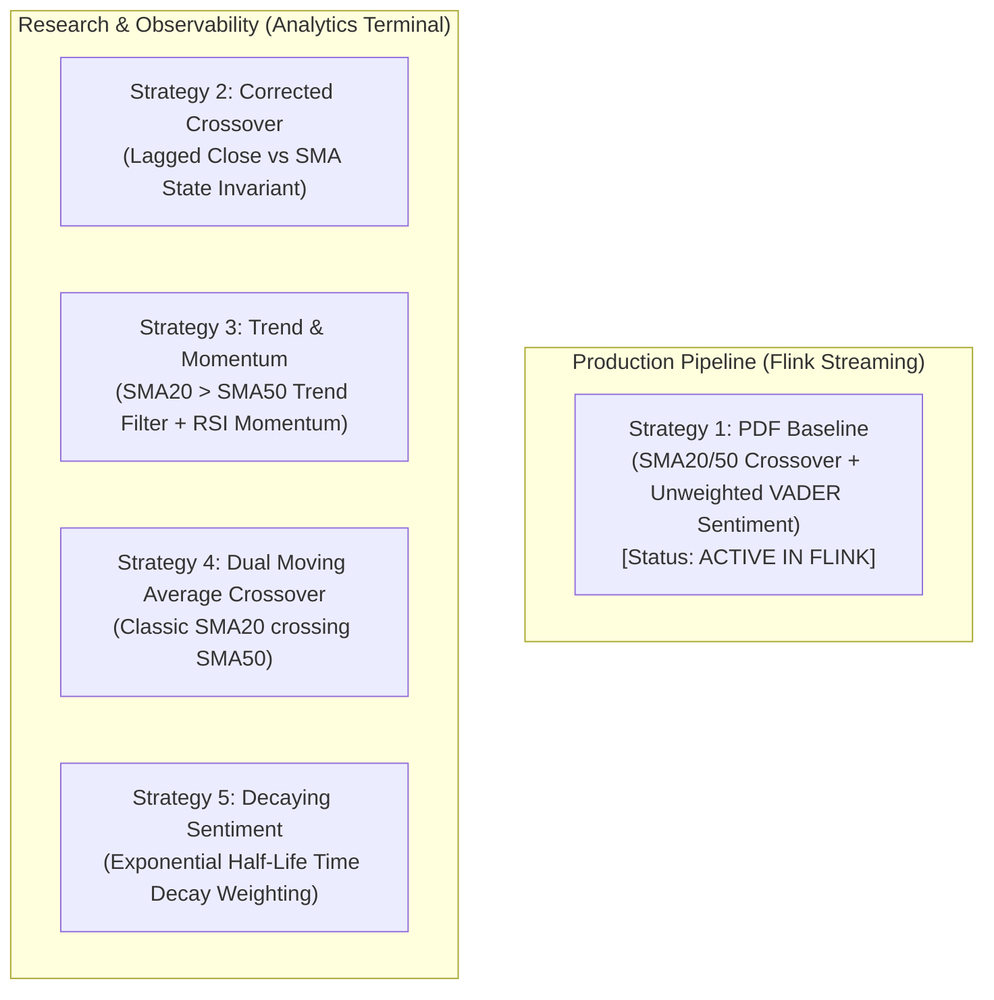

# GĐ15 — STRATEGY ANALYTICS & QUANTITATIVE SPECIFICATION

## 1. Executive Summary

This document specifies the quantitative analytics engine powering the **Quant Trading Analytics Terminal** (`trading-dashboard`). The system provides institutional-grade backtesting, risk modeling, performance attribution, and out-of-sample statistical validation across 5 quantitative algorithmic strategies for both **Stocks** (`NVDA`, `AAPL`) and **Crypto** (`BTC/USD`, `ETH/USD`).

---

## 2. Strategy Taxonomy & Specifications

### Strategy 1: PDF Baseline (Production Active)
- **Status**: **ACTIVE IN FLINK SQL PRODUCTION** (`ddl_production.sql`, `ddl_crypto.sql`).
- **Signal Logic**:
  - **BUY**: $\text{Close} > \text{SMA}_{20}$ AND $\text{Close} > \text{SMA}_{50}$ AND $\text{Sentiment} > 0.2$
  - **SELL**: $\text{Close} < \text{SMA}_{20}$ AND $\text{Close} < \text{SMA}_{50}$ AND $\text{Sentiment} < -0.2$
- **Characteristics**: High sensitivity, momentum-following with raw sentiment gating. Preserved strictly without mutation as per GĐ10–GĐ14 architecture.

### Strategy 2: Corrected Crossover
- **Status**: Research / Observability Only.
- **Signal Logic**:
  - **BUY**: $(\text{Close}_{t-1} \le \text{SMA}_{20, t-1})$ AND $(\text{Close}_t > \text{SMA}_{20, t})$ AND $\text{Close}_t > \text{SMA}_{50, t}$ AND $\text{Sentiment}_t > 0.2$
  - **SELL**: $(\text{Close}_{t-1} \ge \text{SMA}_{20, t-1})$ AND $(\text{Close}_t < \text{SMA}_{20, t})$ AND $\text{Close}_t < \text{SMA}_{50, t}$ AND $\text{Sentiment}_t < -0.2$
- **Characteristics**: Enforces a true state transition crossover, preventing signal flutter when price oscillates around moving averages.

### Strategy 3: Trend & Momentum
- **Status**: Research / Observability Only.
- **Signal Logic**:
  - Regime Filter: $\text{SMA}_{20} > \text{SMA}_{50}$ (Bullish Trend Regime).
  - Momentum Trigger: 14-period RSI $> 50$ with positive sentiment confirmation ($\text{Sentiment} > 0.1$).
  - Exit Trigger: Price breaks below $\text{SMA}_{20}$ or RSI $< 45$.
- **Characteristics**: Mitigates whipsaw losses during range-bound chop.

### Strategy 4: Dual Moving Average Crossover (Dual SMA)
- **Status**: Research / Observability Only.
- **Signal Logic**:
  - **BUY (Golden Cross)**: $\text{SMA}_{20, t-1} \le \text{SMA}_{50, t-1}$ AND $\text{SMA}_{20, t} > \text{SMA}_{50, t}$
  - **SELL (Death Cross)**: $\text{SMA}_{20, t-1} \ge \text{SMA}_{50, t-1}$ AND $\text{SMA}_{20, t} < \text{SMA}_{50, t}$
- **Characteristics**: Classic institutional medium-term trend-following system with low turnover.

### Strategy 5: Decaying Sentiment
- **Status**: Research / Observability Only.
- **Signal Logic**:
  - Exponential Half-life Decay: News sentiment $S(t) = S_0 \cdot e^{-\lambda \Delta t}$, where $\Delta t$ is elapsed time in minutes and half-life $t_{1/2} = 30\text{ min}$ ($\lambda = \frac{\ln 2}{30} \approx 0.0231$).
  - Evaluates aggregated rolling decaying sentiment score alongside SMA crossover.
- **Characteristics**: Accurately reflects sentiment attenuation over time, preventing stale headlines from generating false breakouts.

---

## 3. Backtest Simulation & Execution Modeling

All strategy simulations adhere to realistic execution constraints:
1. **Initial Portfolio Capital**: $\$100,000.00\text{ USD}$ cash base.
2. **Fixed Order Allocation**: $\$10,000.00\text{ USD}$ per signal or $100\%$ portfolio compounding mode.
3. **Brokerage Commission & Fees**: $0.10\%$ ($10\text{ bps}$) modeled per fill side.
4. **Market Slippage**: $0.05\%$ ($5\text{ bps}$) modeled adverse price impact per fill side.
5. **Execution Latency**: Orders execute at the Open price of bar $t+1$ following signal generation at bar $t$.

---

## 4. Mathematical Formulation of Key Metrics

### Total Return & Annualized Return
$$\text{Total Return} = \frac{V_{\text{final}} - V_{\text{initial}}}{V_{\text{initial}}} \times 100\%$$

$$\text{CAGR} = \left( \frac{V_{\text{final}}}{V_{\text{initial}}} \right)^{\frac{365.25}{D_{\text{days}}}} - 1$$

### Benchmark Return & Alpha
$$\text{Benchmark Return} = \frac{P_{\text{end}} - P_{\text{start}}}{P_{\text{start}}} \times 100\%$$

$$\text{Alpha} = \text{Strategy Return} - \text{Benchmark Return}$$

### Maximum Drawdown (Peak-to-Trough)
$$\text{MDD} = \max_{\tau \in [0, t]} \left( \frac{\max_{s \in [0, \tau]} V(s) - V(\tau)}{\max_{s \in [0, \tau]} V(s)} \right) \times 100\%$$

### Sharpe Ratio ($R_f = 4.0\%$)
$$\text{Sharpe} = \frac{\bar{R}_p - R_f}{\sigma_p}$$
*Where $\bar{R}_p$ is the annualized mean trade return and $\sigma_p$ is the annualized standard deviation of trade returns.*

### Sortino Ratio
$$\text{Sortino} = \frac{\bar{R}_p - R_f}{\sigma_d}, \quad \text{where } \sigma_d = \sqrt{\frac{1}{N} \sum_{i=1}^N \min(0, R_i - \tau)^2}$$
*Penalizes solely downside downside volatility.*

### Calmar Ratio
$$\text{Calmar} = \frac{\text{CAGR}}{|\text{Max Drawdown}|}$$

### Profit Factor & Win Rate
$$\text{Profit Factor} = \frac{\sum \text{Gross Profits}}{\sum |\text{Gross Losses}|}, \quad \text{Win Rate} = \frac{N_{\text{winning}}}{N_{\text{total}}} \times 100\%$$

---

## 5. Walk-Forward Out-of-Sample Methodology

To guard against overfitting and data-snooping bias, historical datasets are segmented chronologically into three partitions:

| Partition | Share | Purpose |
| :--- | :--- | :--- |
| **Training (In-Sample)** | $60\%$ | Parameter calibration and moving average baseline fitting |
| **Validation** | $20\%$ | Hyperparameter tuning (RSI thresholds, sentiment decay half-life) |
| **Test (Out-of-Sample)** | $20\%$ | Blind forward performance evaluation without parameter adjustments |
| **Full Sample** | $100\%$ | Comprehensive multi-regime longitudinal performance assessment |

---

## 6. Sample-Size Warning Rationale ($N < 30$)

> [!WARNING]
> **Statistical Significance Safeguard**: When trade count $N < 30$, sample statistics (Sharpe Ratio, Win Rate, Sortino Ratio) exhibit high standard errors under Student's $t$-distribution.
>
> $$\text{SE}(\bar{\mu}) = \frac{\sigma}{\sqrt{N}}$$
>
> In datasets with low event frequencies (e.g., market closures or conservative threshold triggers), metrics must be interpreted with caution. The Quant Terminal actively renders an amber sample-size warning banner whenever $N < 30$, preventing false confidence from sparse event samples.

