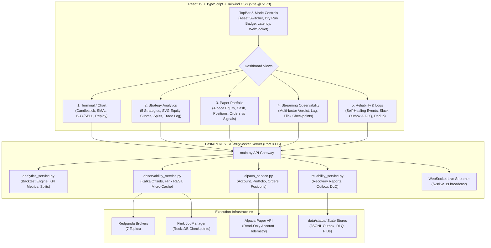

# GĐ15 — ADVANCED TRADING DASHBOARD & TERMINAL ARCHITECTURE

## 1. Overview & Objective

The **Quant Trading Analytics Terminal** (`trading-dashboard`) upgrades the operational trading dashboard into an institutional-grade algorithmic trading research, real-time telemetry, and execution observability terminal.

The dashboard integrates real-time telemetry across both **Stocks** (NVDA, AAPL) and **Crypto** (BTC/USD, ETH/USD) without disrupting the streaming pipeline:
- **Redpanda Cluster** (7 topics, 2 brokers)
- **Apache Flink Stream Processing** (Stocks & Crypto jobs running with persistent RocksDB checkpoints)
- **Continuous Market Data Streaming** (Alpaca Stocks Polling + Alpaca Crypto WebSocket)
- **Signal Deduplication & Self-Healing Reliability** (Outbox queue, DLQ inspection)
- **Alpaca Paper Trading Integration** (Read-only telemetry, strictly `TRADING_MODE=DRY_RUN`)

---

## 2. Architecture & Modular Layout

---

## 3. Frontend Terminal Panels

### Panel 1: Terminal / Trading Chart (`TradingChart.tsx`)
- **Dual Asset Switching**: Instant toggle between Stocks (`NVDA`, `AAPL`) and Crypto (`BTC/USD`, `ETH/USD`).
- **Candlestick & SMA Visualization**: High-precision SVG candlestick series with overlaid SMA-20 (Gold `#f59e0b`) and SMA-50 (Blue `#3b82f6`).
- **Flink BUY/SELL Signal Markers**: Triangle markers pinned directly on candle timestamps showing signal price, rule triggers, and execution intent.
- **Interactive Historical Replay Bar**: Scrub through historical 1-minute bars to inspect moving average crossover moments.
- **News Sentiment Feed**: Real-time VADER compound sentiment scores (bounded $[-1.0, +1.0]$) paired with financial headlines.

### Panel 2: Strategy Analytics (`StrategyAnalyticsPanel.tsx`)
- **5 Strategy Switcher Cards**:
  1. `Strategy 1`: PDF Baseline (Active Flink Production)
  2. `Strategy 2`: Corrected Crossover (Lagged SMA State)
  3. `Strategy 3`: Trend & Momentum (SMA20 > SMA50 + RSI Filter)
  4. `Strategy 4`: Dual Moving Average Crossover (Golden Cross/Death Cross)
  5. `Strategy 5`: Decaying Sentiment (Time-Weighted Exponential Decay)
- **Quantitative KPI Grid**:
  - Total Return (%), Annualized Return (%), Benchmark Return (%)
  - Alpha (%) vs Buy-and-Hold
  - Sharpe Ratio, Sortino Ratio, Calmar Ratio
  - Max Drawdown (%), Win Rate (%), Profit Factor
  - Total Trades count & Average Holding Duration (minutes)
- **Sample-Size Warning Alert**: Dynamic amber alert when sample size is statistically small ($N < 30$).
- **Dual Vector Equity Curves ($100,000 Base)**:
  - Custom SVG rendering of strategy equity vs Buy-and-Hold benchmark.
  - Hover tooltip displaying exact timestamp, portfolio valuation, and benchmark return.
- **Underwater Drawdown Area Chart**: Peak-to-trough rolling percentage drawdown visualization.
- **Walk-Forward Out-of-Sample Validation Table**:
  - Partitions: Training ($60\%$), Validation ($20\%$), Out-of-Sample Test ($20\%$), Full Sample ($100\%$).
- **Friction-Modeled Trade Log**: Detailed trade executions incorporating $0.1\%$ fee and $0.05\%$ slippage.

### Panel 3: Paper Portfolio Telemetry (`PortfolioPanel.tsx`)
- **Live Account Balance Overview**: Equity, Cash, Buying Power, Unrealized P/L ($ and %), and Cost Basis.
- **Portfolio Allocation**: Total held positions count, open orders, and completed orders.
- **Open Positions Table**: Segregated Stocks vs Crypto positions, held quantity, current market value, entry price, and unrealized return.
- **Orders History Table**: Categorized by 6 standard execution states (`filled`, `accepted`, `pending_new`, `partially_filled`, `cancelled`, `rejected`).
- **Kafka Signal vs Paper Order Distinction**: Clear visual explanation emphasizing that Kafka signals represent analytical trigger events, whereas Paper Orders represent executed broker transactions under `DRY_RUN`.

### Panel 4: Streaming Infrastructure Observability (`StreamingObservabilityPanel.tsx`)
- **Multi-Factor Pipeline Health Verdict**:
  - Evaluates Kafka connectivity, Flink checkpointing, and Producer heartbeats simultaneously.
  - States: `HEALTHY` (All systems nominal), `DEGRADED` (Market closed or partial lag), `UNHEALTHY` (Broker or checkpoint failure).
- **Latency Gauges**: Market data latency, ingestion lag, and WebSocket round-trip delay.
- **Flink Checkpoint Engine Monitor**:
  - Real-time completed checkpoint count ($> 1,300$ checks), $0$ failures, checkpoint duration ($< 15\text{ms}$), state size, and persistent RocksDB path.
- **Kafka Topic Offsets & Consumer Group Lag**:
  - End offsets across all 7 topics.
  - Lag tracking for `signal-handler-group` (Stocks) and `crypto-signal-handler-group` (Crypto).
- **Producer Process Health**: Heartbeat age, operating PIDs, and uptime for `price_producer`, `news_producer`, and `crypto_producer`.

### Panel 5: Self-Healing & Reliability Logs (`ReliabilityLogsPanel.tsx`)
- **Self-Healing Recovery Log**: Displays actions taken by automated recovery routines (stale PID cleanup, lock resolution).
- **Slack Outbox Queue**: Real-time queue status showing pending and delivered notification payloads.
- **Dead-Letter Queue (DLQ) Inspector**: Failure inspection table capturing error traces, payload dumps, and retry attempts.
- **Signal Deduplication Store**: Monitored active deduplication keys preventing duplicate order execution.

---

## 4. Backend Service Endpoints & Micro-Caching

To maintain sub-500ms dashboard latency under high concurrency without overloading Alpaca REST APIs or Kafka metadata lookups, backend services utilize thread-safe in-memory micro-caching (TTL $3 - 10$ seconds).

| Endpoint | Method | Service Provider | Description | Cache TTL |
| :--- | :--- | :--- | :--- | :--- |
| `/api/system/status` | GET | `main.py` | Pipeline status, market clock, producers, topics | 2s |
| `/api/candles` | GET | `kafka_consumer_service.py` | Stocks 1m OHLCV bars & SMAs (NVDA, AAPL) | Dynamic |
| `/api/crypto/candles` | GET | `kafka_consumer_service.py` | Crypto 1m OHLCV bars & SMAs (BTC/USD, ETH/USD) | Dynamic |
| `/api/signals` | GET | `kafka_consumer_service.py` | Flink generated trading signals | Dynamic |
| `/api/news` | GET | `kafka_consumer_service.py` | Financial news & VADER sentiment | Dynamic |
| `/api/analytics/strategies` | GET | `analytics_service.py` | 5 Strategy backtest performance metrics | 10s |
| `/api/analytics/equity-curve` | GET | `analytics_service.py` | 100-point vector equity curves & drawdown series | 10s |
| `/api/analytics/trades` | GET | `analytics_service.py` | Detailed historical trades with fee/slippage modeling | 10s |
| `/api/analytics/splits` | GET | `analytics_service.py` | Out-of-sample data split performance metrics | 10s |
| `/api/observability/stream` | GET | `observability_service.py` | Telemetry: Kafka lag, Flink checkpoints, heartbeats | 5s |
| `/api/reliability/events` | GET | `reliability_service.py` | Self-healing events, Slack outbox, and DLQ errors | 3s |
| `/api/paper/summary` | GET | `alpaca_service.py` | Alpaca Paper portfolio balance and metrics | 5s |
| `/api/paper/positions` | GET | `alpaca_service.py` | Open paper trading positions | 5s |
| `/api/paper/orders` | GET | `alpaca_service.py` | Historical Alpaca paper orders | 5s |
| `/ws/live` | WS | `main.py` | Real-time 1-second telemetry broadcast | N/A |

---

## 5. Security & Safety Compliance

- **Zero Credential Exposure**: Slack tokens, Alpaca API secrets, and Redpanda credentials are completely stripped from all REST and WebSocket payloads.
- **Strict DRY_RUN Safety**: All trading handlers enforce `TRADING_MODE=DRY_RUN`. The dashboard is read-only with respect to paper and live brokerage execution.
- **Zero Destruction**: Kafka topics, partition offsets, and Flink checkpoint directories remain unaltered.

