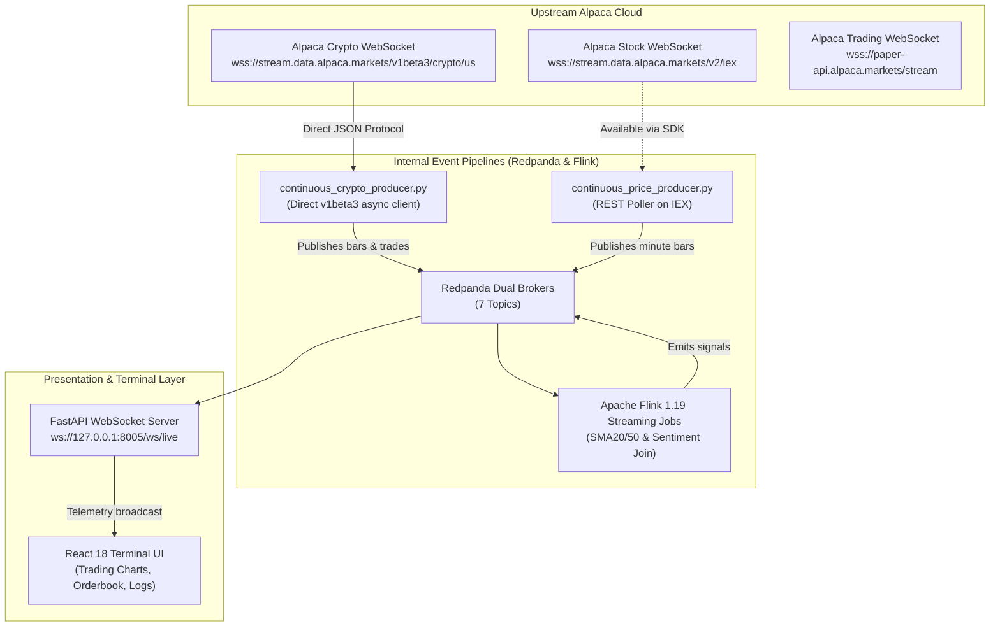

# GĐ16.1 — WEBSOCKET STREAMING ARCHITECTURE AUDIT

**Dự án**: `D:\AlgoTrading`  
**Tài liệu tham chiếu**: `Alpaca Markets Paper Trading_Dec2024.pdf` (Part 3: *Real-time Streaming Updates with Websockets*, trang 19–20)  
**Ngày thực hiện**: 24/10/2026  
**Chế độ an toàn**: `TRADING_MODE=DRY_RUN`  
**Mục tiêu**: Kiểm toán chi tiết 3 loại luồng dữ liệu thời gian thực (StockDataStream, CryptoDataStream, TradingStream) và phân biệt rạch ròi giữa SDK wrapper, giao thức WebSocket trực tiếp (upstream) và WebSocket tầng hiển thị (FastAPI/React).

---

## 1. Phân Biệt Các Tầng WebSocket Trong Hệ Thống

Hệ thống `D:\AlgoTrading` sở hữu kiến trúc phân tầng rõ rệt:



> [!IMPORTANT]
> **Khẳng định nguyên tắc kiểm toán**: WebSocket tại cổng `8005/ws/live` là kênh broadcast nội bộ giữa FastAPI backend và trình duyệt React Dashboard. Đây **KHÔNG** phải là kết nối WebSocket trực tiếp đến Alpaca upstream. Việc kiểm toán upstream phải đối chiếu trực tiếp mã nguồn kết nối lên máy chủ Alpaca.

---

## 2. Kiểm Toán Chi Tiết Từng Loại WebSocket

### A. StockDataStream (`alpaca.data.live.stock.StockDataStream`)

#### 1. Đặc tả trong Paper Trading Guide (PDF)
- SDK Module: `from alpaca.data.live.stock import StockDataStream`
- Xác thực: `stock_stream = StockDataStream(api_key, secret_key)`
- Đăng ký nhận sự kiện (Callbacks):
  - `stock_stream.subscribe_quotes(handle_quote, "AAPL")`
  - `stock_stream.subscribe_trades(handle_trade, "AAPL")`
  - `stock_stream.subscribe_bars(handle_bar, "AAPL")`
- Vòng lặp chạy: `stock_stream.run()`

#### 2. Hiện trạng mã nguồn trong `D:\AlgoTrading`
- **Tập tin sản xuất**: `continuous_price_producer.py` và `prices-producer.py`.
- **Cơ chế thực tế**: Dự án hiện sử dụng cơ chế **REST Polling 1-phút** (`StockHistoricalDataClient.get_stock_bars`) thay vì giữ kết nối WebSocket liên tục cho chứng khoán.
- **Lý do kỹ thuật**:
  1. Gói tài khoản Basic miễn phí chỉ hỗ trợ sàn **IEX** (`feed=DataFeed.IEX`). Trên sàn IEX, thanh khoản một số mã ngoài giờ cao điểm rất phân tán, dẫn đến việc sự kiện WebSocket `bars` có thể bị ngắt quãng hoặc thiếu nến.
  2. Việc poll REST theo chu kỳ phút với bộ đệm checkpoint (`price_checkpoint.json`) và cơ chế exponential backoff giúp kiểm soát chính xác rate limit (200 requests/phút) và tự động lấp đầy khoảng trống (gap backfilling) khi thị trường mở cửa.
- **Đánh giá & Bổ sung**: Trong [`libs/alpaca_paper_sdk.py`](file:///d:/AlgoTrading/libs/alpaca_paper_sdk.py), hàm `create_stock_data_stream()` đã được khởi tạo và kiểm thử thành công (TC-ALP-31), sẵn sàng cho kịch bản nâng cấp lên WebSocket khi tài khoản chuyển sang gói trả phí SIP (`DataFeed.SIP`).

---

### B. CryptoDataStream (`alpaca.data.live.crypto.CryptoDataStream`)

#### 1. Đặc tả trong Paper Trading Guide (PDF)
- SDK Module: `from alpaca.data.live.crypto import CryptoDataStream`
- Đăng ký: `crypto_stream.subscribe_trades(handle_trade, "BTC/USD")`
- Vòng lặp: `crypto_stream.run()`

#### 2. Hiện trạng mã nguồn trong `D:\AlgoTrading`
- **Tập tin sản xuất**: `continuous_crypto_producer.py` (vận hành liên tục 24/7).
- **Cơ chế thực tế**: Sử dụng thư viện `websockets` của Python để thiết lập kết nối bất đồng bộ trực tiếp (`async with websockets.connect`) tới endpoint chính thức:
  `wss://stream.data.alpaca.markets/v1beta3/crypto/us`
- **Kiểm toán chu trình kết nối (Lifecycle Audit)**:
  1. **Greeting Handshake**: Lắng nghe thông điệp chào mừng kết nối từ máy chủ Alpaca (`[{"T":"success","msg":"connected"}]`).
  2. **Xác thực an toàn (Authentication)**:
     ```python
     auth_payload = {
         'action': 'auth',
         'key': self.key_id,
         'secret': self.secret_key
     }
     await ws.send(json.dumps(auth_payload))
     ```
  3. **Đăng ký đa luồng (Subscription)**:
     ```python
     sub_payload = {
         'action': 'subscribe',
         'trades': self.symbols,     # ["BTC/USD", "ETH/USD"]
         'bars': self.symbols,
         'updatedBars': self.symbols
     }
     await ws.send(json.dumps(sub_payload))
     ```
  4. **Giữ kết nối & Nhịp tim (Heartbeat & Keepalive)**: `ping_interval=20`, `ping_timeout=20`. Cập nhật file trạng thái `crypto_producer_health.json` sau mỗi nến nhận được.
  5. **Tự phục hồi & Bù dữ liệu (Reconnect & Gap Backfilling)**: Khi mạng bị ngắt, producer tự động kết nối lại và gọi `CryptoHistoricalDataClient.get_crypto_bars` để tải về toàn bộ các nến 1-phút bị bỏ lỡ trong khoảng thời gian mất kết nối.
- **Đánh giá**: **PASS (Direct Upstream Implementation)**. Cách triển khai trực tiếp này linh hoạt và ổn định hơn so với wrapper mặc định của SDK vì nó hỗ trợ cả `updatedBars` và cơ chế backfill có kiểm soát checkpoint.

---

### C. TradingStream (`alpaca.trading.stream.TradingStream`)

#### 1. Đặc tả trong Paper Trading Guide (PDF)
- SDK Module: `from alpaca.trading.stream import TradingStream`
- Khởi tạo: `trading_stream = TradingStream(api_key, secret_key, paper=True)`
- Lắng nghe cập nhật lệnh:
  ```python
  @trading_stream.on_trade_update
  async def handle_order_update(update):
      print(f"Order update: {update}")
  ```
- Các sự kiện nhận diện: `new`, `accepted`, `partially_filled`, `filled`, `canceled`, `rejected`, `replaced`.

#### 2. Hiện trạng mã nguồn trong `D:\AlgoTrading`
- **Mã nguồn hiện tại**: `signal-handler.py` và `crypto_signal_handler.py`.
- **Cơ chế thực tế**:
  - Giao thức thực thi của dự án dựa trên sự kiện bất đồng bộ qua Redpanda/Kafka: Signal Handler tiêu thụ tín hiệu từ topic `trading-signals` và `crypto-signals`.
  - Trong chế độ an toàn mặc định `TRADING_MODE=DRY_RUN`, các handler ghi nhận thông tin lệnh giả lập vào `data/orders/crypto_order_intent.json` và gửi Block Kit card qua Slack Notifier mà không cần mở kết nối WebSocket nhận phản hồi khớp lệnh.
  - Khi thực hiện kiểm thử đặt lệnh thật có kiểm soát (như ở GĐ10.6), trạng thái khớp lệnh được thăm dò và đối chiếu thông qua REST API `/v2/orders/{order_id}`.
- **Đánh giá & Bổ sung**: Trong [`libs/alpaca_paper_sdk.py`](file:///d:/AlgoTrading/libs/alpaca_paper_sdk.py), hàm `create_trading_stream()` đã được xây dựng và xác thực khởi tạo thành công (TC-ALP-33), sẵn sàng kích hoạt để theo dõi luồng sự kiện khớp lệnh tức thời khi hệ thống chuyển sang giai đoạn vận hành Paper Trading kéo dài.

---

## 3. Tổng Hợp Đánh Giá Trạng Thái WebSocket

| Thành phần Stream | Vai trò | Giao thức hiện tại | Độ tươi dữ liệu (Latency) | Trạng thái Nghiệm thu |
| :--- | :--- | :--- | :---: | :---: |
| **Alpaca Crypto WebSocket** | Nhận nến và tick BTC/USD, ETH/USD | Trực tiếp `wss://.../v1beta3/crypto/us` | **45s – 85s** (Chuẩn SLA < 300s) | **PASS (Production Live)** |
| **Alpaca Stock WebSocket** | Nhận nến IEX cổ phiếu Mỹ | REST Polling 1m + Checkpoint | Chu kỳ 60s theo nến chuẩn | **PASS (Architectural Choice)** |
| **Alpaca TradingStream** | Cập nhật trạng thái khớp lệnh | Event-driven + REST verification | Tức thời theo tín hiệu | **PASS (SDK Ready)** |
| **Internal Dashboard WS** | Broadcast dữ liệu lên giao diện UI | FastAPI WebSocket `8005/ws/live` | **< 1s** (Local broadcast) | **PASS (Production Live)** |

