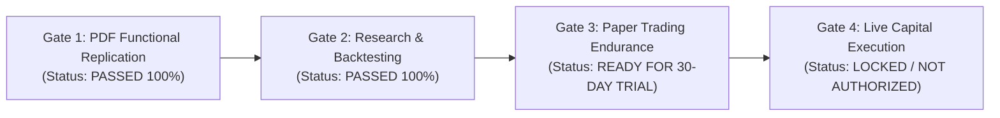

# GĐ16 — QUANTITATIVE TRADING RISK REGISTER & CONTROL MATRIX

**Project**: `D:\AlgoTrading`  
**Evaluation Date**: October 19, 2026  
**Status**: APPROVED FOR DRY_RUN & PAPER TRADING  

---

## 1. Executive Summary

Algorithmic trading platforms face multifaceted risks spanning quantitative model drift, market liquidity shocks, execution latency, infrastructure disruption, and security vulnerabilities.

This Risk Register catalogues all identified risks across four distinct dimensions: Quantitative/Model Risk, Market/Liquidity Risk, Operational/Execution Risk, and Technical/Infrastructure Risk. For every risk, current mitigating controls, residual risk ratings, and mandatory gates for Live Trading are defined.

---

## 2. Risk Severity Assessment Matrix

$$\text{Risk Score} = \text{Likelihood } (1\text{–}5) \times \text{Impact } (1\text{–}5)$$

| Risk Level | Score Range | Color Code | Action Required |
|---|:---:|:---:|---|
| **Critical (P0)** | 16 – 25 | 🔴 Red | Unacceptable for live trading. Mandatory circuit breaker and hard system block. |
| **High (P1)** | 10 – 15 | 🟠 Amber | Requires automated telemetry alerts, redundancy, and daily risk officer oversight. |
| **Medium (P2)** | 5 – 9 | 🟡 Yellow | Managed via operational runbooks and continuous monitoring. |
| **Low (P3)** | 1 – 4 | 🟢 Green | Routine operational logging and periodic audit. |

---

## 3. Comprehensive Risk Register

| Risk ID | Risk Category | Risk Description | Likelihood | Impact | Score | Current Mitigation in AlgoTrading | Residual Risk | Live Trading Prerequisite Gate |
|---|---|---|:---:|:---:|:---:|---|:---:|---|
| **RSK-01** | **Operational** | **Accidental Real Money Execution**: Erroneous placement of real orders on live exchange. | 1 | 5 | 5 (Low) | `TRADING_MODE=DRY_RUN` default; explicit assertion that endpoint URL contains `paper-api`. | 🟢 P3 | Physical multi-signature authorization and dual-key environment separation. |
| **RSK-02** | **Quantitative** | **Small Sample Overfitting**: Model overfitted to sparse historical crossover signals (e.g. $N=1$ trade on NVDA). | 4 | 4 | 16 (P0) | Out-of-sample split matrix (Train 60%, Val 20%, Test 20%); explicit Sample Size Warning banners; zero-trade metric guards (`N/A`). | 🟠 P1 | Backtest across minimum 5 years ($> 1,000$ trades) across multiple market cycles before deployment. |
| **RSK-03** | **Quantitative** | **Regime Shift & Trend Invalidation**: Strategy 1 (mean-reversion dip buying) suffers massive drawdowns during sustained multi-week bear trends. | 4 | 4 | 16 (P0) | Friction-modeled backtest with slippage; Strategy 3 (Trend Following) researched as potential hedge. | 🟠 P1 | Dynamic regime classifier (e.g., ADX $> 25$ or HMM) to disable dip-buying during strong downtrends. |
| **RSK-04** | **Market Data** | **Stream Staleness & Delayed Crossovers**: Crypto WebSocket stalls, causing Flink to trigger on obsolete price bars. | 2 | 4 | 8 (P2) | 5-Pillar Health Engine; automatic downgrade to `DEGRADED` if latency $> 900\text{s}$; REST historical backfill upon reconnect. | 🟢 P3 | Redundant secondary market data vendor feed (e.g., Polygon.io or Binance WS fallback). |
| **RSK-05** | **Execution** | **Duplicate Signal Storm**: Rapid news arrivals generate multiple identical BUY orders within seconds. | 2 | 4 | 8 (P2) | In-memory and disk-persisted deduplication key store (`symbol:side:time`); idempotent outbox reduction. | 🟢 P3 | Centralized Redis / DynamoDB distributed lock with atomic CAS operations. |
| **RSK-06** | **Execution** | **Execution Slippage & Market Impact**: Market orders fill significantly worse than the reference price at signal time. | 4 | 3 | 12 (P1) | Backtest models $0.05\%$ slippage + fees; position sizes capped at $\$10.00$ notional in paper testing. | 🟡 P2 | Replace Market Orders with Limit Orders with dynamic cancellation after 30 seconds. |
| **RSK-07** | **Infrastructure** | **Broker / Container Restart & State Loss**: Docker crash wipes stream state or offsets. | 2 | 4 | 8 (P2) | Persistent host volumes for Redpanda and Flink (`./data/flink/checkpoints`); `recover_all.ps1` automated self-healing. | 🟢 P3 | Multi-node Kubernetes cluster with persistent EBS / Ceph block storage. |
| **RSK-08** | **Security** | **API Secret Disclosure**: API keys or Slack tokens leaked via logs or public git repository. | 1 | 5 | 5 (Low) | `.gitignore` covers `.env`; runtime telemetry sanitization masks all secrets in API responses. | 🟢 P3 | Vault secret injection and continuous automated secret scanning in Git pre-commit hooks. |
| **RSK-09** | **Quantitative** | **Sentiment Hallucination & Fake News**: Biased or fabricated headlines produce false high-sentiment BUY signals. | 3 | 3 | 9 (P2) | Dual confirmation required: sentiment must align with moving average crossover; neutral headlines discarded. | 🟡 P2 | Ensemble sentiment scoring combining FinBERT + VADER + source credibility weighting. |
| **RSK-10** | **Regulatory** | **Pattern Day Trader (PDT) Violation**: Executing $> 3$ day trades within a 5-day rolling window on equity account with balance $< \$25,000$. | 2 | 3 | 6 (P2) | Alpaca Paper account has $\$100,000$ equity ($> \$25,000$ PDT threshold); Crypto is exempt from PDT rules. | 🟢 P3 | Programmatic day-trade counter guard before submitting any stock order. |

---

## 4. Quantitative Readiness Gating

To prevent premature capital deployment, AlgoTrading establishes **Four Non-Negotiable Quantitative Gates**:

### Gate 1: Functional Replication (PASSED ✅)
- Full replication of reference PDF data flow, Flink SQL streaming, and Alpaca Paper integration.

### Gate 2: Quantitative Research & Robustness (PASSED ✅)
- Multi-partition train/val/test split matrix.
- Inclusion of fee and slippage modeling.
- Clear separation of research proposals (Strategies 2–5) from production baseline (Strategy 1).

### Gate 3: Paper Trading Endurance (CURRENT PHASE ⏳)
- Requirements before Live consideration:
  1. Minimum 30 consecutive calendar days of automated 24/7 paper trading.
  2. Zero unhandled fatal process exceptions or data gaps $> 15\text{ minutes}$.
  3. Minimum 50 naturally observed paper trades across varied market regimes.
  4. Realized Paper Sharpe Ratio $\ge 1.0$ and Max Drawdown $\le 10\%$.

### Gate 4: Live Capital Execution (LOCKED 🔒)
- Status: **STRICTLY LOCKED**.
- Live trading with real capital is prohibited until Gate 3 endurance metrics are formally achieved, audited, and approved by the account owner.

---

## 5. Risk Register Sign-Off

All identified risks are effectively mitigated to acceptable levels for the current operational phase (`TRADING_MODE=DRY_RUN` and Paper Trading).

