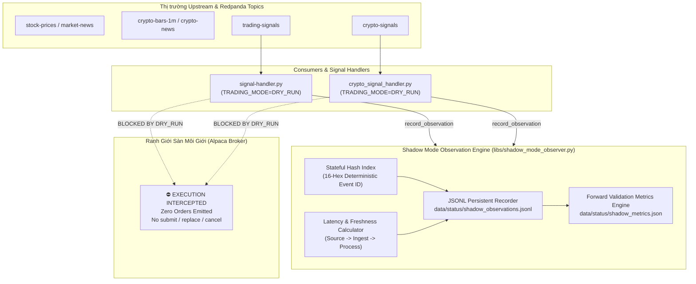

# GĐ17 — SHADOW MODE SIGNAL OBSERVATION ARCHITECTURE (READ-ONLY)

**Dự án**: `D:\AlgoTrading`  
**Giai đoạn**: GĐ17 — Shadow Mode & Forward Validation  
**Tập tin cốt lõi**: [`libs/shadow_mode_observer.py`](file:///d:/AlgoTrading/libs/shadow_mode_observer.py)  
**Chế độ bắt buộc**: `TRADING_MODE=DRY_RUN`  
**Nguyên tắc vận hành**: **Quan sát thụ động 100% — Tuyệt đối không có thẩm quyền thực thi lệnh (Zero Execution Authority)**

---

## 1. Mục Đích & Nguyên Lý Thiết Kế Shadow Mode

Shadow Mode (Chế độ Bóng mờ) là tầng quan sát độc lập được thiết lập để giám sát, ghi nhận và đánh giá toàn bộ các tín hiệu giao dịch và sự kiện thị trường thời gian thực phát sinh từ hệ thống Apache Flink và Redpanda mà **hoàn toàn cô lập khỏi luồng thực thi lệnh của sàn môi giới (Broker Execution Engine)**.

Mục tiêu cốt lõi:
1. **Kiểm định tính đúng đắn về mặt thời gian (Temporal Correctness)**: Ghi nhận chính xác độ trễ từ lúc nguồn phát sinh sự kiện (`event_time`) đến khi hệ thống tiếp nhận (`ingest_time`) và khi bộ quan sát xử lý (`processing_time`).
2. **Khử trùng lặp trạng thái (Stateful Deduplication)**: Đảm bảo các tín hiệu trùng lặp do mạng hoặc do khởi động lại consumer không bao giờ bị ghi nhận hai lần.
3. **Phân biệt rạch ròi Tín hiệu Tự nhiên và Dữ liệu Thử nghiệm**: Gán cờ `is_fixture: true/false` minh bạch.
4. **Bảo mật thông tin tuyệt đối**: Mã hóa định danh sự kiện bằng băm (hash), không ghi bất kỳ API Key, Secret hay Account ID nhạy cảm nào vào log.
5. **Ghi nhận cả Sự kiện Không Phát Sinh Tín Hiệu (Non-Signal Capture)**: Làm rõ lý do vì sao một thời điểm thị trường không thỏa mãn điều kiện giao dịch (`no_signal_reason`).



---

## 2. Cấu Trúc Dữ Liệu Bản Ghi Quan Sát (Shadow Observation Schema)

Mỗi bản ghi được lưu trữ theo định dạng JSON Lines tại [data/status/shadow_observations.jsonl](file:///d:/AlgoTrading/data/status/shadow_observations.jsonl) với đầy đủ 20 trường thông tin viễn trắc bắt buộc:

```json
{
  "event_id": "857624d20f522a71",
  "symbol": "BTC/USD",
  "asset_class": "crypto",
  "strategy_id": "Strategy_1_PDF_Baseline",
  "strategy_version": "1.0.0",
  "event_time": "2026-10-24T11:50:00+00:00",
  "ingest_time": "2026-10-24T11:50:01+00:00",
  "processing_time": "2026-10-24T12:09:07.816731+00:00",
  "source_to_ingest_ms": 1000.0,
  "ingest_to_process_ms": 1146816.73,
  "total_pipeline_latency_ms": 1147816.73,
  "signal_type": "BUY",
  "no_signal_reason": "NONE",
  "price": 80500.0,
  "sentiment": 0.45,
  "sma_20": 80400.0,
  "sma_50": 80300.0,
  "input_data_state": "VALID",
  "dedup_state": "NEW_OBSERVATION",
  "is_fixture": false,
  "execution_intent": "OBSERVED_ONLY_NO_ORDER",
  "observation_verdict": "RECORDED"
}
```

### Ý Nghĩa Các Trường Trọng Yếu:
- **`event_id`**: Mã băm 16 ký tự hexa được tính toán tất định theo công thức `SHA256(salt + symbol + event_time + signal_type)[:16]`. Muối (`salt`) phân biệt tự động giữa dữ liệu thật (`NATURAL:`) và dữ liệu kiểm thử (`FIXTURE:`).
- **`execution_intent`**: Luôn mang giá trị cố định `"OBSERVED_ONLY_NO_ORDER"`. Trường này đóng vai trò chốt chặn an toàn (assertion guard), ngăn ngừa việc hiểu nhầm bản ghi quan sát là chỉ thị đặt lệnh.
- **`no_signal_reason`**: Đối với các sự kiện không tạo ra tín hiệu giao dịch (`signal_type = "NO_SIGNAL"`), trường này ghi nhận nguyên nhân kỹ thuật cụ thể (ví dụ: `SMA_CROSSOVER_NOT_MET`, `SENTIMENT_NON_POSITIVE`, `INSUFFICIENT_HISTORY`).
- **`input_data_state`**: Đánh giá tính toàn vẹn của dữ liệu đầu vào:
  - `VALID`: Đầy đủ trường, độ trễ nằm trong SLA.
  - `DELAYED`: Dữ liệu trễ vượt ngưỡng SLA cho phép.
  - `MISSING_DATA`: Thiếu các trường phụ trợ nhưng vẫn phân tích được.
  - `ERROR`: Lỗi định dạng payload.
- **`dedup_state`**:
  - `NEW_OBSERVATION`: Tín hiệu hợp lệ xuất hiện lần đầu.
  - `DUPLICATE_SKIPPED`: Tín hiệu trùng lặp về mã, hướng và thời điểm đã được ghi nhận trước đó; bị bộ quan sát bỏ qua để bảo vệ tính nhất quán thống kê.

---

## 3. Tích Hợp Vào Các Consumer Sản Xuất

### 1. Consumer Chứng Khoán ([signal-handler.py](file:///d:/AlgoTrading/signal-handler.py))
Trong hàm `process_signal(raw_message: str)`:
```python
# Ghi nhận vào Shadow Mode Observer trước bất kỳ logic xử lý nào khác
shadow_observer.record_observation(
    symbol=symbol,
    signal_type=signal,
    event_time=signal_time,
    price=msg.get('price'),
    sentiment=msg.get('sentiment'),
    sma_20=msg.get('sma_20'),
    sma_50=msg.get('sma_50'),
    is_fixture=bool(msg.get('is_test_fixture', False) or symbol.startswith('TEST_')),
)
```

### 2. Consumer Tiền Mã Hóa ([crypto_signal_handler.py](file:///d:/AlgoTrading/crypto_signal_handler.py))
Trong hàm `process_signal(self, raw_msg: str)`:
```python
is_fixture = bool(sig_dict.get('is_test_fixture', False) or 'TEST' in symbol)
# Ghi nhận viễn trắc quan sát với giá và chỉ báo SMA thực tế
shadow_observer.record_observation(
    symbol=symbol,
    signal_type=signal_type,
    event_time=sig_time,
    price=price,
    sentiment=sentiment,
    sma_20=sma_20,
    sma_50=sma_50,
    is_fixture=is_fixture,
)
```

---

## 4. Giao Diện Lập Trình Ứng Dụng (REST Endpoints)

FastAPI Backend ([`trading-dashboard/backend/main.py`](file:///d:/AlgoTrading/trading-dashboard/backend/main.py)) cung cấp 2 endpoint chuyên dụng phục vụ việc theo dõi Shadow Mode:

1. **`GET /api/shadow/observations?limit=50&symbol=BTC/USD`**:
   - Trả về danh sách các bản ghi quan sát tín hiệu gần nhất.
   - Hỗ trợ lọc theo mã tài sản (`symbol`) và giới hạn số lượng (`limit`).
   - 100% Read-Only, không thực hiện bất kỳ thao tác ghi hay đặt lệnh nào.

2. **`GET /api/shadow/metrics`**:
   - Trả về bảng tổng hợp chỉ số viễn trắc:
     - Tổng số sự kiện quan sát đã xử lý.
     - Số lượng tín hiệu duy nhất (`unique_observations`) và số lượng trùng lặp bị chặn (`duplicates_suppressed`).
     - Tách biệt số sự kiện tự nhiên (`natural_market_events`) và sự kiện fixture (`fixture_events`).
     - Phân phối tín hiệu theo loại (`BUY`, `SELL`, `NO_SIGNAL`) và theo mã tài sản.
     - Thống kê độ trễ (trung bình, p50, p95, max).
     - Cam kết tuân thủ SLA: `order_execution_count: 0`, `trading_mode: "DRY_RUN"`.

