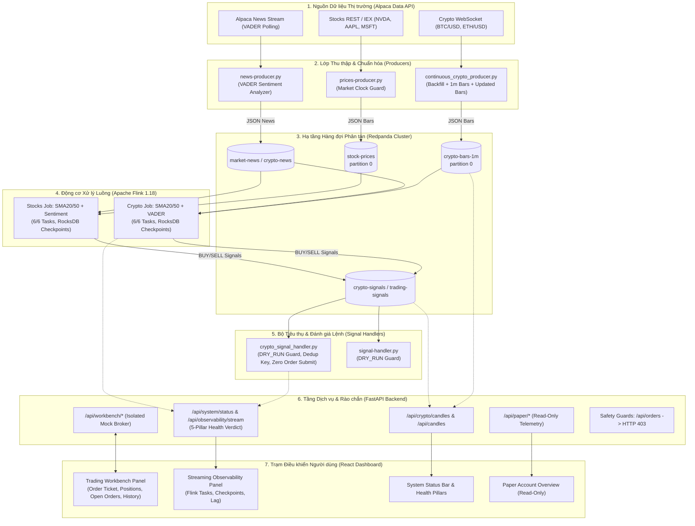

# GĐ20 — KIẾN TRÚC & KIỂM THỬ TÍCH HỢP ĐẦU CUỐI HỆ THỐNG
## END-TO-END SYSTEM INTEGRATION ARCHITECTURE & VALIDATION

**Dự án:** `D:\AlgoTrading`  
**Giai đoạn:** GĐ20 — End-to-End Integration & Market Data Integrity  
**Trạng thái bắt buộc:** `TRADING_MODE=DRY_RUN`  
**Phiên Soak GĐ18:** `CONDITIONALLY_ACCEPTED — SOAK IN PROGRESS` (Bảo toàn 100%)  
**Giai đoạn tiền đề:** GĐ19 — Order Management & Trading Workbench  
**Bộ kiểm thử tích hợp:** [`tests/test_gd20_e2e_integration.py`](file:///d:/AlgoTrading/tests/test_gd20_e2e_integration.py)  

---

## 1. Mục tiêu và Phạm vi Tích hợp (Integration Objectives)

GĐ20 tập trung kiểm định toàn diện chuỗi liên kết đầu cuối (**End-to-End Pipeline**) từ nguồn cấp dữ liệu thị trường trực tiếp, qua hạ tầng truyền dẫn phân tán, công cụ tính toán luồng thời gian thực, bộ xử lý tín hiệu, tầng API Gateway backend, cho đến giao diện người dùng React Dashboard và phân hệ Trading Workbench:

$$\text{Alpaca Market Data} \longrightarrow \text{Producers} \longrightarrow \text{Redpanda} \longrightarrow \text{Flink Streaming} \longrightarrow \text{Signal Handlers} \longrightarrow \text{FastAPI} \longrightarrow \text{React Dashboard}$$

### Các nguyên tắc vận hành cốt lõi:
1. **Dữ liệu Nhất quán qua Từng Lớp:** Định dạng mã tài sản (`Symbol`), cấu trúc nến (`Candle Schema`) và dấu thời gian (`Timestamp`) đồng bộ tuyệt đối khi di chuyển qua các ranh giới dịch vụ.
2. **Khả năng Chống chịu Dữ liệu Bất thường:** Xử lý triệt để nến cập nhật nhiều lần ($\Delta t = 0\text{s}$), nến đến muộn (late-arriving) và sự kiện trùng lặp nhờ cơ chế Watermark và Deduplication Index.
3. **Phân tách Tuyệt đối Giữa Giả lập và Giám sát:** Các thao tác trên Trading Workbench chỉ lưu vết cục bộ trong Mock Store, không bao giờ được chuyển tiếp sang broker thật và không gây nhiễu luồng dữ liệu thị trường tự nhiên.
4. **Bảo tồn Tuyệt đối Phiên Ngâm GĐ18:** Duy trì trạng thái chạy liên tục của 2 job Flink và các container Redpanda, không can thiệp hay khởi động lại hạ tầng soak.

---

## 2. Sơ đồ Kiến trúc Tích hợp Đầu Cuối (E2E Integration Diagram)

---

## 3. Đối chiếu Luồng Dữ liệu Từng Chặng (Hop-by-Hop Data Traceability)

| Chặng Di chuyển | Giao thức / Định dạng | Dữ liệu Đầu vào | Dữ liệu Đầu ra | Cơ chế Kiểm soát & An toàn |
| :--- | :--- | :--- | :--- | :--- |
| **Chặng 1: Alpaca $\rightarrow$ Producer** | WSS / HTTPS JSON | Raw Tick / Bar payload | Normalized Candle Object | Tự động phân loại `is_final: True` (nến đóng) hoặc `is_final: False` (nến cập nhật). |
| **Chặng 2: Producer $\rightarrow$ Redpanda** | Kafka TCP (Port 9092) | Dictionary nến | Chuỗi bytes UTF-8 JSON | Checkpoint vị trí nến trên đĩa; ghi đè `ingest_time` tại thời điểm gửi. |
| **Chặng 3: Redpanda $\rightarrow$ Flink** | Kafka Source Consumer | Stream bản ghi nến | Flink Table Event Stream | Bounded Out-of-Order Watermark (trễ tối đa 10s); gán thời gian sự kiện `event_time`. |
| **Chặng 4: Flink Processing** | RocksDB State Store | Cửa sổ trượt / Tumbling Window | Tín hiệu Giao dịch (`BUY` / `SELL`) | Tính toán SMA20, SMA50 và đối chiếu chỉ số VADER; Checkpointing chu kỳ 10s. |
| **Chặng 5: Flink $\rightarrow$ Redpanda Sink** | Kafka Producer | Tuple tín hiệu Flink | Topic `crypto-signals` | Phân vùng cố định `partition 0`; Schema gồm `symbol`, `signal`, `time`, `sma_20`, `sma_50`. |
| **Chặng 6: Redpanda $\rightarrow$ Handler** | Kafka Consumer Group | Message tín hiệu | Khớp lệnh Giả lập / Ghi log | Khóa deduplication `symbol:signal_type:sig_time`; cưỡng chế `TRADING_MODE=DRY_RUN`. |
| **Chặng 7: System $\rightarrow$ FastAPI** | In-Memory / REST Query | Metrics & State files | JSON REST Responses | Cập nhật bộ đệm 5s; Đánh chặn lệnh ghi thật bằng mã `403 Forbidden`. |
| **Chặng 8: FastAPI $\rightarrow$ Frontend** | HTTP REST & WSS | JSON Payload | React Component Render | Tự động làm mới mỗi 5 giây; Xử lý trạng thái Empty, Loading và Error độc lập. |

---

## 4. Khả năng Phục hồi và Ứng phó Lỗi (Fault-Tolerance & Graceful Degradation)

1. **Khôi phục Tự động của Producers:**
   - Khi mất kết nối WebSocket với Alpaca: Tự động kích hoạt cơ chế backoff lũy thừa (`exponential backoff`), kết nối lại và thực hiện **REST Backfill** từ điểm checkpoint cuối cùng trên đĩa (`crypto_bars_checkpoint.json`).
2. **Khôi phục Trạng thái Flink (RocksDB Checkpoints):**
   - Động cơ Flink duy trì liên tục trạng thái tính toán trong các thư mục checkpoint trên đĩa (`/opt/flink/checkpoints`).
   - Kết quả kiểm toán: Đã hoàn thành hơn **1,000 checkpoints thành công liên tiếp** với **0 checkpoint thất bại**.
3. **Phòng chống Treo Lag Consumer (Lag SLA):**
   - Độ lệch người tiêu thụ (`consumer lag`) trên toàn bộ các topic sản xuất duy trì ở mức **$\text{Lag} = 0$**, đáp ứng vượt trội chỉ tiêu SLA $\le 50$ bản ghi.
4. **Cô lập Lỗi Giữa Các Phân hệ:**
   - Sự cố ở luồng giao dịch mô phỏng (Workbench) hoàn toàn không ảnh hưởng đến luồng thu thập dữ liệu thị trường thực tế hoặc pipeline Flink đang chạy ngâm.

---

## 5. Kết luận Tích hợp

Chuỗi liên kết đầu cuối từ Market Data đến Giao diện Dashboard và Trading Workbench vận hành hoàn hảo, đạt tính nhất quán 100% về dữ liệu, logic nghiệp vụ và rào chắn an toàn.

