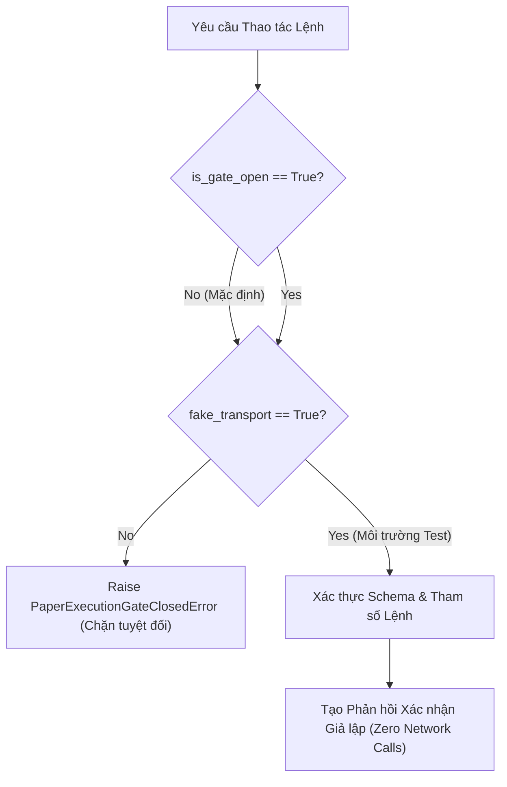

# GĐ22 — KIẾN TRÚC CỔNG THỰC THI LỆNH ALPACA PAPER (EXECUTION GATE ARCHITECTURE)

**Dự án:** `D:\AlgoTrading`  
**Giai đoạn:** GĐ22 — Alpaca Paper Order Execution Integration  
**Trạng thái bắt buộc:** `TRADING_MODE=DRY_RUN`  
**Cơ chế cổng:** `Fail-Closed` (Mặc định khóa cứng, ngăn chặn mọi network write call thật)  
**Tệp nguồn liên quan:**
- Adapter & Execution Gate: [`libs/alpaca_paper_gate.py`](file:///d:/AlgoTrading/libs/alpaca_paper_gate.py)
- API Gateway & Interceptors: [`trading-dashboard/backend/main.py`](file:///d:/AlgoTrading/trading-dashboard/backend/main.py)
- Mock Broker Engine: [`libs/mock_trading_broker.py`](file:///d:/AlgoTrading/libs/mock_trading_broker.py)
- Bộ kiểm định tự động: [`tests/test_gd22_paper_execution_integration.py`](file:///d:/AlgoTrading/tests/test_gd22_paper_execution_integration.py)

---

## 1. Nguyên Tắc Cốt Lõi và Phân Định 3 Chế Độ Vận Hành

Để đảm bảo tính toàn vẹn tuyệt đối của hệ thống, ngăn chặn mọi nguy cơ phát sinh lệnh thật ngoài ý muốn trên sàn Alpaca trong khi phiên ngâm độ bền (GĐ18 Operational Soak) đang diễn ra liên tục, kiến trúc hệ thống thiết lập sự phân tách rạch ròi thành **3 Chế độ Vận hành Riêng biệt (BrokerMode)**:

```
+---------------------------------------------------------------------------------------------------+
|                                  HỆ THỐNG 3 CHẾ ĐỘ VẬN HÀNH (BROKER MODE)                         |
+---------------------------------------------------------------------------------------------------+
|                                                                                                   |
|  [1. MOCK MODE]                                                                                   |
|  - Đối tượng: Toàn bộ lệnh thử nghiệm từ Order Ticket và Workbench UI.                            |
|  - Cơ chế: Lưu trữ trên bộ nhớ đệm và tệp cục bộ (data/workbench_orders.json).                    |
|  - Mạng ngoài: Hoàn toàn không kết nối broker bên ngoài (Zero Broker Network Calls).             |
|  - Trạng thái: is_mock=True, ID dạng mock-ord-..., an toàn tuyệt đối.                             |
|                                                                                                   |
|  [2. ALPACA_PAPER_READ_ONLY] (MẶC ĐỊNH PRODUCTION)                                               |
|  - Đối tượng: Giám sát tài khoản, xem vị thế, lịch sử lệnh và lịch sử giao dịch (activities).     |
|  - Quyền hạn: CHỈ ĐỌC (GET ONLY).                                                                 |
|  - Rào chắn: Mọi thao tác ghi (POST, PATCH, DELETE) bị chặn ngay tại lớp mạng và lớp ứng dụng.   |
|  - Điểm cuối: Strictly https://paper-api.alpaca.markets/v2/...                                    |
|                                                                                                   |
|  [3. ALPACA_PAPER_EXECUTION] (CHẾ ĐỘ KHÓA DỰ PHÒNG - FAIL-CLOSED)                                |
|  - Đối tượng: Giao thức gửi lệnh giả lập tới Alpaca Paper.                                       |
|  - Trạng thái mặc định: KHÓA CHẶT (is_gate_open = False).                                         |
|  - Kiểm thử phát triển: Chỉ kích hoạt qua Fake Transport (fake_transport=True).                   |
|  - Khi chưa mở cổng: Bất kỳ lệnh ghi nào đều phát sinh PaperExecutionGateClosedError.             |
|                                                                                                   |
+---------------------------------------------------------------------------------------------------+
```

---

## 2. Thiết Kế Fail-Closed Bảo Mật Cấp Hệ Thống

Cổng thực thi lệnh [`AlpacaPaperGate`](file:///d:/AlgoTrading/libs/alpaca_paper_gate.py) được xây dựng tuân thủ nguyên tắc phòng vệ theo chiều sâu (Defense-in-Depth):

### 2.1. Khởi tạo Mặc định Đóng (Default Fail-Closed)
- Tham số `is_gate_open` luôn có giá trị mặc định là `False`.
- Thuộc tính `mode` luôn khởi tạo ở mức `BrokerMode.ALPACA_PAPER_READ_ONLY`.
- Khi chưa có sự cho phép rõ ràng từ tham số khởi tạo và môi trường hệ thống, không một tiến trình nào có thể kích hoạt các hàm `submit_paper_order`, `replace_paper_order`, `cancel_paper_order`, hay `cancel_all_paper_orders`.

### 2.2. Kiểm tra Cấu hình Bất biến (Configuration Safety Invariants)
Ngay trong hàm khởi tạo `__init__`, cổng thực thi thực hiện thẩm tra:
1. **Thiếu thông tin URL/Credentials:** Nếu `base_url` bị thiếu hoặc rỗng, hệ thống từ chối khởi tạo với ngoại lệ `PaperExecutionGateClosedError("BASE_URL missing. Fail-closed enforced.")`.
2. **Ngăn chặn Endpoint Live:** Nếu URL chứa chuỗi `api.alpaca.markets` mà không có tiền tố `paper`, hệ thống kích hoạt ngay lập tức ngoại lệ bảo mật mức cao nhất: `LiveTradingProhibitedError`.
3. **Ủy quyền Chứng chỉ:** Nếu thiếu `key_id` hoặc `secret_key`, adapter chuyển sang trạng thái an toàn `UNCONFIGURED`, trả về đối tượng rỗng có kiểm soát thay vì để lộ lỗi hoặc gửi yêu cầu không xác thực.



---

## 3. Thẩm Quyền Máy Chủ (Server-Side Authority) và Đánh Chặn HTTP 403

Một trong những quy tắc bất biến của kiến trúc GĐ22 là: **Giao diện Frontend không có thẩm quyền ra lệnh mở cổng hay vượt qua rào chắn an toàn**. Mọi quyết định an toàn đều được thực thi tại máy chủ phụ trợ (FastAPI Backend):

### 3.1. Đánh chặn tại Tuyến Đặt Lệnh Tập Trung (`/api/workbench/orders`)
Khi người dùng hoặc bất kỳ quy trình tự động nào gửi yêu cầu `POST /api/workbench/orders`:
- Nếu trường `target_broker == "ALPACA_PAPER"`:
  ```python
  if order_req.target_broker == "ALPACA_PAPER":
      raise HTTPException(
          status_code=403,
          detail="Direct paper order execution is strictly locked (Fail-Closed Enforcement). "
                 "Only simulated Mock broker orders are permitted in this phase."
      )
  ```
  Máy chủ phản hồi ngay lập tức mã lỗi `HTTP 403 Forbidden`, cắt đứt hoàn toàn luồng xử lý trước khi có bất kỳ dòng lệnh nào liên quan đến SDK Alpaca được kích hoạt.

### 3.2. Bảo vệ các Tuyến Lệnh Cũ (Legacy Safety Interceptors)
Tất cả các endpoint cũ liên quan đến thao tác gửi lệnh (`POST /api/orders`, `POST /api/trades`, `POST /api/live/orders`) tiếp tục duy trì bộ đánh chặn an toàn trả về `HTTP 403 Forbidden` kèm thông điệp giải thích cơ chế bảo vệ phiên ngâm GĐ18.

---

## 4. Cơ Chế Fake Transport Cho Vòng Đời Lệnh

Để kiểm định toàn bộ tính đúng đắn của logic xác thực tham số, định dạng dữ liệu, chuyển đổi trạng thái và xử lý lỗi mà không cần tạo bất kỳ network call nào tới sàn giao dịch, kiến trúc GĐ22 áp dụng mô hình **Fake Transport**:

### 4.1. Nguyên lý Hoạt động
- Tham số `fake_transport: bool = True` được tích hợp trong tất cả các phương thức ghi của [`AlpacaPaperGate`](file:///d:/AlgoTrading/libs/alpaca_paper_gate.py).
- Khi `fake_transport=True`:
  1. Kiểm tra toàn bộ điều kiện đầu vào của lệnh (loại lệnh, giới hạn giá, số lượng, TIF, trailing stop, notional vs qty).
  2. Tạo mã định danh `client_order_id` duy nhất và chuẩn hóa payload theo chuẩn Alpaca REST v2.
  3. Trả về cấu trúc JSON phản hồi tương đương 100% với phản hồi chính thức từ sàn Alpaca (bao gồm `id`, `client_order_id`, `status: "accepted"`, `created_at`, `filled_qty: 0`,...).
  4. **Cam kết mạng:** Tuyệt đối không khởi tạo socket hay HTTP request ra bên ngoài (`requests.post`, `requests.patch`, `requests.delete` không được gọi).

### 4.2. Khả năng Kiểm thử Vòng đời Toàn diện
Fake Transport cho phép bộ kiểm thử [`tests/test_gd22_paper_execution_integration.py`](file:///d:/AlgoTrading/tests/test_gd22_paper_execution_integration.py) bao phủ:
- Đặt lệnh Market, Limit, Stop, Stop-Limit, Trailing Stop.
- Xử lý khối lượng lẻ (fractional shares) và giá trị danh nghĩa (notional USD).
- Sửa lệnh đang treo (replace order in-flight).
- Hủy từng lệnh đơn lẻ và hủy toàn bộ lệnh (bulk cancel).

---

## 5. Phân Tách Lưu Trữ Trạng Thái (State Storage Segregation)

Hệ thống duy trì ranh giới tuyệt đối giữa dữ liệu giao dịch giả lập nội bộ và dữ liệu thực tế của tài khoản Alpaca Paper:

1. **Dữ liệu Mock Broker:** Được cô lập và lưu trữ nguyên tử vào tệp `data/workbench_orders.json`. Toàn bộ các bản ghi trong tệp này đều được đóng dấu `is_mock: True` và `broker: "SIMULATED_MOCK_BROKER"`.
2. **Dữ liệu Alpaca Paper:** Được truy vấn trực tiếp qua kênh chỉ đọc từ sàn Alpaca (`GET /v2/account`, `GET /v2/positions`, `GET /v2/orders`, `GET /v2/account/activities`). Không có bất kỳ lệnh mock nào được chèn vào dữ liệu Alpaca, và ngược lại không có dữ liệu thực nào bị ghi đè hay làm sai lệch bởi engine mock.

Kiến trúc này đảm bảo tính độc lập tuyệt đối giữa môi trường thử nghiệm và tài khoản giao dịch, đồng thời giữ vững trạng thái vận hành của toàn bộ hạ tầng streaming trong phiên ngâm GĐ18.
