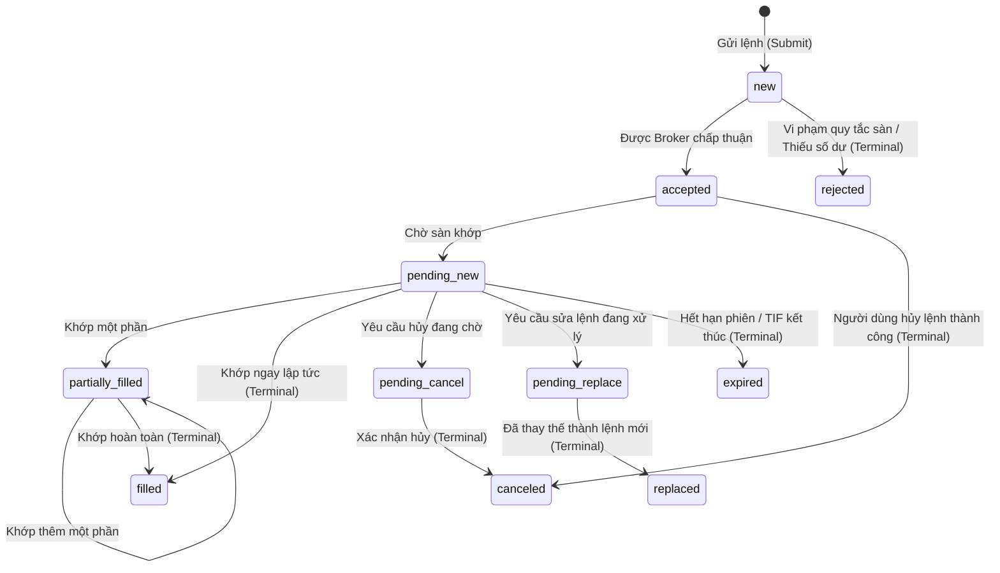

# GĐ22 — VÒNG ĐỜI LỆNH VÀ QUY TẮC XÁC THỰC ALPACA PAPER (ORDER LIFECYCLE & VALIDATION RULES)

**Dự án:** `D:\AlgoTrading`  
**Giai đoạn:** GĐ22 — Alpaca Paper Order Execution Integration  
**Chế độ bắt buộc:** `TRADING_MODE=DRY_RUN`  
**Mục tiêu tài liệu:** Đặc tả chi tiết trạng thái vòng đời lệnh, quy tắc kiểm định tham số cho 5 loại lệnh chuẩn Alpaca, cơ chế xử lý khối lượng lẻ (fractional) / giá trị danh nghĩa (notional), giao thức sửa/hủy lệnh và quy trình đồng bộ sự kiện qua TradingStream.

---

## 1. Sơ Đồ Chuyển Đổi Trạng Thái Vòng Đời Lệnh (Order State Machine)

Hệ thống quản lý trạng thái lệnh tuân thủ chuẩn giao thức Alpaca Trading API v2. Mỗi lệnh trải qua chuỗi trạng thái từ khi khởi tạo cho đến khi kết thúc (terminal state):



### Phân cấp Ưu tiên Trạng thái Đơn điệu (Monotonic State Hierarchy)
Để giải quyết bài toán gói tin đến muộn (out-of-order arrival) trong môi trường mạng phân tán và WebSocket, hệ thống thiết lập thứ tự ưu tiên số học cho từng trạng thái:

| Cấp độ Ưu tiên | Trạng thái Alpaca | Phân loại | Ghi chú |
| :---: | :--- | :--- | :--- |
| **0** | `unknown` | Chưa xác định | Trạng thái dự phòng khởi tạo |
| **1** | `held`, `pending_new` | Đang chờ gửi | Trạng thái trung gian cấp 1 |
| **2** | `new`, `accepted` | Đã tiếp nhận | Sàn ghi nhận lệnh vào sổ lệnh |
| **3** | `partially_filled` | Khớp một phần | Đã có khối lượng thực thi |
| **4** | `filled` | **Đã khớp hoàn toàn** | **Trạng thái kết thúc (Terminal)** |
| **4** | `canceled`, `expired`, `rejected` | **Đã hủy / Từ chối** | **Trạng thái kết thúc (Terminal)** |
| **4** | `replaced` | **Đã thay thế** | **Trạng thái kết thúc (Terminal)** |

> [!IMPORTANT]
> **Quy tắc Bất biến:** Một trạng thái có cấp độ ưu tiên thấp hơn (ví dụ sự kiện trễ `new` với cấp độ 2) tuyệt đối **KHÔNG ĐƯỢC PHÉP** ghi đè lên trạng thái có cấp độ cao hơn đã được ghi nhận trước đó (ví dụ `filled` với cấp độ 4). Vi phạm thứ tự sẽ bị bộ lọc của [`AlpacaPaperGate`](file:///d:/AlgoTrading/libs/alpaca_paper_gate.py) phát hiện và ghi log cảnh báo an toàn.

---

## 2. Quy Tắc Xác Thực Cho 5 Loại Lệnh (Order Types Validation)

Adapter [`AlpacaPaperGate`](file:///d:/AlgoTrading/libs/alpaca_paper_gate.py) kiểm tra nghiêm ngặt các tham số đầu vào trước khi tiếp nhận:

### 2.1. Lệnh Thị Trường (Market Order)
- **Mục đích:** Khớp lệnh ngay lập tức ở mức giá tốt nhất hiện có trên sổ lệnh.
- **Tham số bắt buộc:** `symbol`, `qty` (hoặc `notional`), `side` (`buy` hoặc `sell`), `type = "market"`, `time_in_force`.
- **Hiệu lực lệnh (TIF):** `day`, `gtc`, `ioc`, `fok`. (Đối với lệnh Notional USD, bắt buộc phải là `day`).
- **Thời gian giao dịch:** Cổ phiếu chỉ khớp trong giờ giao dịch chính thức (Market Hours) hoặc phiên mở rộng nếu được cấu hình. Crypto (BTC, ETH) khớp liên tục 24/7/365.

### 2.2. Lệnh Giới Hạn (Limit Order)
- **Mục đích:** Chỉ khớp ở mức giá xác định (`limit_price`) hoặc mức giá tốt hơn.
- **Tham số bắt buộc:** `limit_price > 0`.
- **Ràng buộc:** Nếu thiếu hoặc `limit_price <= 0`, adapter từ chối lệnh với lỗi: `ValueError("Limit order requires limit_price > 0")`.

### 2.3. Lệnh Cắt Lỗ (Stop Order)
- **Mục đích:** Kích hoạt lệnh thị trường khi giá thị trường chạm hoặc vượt mức giá dừng (`stop_price`).
- **Tham số bắt buộc:** `stop_price > 0`.
- **Ràng buộc:** Nếu thiếu hoặc `stop_price <= 0`, adapter từ chối lệnh với lỗi: `ValueError("Stop order requires stop_price > 0")`.

### 2.4. Lệnh Giới Hạn Cắt Lỗ (Stop-Limit Order)
- **Mục đích:** Kích hoạt lệnh giới hạn (`limit_price`) khi giá thị trường chạm mức giá dừng (`stop_price`).
- **Tham số bắt buộc:** Phải đồng thời cung cấp cả `stop_price > 0` VÀ `limit_price > 0`.
- **Ràng buộc:** Thiếu một trong hai tham số lập tức bị từ chối với lỗi: `ValueError("Stop-limit order requires both stop_price and limit_price > 0")`.

### 2.5. Lệnh Dừng Theo Vết (Trailing Stop Order)
- **Mục đích:** Mức giá dừng tự động di chuyển bám sát theo chiều hướng có lợi của giá thị trường theo một khoảng cách cố định hoặc tỷ lệ phần trăm.
- **Tham số cấu hình:** Người dùng phải chỉ định một trong hai thông số:
  - `trail_price > 0`: Khoảng giá bám đuổi tuyệt đối bằng USD (ví dụ: \$2.50).
  - `trail_percent > 0`: Khoảng giá bám đuổi theo phần trăm (ví dụ: 1.5%).
- **Ràng buộc loại trừ lẫn nhau:** Không được phép cùng lúc bỏ trống cả hai hoặc cùng lúc truyền cả hai tham số. Nếu vi phạm, adapter báo lỗi: `ValueError("Trailing stop order requires either trail_price or trail_percent, not both")`.

---

## 3. Quy Tắc Khối Lượng Lẻ (Fractional) và Giá Trị Danh Nghĩa (Notional)

Alpaca hỗ trợ đặt lệnh theo số lượng cổ phiếu lẻ (Fractional Shares) và theo giá trị đồng USD (Notional Value). Adapter thiết lập các rào chắn kiểm soát:

1. **Loại trừ lẫn nhau (Mutual Exclusivity):** Mỗi lệnh chỉ được phép chỉ định `qty` HOẶC `notional`. Cung cấp cả hai hoặc không cung cấp tham số nào sẽ bị từ chối ngay lập tức:
   ```python
   has_qty = qty is not None and qty > 0
   has_notional = notional is not None and notional > 0
   if (has_qty and has_notional) or (not has_qty and not has_notional):
       raise ValueError("Order must specify either qty or notional, but not both.")
   ```
2. **Độ chính xác thập phân:**
   - Cổ phiếu Mỹ: Tối đa 9 chữ số thập phân đối với khối lượng.
   - Tiền mã hóa (Crypto): Hỗ trợ đến 9 chữ số thập phân (đối với Bitcoin đến Satoshi `0.00000001 BTC`).
3. **Giới hạn loại lệnh đối với Notional:** Lệnh Notional USD chỉ áp dụng cho lệnh Market và `time_in_force = "day"`. Không áp dụng cho lệnh Limit, Stop hoặc Trailing Stop theo quy định của sàn Alpaca.

---

## 4. Quản Lý Định Danh Khách Hàng (Client Order ID & Idempotency)

- Mỗi lệnh khi gửi qua [`AlpacaPaperGate`](file:///d:/AlgoTrading/libs/alpaca_paper_gate.py) có thể kèm theo `client_order_id` do hệ thống quản lý giao dịch tự sinh.
- **Quy cách:** Chuỗi ký tự độ dài không quá 128 ký tự, chỉ chứa các ký tự chữ, số và dấu gạch nối (`a-z`, `A-Z`, `0-9`, `-`, `_`).
- **Bảo đảm Tính Bất khả Trùng lặp (Idempotency):**
  - Khi sàn Alpaca nhận được yêu cầu đặt lệnh với `client_order_id` đã tồn tại, sàn sẽ trả về mã lỗi `HTTP 409 Conflict` kèm thông tin của lệnh đã có.
  - Bộ kiểm định [`TC-G22-14`](file:///d:/AlgoTrading/tests/test_gd22_paper_execution_integration.py#L201-L215) xác minh rằng mã định danh này được lưu giữ toàn vẹn xuyên suốt toàn bộ vòng đời lệnh và chuỗi phản hồi.

---

## 5. Quy Trình Sửa Lệnh (Order Replacement Lifecycle)

- **Điểm cuối Alpaca:** `PATCH /v2/orders/{order_id}`
- **Điều kiện sửa:** Lệnh phải đang ở trạng thái có thể sửa (`new`, `accepted`, `pending_new`, `partially_filled`).
- **Các tham số được phép sửa đổi:**
  - `qty`: Thay đổi khối lượng lệnh.
  - `limit_price`: Cập nhật giá giới hạn mới.
  - `stop_price`: Cập nhật giá dừng mới.
  - `trail`: Cập nhật khoảng cách bám đuổi cho lệnh Trailing Stop.
  - `time_in_force`: Cập nhật thời hạn hiệu lực.
  - `client_order_id`: Cung cấp mã định danh mới cho lệnh thay thế.
- **Cơ chế hoạt động của sàn:** Khi nhận lệnh sửa, sàn Alpaca hủy lệnh cũ và tạo ra một bản ghi lệnh mới với ID mới, đồng thời gắn cờ trạng thái lệnh cũ thành `replaced`.

---

## 6. Quy Trình Hủy Lệnh (Single & Bulk Order Cancellation)

1. **Hủy từng lệnh đơn lẻ (`DELETE /v2/orders/{order_id}`):**
   - Áp dụng khi người dùng hoặc chiến lược muốn rút một lệnh cụ thể đang treo.
   - Trả về mã `HTTP 204 No Content` khi yêu cầu được ghi nhận thành công hoặc `HTTP 422 / 404` nếu lệnh đã khớp hoặc không tồn tại.
2. **Hủy toàn bộ lệnh hàng loạt (`DELETE /v2/orders`):**
   - Cơ chế ngắt khẩn cấp (Emergency Kill Switch) cho phép hủy toàn bộ các lệnh đang mở trên tài khoản.
   - Phản hồi dạng danh sách chứa kết quả xử lý của từng lệnh:
     ```json
     [
       {"id": "ord_1", "status": 200},
       {"id": "ord_2", "status": 200}
     ]
     ```

---

## 7. Xử Lý Luồng Sự Kiện Thời Gian Thực (TradingStream Event Processing)

Để duy trì đồng bộ trạng thái lệnh giữa máy chủ giao dịch và sàn Alpaca, bộ xử lý [`AlpacaTradingStreamProcessor`](file:///d:/AlgoTrading/libs/alpaca_paper_gate.py) triển khai các cơ chế phòng vệ:

1. **Lọc trùng lặp bản ghi (Deduplication):**
   - Khóa duy nhất được tạo dựa trên bộ ba: `f"{event_name}:{order_id}:{event_timestamp}"`.
   - Các gói tin trùng lặp nhận được do hiện tượng truyền lại trên mạng (network retransmission) bị loại bỏ ngay lập tức và tăng biến đếm `duplicate_events_dropped`.
2. **Xử lý ngắt kết nối và Tái đồng bộ (Disconnection & Reconciliation):**
   - Khi luồng WebSocket bị đứt đoạn, trạng thái kết nối chuyển thành `DISCONNECTED`.
   - Ngay sau khi tái lập kết nối (`RECONNECTED`), hệ thống tự động kích hoạt truy vấn REST `GET /v2/orders?status=open` để bù đắp toàn bộ các sự kiện bị bỏ lỡ trong khoảng thời gian mất mạng (REST Catch-up Reconciliation).
   - Bộ kiểm thử [`TC-G22-20`](file:///d:/AlgoTrading/tests/test_gd22_paper_execution_integration.py#L273-L287) xác minh tính năng này hoạt động hoàn hảo mà không làm mất mát thông tin đơn hàng.
