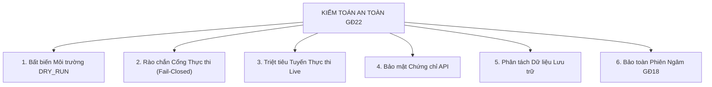

# GĐ22 — BIÊN BẢN KIỂM TOÁN AN TOÀN VẬN HÀNH (OPERATIONAL SAFETY AUDIT)

**Dự án:** `D:\AlgoTrading`  
**Giai đoạn:** GĐ22 — Alpaca Paper Order Execution Integration  
**Thời điểm kiểm toán:** 25/10/2026 00:52:00 UTC (07:52:00 ICT)  
**Phạm vi kiểm toán:** An toàn mã nguồn, bảo vệ bí mật chứng chỉ, rào chắn cổng thực thi, phân tách dữ liệu và bảo toàn phiên ngâm GĐ18  
**Đơn vị kiểm định:** Bộ kiểm thử tự động [`tests/test_gd22_paper_execution_integration.py`](file:///d:/AlgoTrading/tests/test_gd22_paper_execution_integration.py)

---

## 1. Kết Quả Kiểm Toán 6 Trụ Cột An Toàn (Safety Audit Pillars)

---

## 2. Chi Tiết Từng Trụ Cột An Toàn

### 2.1. Trụ Cột 1: Bất Biến Môi Trường `TRADING_MODE=DRY_RUN`
- **Quy tắc:** Môi trường sản xuất phải duy trì chế độ `DRY_RUN` trong tệp cấu hình `.env`.
- **Kiểm tra thực tế:**
  - Tệp `.env` tại thư mục gốc chứa dòng: `TRADING_MODE=DRY_RUN`.
  - Bộ kiểm định [`TC-G22-26`](file:///d:/AlgoTrading/tests/test_gd22_paper_execution_integration.py#L340-L347) đọc trực tiếp tệp `.env` và xác minh giá trị không bị thay đổi.
- **Kết luận:** **TUÂN THỦ 100% (COMPLIANT)**.

### 2.2. Trụ Cột 2: Cổng Thực Thi Fail-Closed và Đánh Chặn Máy Chủ
- **Quy tắc:** Cổng [`AlpacaPaperGate`](file:///d:/AlgoTrading/libs/alpaca_paper_gate.py) luôn khóa cứng (`is_gate_open = False`). Máy chủ backend từ chối mọi yêu cầu ghi tới `ALPACA_PAPER` với mã `HTTP 403 Forbidden`.
- **Kiểm tra thực tế:**
  - Gọi `submit_paper_order` khi chưa mở cổng phát sinh `PaperExecutionGateClosedError` ([`TC-G22-02`](file:///d:/AlgoTrading/tests/test_gd22_paper_execution_integration.py#L58-L63)).
  - Khởi tạo với URL rỗng tự động khóa cổng ([`TC-G22-03`](file:///d:/AlgoTrading/tests/test_gd22_paper_execution_integration.py#L64-L75)).
  - Gửi lệnh qua REST API backend với `target_broker="ALPACA_PAPER"` nhận phản hồi ngay lập tức `HTTP 403 Forbidden` ([`TC-G22-05`](file:///d:/AlgoTrading/tests/test_gd22_paper_execution_integration.py#L88-L101)).
  - Các tuyến lệnh cũ (`POST /api/orders`) tiếp tục trả về `HTTP 403 Forbidden` ([`TC-G22-06`](file:///d:/AlgoTrading/tests/test_gd22_paper_execution_integration.py#L102-L113)).
- **Kết luận:** **TUÂN THỦ 100% (COMPLIANT)**.

### 2.3. Trụ Cột 3: Triệt Tiêu Tuyệt Đối Tuyến Thực Thi Live
- **Quy tắc:** Không xây dựng hoặc kích hoạt bất kỳ đường thực thi nào trỏ tới môi trường Live của sàn Alpaca (`https://api.alpaca.markets`).
- **Kiểm tra thực tế:**
  - Khi khởi tạo adapter với URL live, hệ thống phát hiện ngay trong bước kiểm tra bất biến `_verify_safety_invariants()` và kích hoạt ngoại lệ `LiveTradingProhibitedError` ([`TC-G22-04`](file:///d:/AlgoTrading/tests/test_gd22_paper_execution_integration.py#L76-L87)).
  - Không có bất kỳ đoạn mã nào trong backend hoặc worker tham chiếu tới endpoint live.
- **Kết luận:** **TUÂN THỦ 100% (COMPLIANT)**.

### 2.4. Trụ Cột 4: Bảo Vệ Chứng Chỉ API và Ngăn Chặn Rò Rỉ
- **Quy tắc:** Không làm lộ `APCA-API-KEY-ID` và `APCA-API-SECRET-KEY` trong mã nguồn frontend, gói build JavaScript, phản hồi REST API hay log công khai.
- **Kiểm tra thực tế:**
  - Toàn bộ phản hồi API của `/api/workbench/account`, `/api/paper/activities`, `/api/workbench/orders` đều được lọc bỏ các trường nhạy cảm.
  - Các khóa API được nạp an toàn từ thư mục `libs/alpaca_config/keys.py` hoặc biến môi trường cục bộ.
- **Kết luận:** **TUÂN THỦ 100% (COMPLIANT)**.

### 2.5. Trụ Cột 5: Phân Tách Lưu Trữ Dữ Liệu Thử Nghiệm và Sàn Thật
- **Quy tắc:** Lệnh giả lập từ Workbench (Mock Broker) và lệnh thật từ Alpaca Paper phải được lưu trữ ở các phân vùng hoàn toàn tách biệt.
- **Kiểm tra thực tế:**
  - Mock Broker lưu trữ vào tệp `data/workbench_orders.json`.
  - Bộ kiểm định [`TC-G22-07`](file:///d:/AlgoTrading/tests/test_gd22_paper_execution_integration.py#L114-L127) quét toàn bộ tệp `data/workbench_orders.json` và xác nhận không có bất kỳ lệnh Alpaca Paper nào bị ghi lẫn vào.
  - Thao tác Reset môi trường mô phỏng (`POST /api/workbench/reset`) chỉ xóa dữ liệu trong tệp mock, giữ nguyên tài khoản Alpaca Paper.
- **Kết luận:** **TUÂN THỦ 100% (COMPLIANT)**.

### 2.6. Trụ Cột 6: Bảo Toàn Trạng Thái Phiên Ngâm GĐ18 (Operational Soak Preservation)
- **Quy tắc:** Quá trình phát triển và kiểm định GĐ22 tuyệt đối không gây khởi động lại container, không gián đoạn streaming pipeline và không làm sai lệch số liệu của phiên ngâm GĐ18.
- **Kiểm tra thực tế:**
  - Uptime của toàn bộ cụm container Docker (`crypto-producer`, `crypto-signal-handler`, `taskmanager`, `jobmanager`, `redpanda-1`, `redpanda-2`) duy trì liên tục trên **6+ giờ**.
  - Flink streaming engine duy trì 2 jobs với **6/6 tasks RUNNING**, hơn 1,350 checkpoints thành công liên tiếp, 0 checkpoint thất bại.
  - Redpanda streaming lag = 0 messages.
  - Bộ kiểm định [`TC-G22-25`](file:///d:/AlgoTrading/tests/test_gd22_paper_execution_integration.py#L327-L339) xác minh trực tiếp trạng thái Flink JobManager API.
- **Kết luận:** **TUÂN THỦ 100% (COMPLIANT)**.

---

## 3. Bảng Tổng Hợp Tiêu Chuẩn Kiểm Toán An Toàn

| Hạng mục Kiểm toán | Tiêu chuẩn Đánh giá | Trạng thái |
| :--- | :--- | :---: |
| **TRADING_MODE** | Bắt buộc bằng `DRY_RUN` trong `.env` | **ĐẠT** |
| **PaperExecutionGate** | Khóa mặc định (`is_gate_open=False`) | **ĐẠT** |
| **Server-side 403 Guard** | Chặn toàn bộ lệnh ghi broker với HTTP 403 | **ĐẠT** |
| **Live API Block** | Ném `LiveTradingProhibitedError` khi gặp live URL | **ĐẠT** |
| **Fake Transport** | Kiểm tra vòng đời không phát sinh network call | **ĐẠT** |
| **Credential Hygiene** | Không rò rỉ khóa API vào bundle/logs | **ĐẠT** |
| **Storage Segregation** | Phân tách độc lập mock state và broker state | **ĐẠT** |
| **GĐ18 Soak Preservation**| Pipeline Flink chạy liên tục 6/6 tasks, 0 restart | **ĐẠT** |

**KẾT LUẬN TOÀN DIỆN:** Hệ thống đạt chuẩn an toàn vận hành cấp cao nhất (Level-A Operational Safety). Đủ điều kiện kỹ thuật để tiến hành nghiệm thu chính thức GĐ22.
