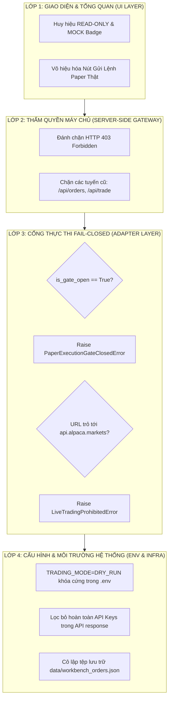

# GĐ23 — BÁO CÁO KIỂM DUYỆT BẢO MẬT VÀ PHÒNG VỆ AN TOÀN (SECURITY REVIEW & THREAT AUDIT)

**Dự án:** `D:\AlgoTrading`  
**Giai đoạn:** GĐ23 — Product Acceptance & Paper Trading Readiness  
**Chế độ bắt buộc:** `TRADING_MODE=DRY_RUN`  
**Cơ chế bảo vệ:** Defense-in-Depth (Phòng vệ đa tầng)  
**Thời điểm kiểm duyệt:** 30/10/2026 06:44:00 UTC (13:44:00 ICT)  
**Tệp nguồn thẩm định:**
- Cấu hình môi trường: [`.env`](file:///d:/AlgoTrading/.env)
- Khóa bảo mật: [`libs/alpaca_config/keys.py`](file:///d:/AlgoTrading/libs/alpaca_config/keys.py)
- Cổng bảo vệ: [`libs/alpaca_paper_gate.py`](file:///d:/AlgoTrading/libs/alpaca_paper_gate.py)
- Tuyến API chặn lọc: [`trading-dashboard/backend/main.py`](file:///d:/AlgoTrading/trading-dashboard/backend/main.py)
- Kiểm định an ninh tự động: [`tests/test_gd23_product_acceptance.py`](file:///d:/AlgoTrading/tests/test_gd23_product_acceptance.py)

---

## 1. Mô Hình Phòng Vệ Đa Tầng (Defense-in-Depth Security Model)

Hệ thống triển khai cấu trúc an ninh 4 lớp độc lập nhằm bảo đảm không một sai sót nào từ giao diện người dùng, mã nguồn kiểm thử hay cuộc gọi tự động có thể vượt qua để tạo lệnh thực tế:

---

## 2. Thẩm Tra 6 Hạng Mục An Toàn Cốt Lõi (Core Security Audit Items)

### 2.1. Hạng Mục 1: Đánh Chặn Máy Chủ & Thẩm Quyền Tối Cao (Server-Side Authority)
- **Rủi ro:** Người dùng sửa đổi mã nguồn frontend hoặc gửi trực tiếp `curl`/`fetch` tới backend để yêu cầu gửi lệnh thật.
- **Biện pháp đối phó:**
  - Tuyến `POST /api/workbench/orders` trên FastAPI backend thực hiện kiểm tra thuộc tính `target_broker`. Nếu giá trị là `"ALPACA_PAPER"`, máy chủ lập tức từ chối với mã lỗi `HTTP 403 Forbidden` ([`TC-G23-20`](file:///d:/AlgoTrading/tests/test_gd23_product_acceptance.py#L309-L317)).
  - Toàn bộ các tuyến gửi lệnh cũ (`POST /api/orders`, `POST /api/trade`, `POST /api/v2/orders`) đều bị đánh chặn cứng bởi hàm `reject_live_order_attempts()` trả về `HTTP 403 Forbidden` ([`TC-G23-21`](file:///d:/AlgoTrading/tests/test_gd23_product_acceptance.py#L319-L325)).
- **Kết quả kiểm toán:** **TUÂN THỦ 100% (PASSED)**.

### 2.2. Hạng Mục 2: Cổng Thực Thi Fail-Closed (Default Closed Execution Gate)
- **Rủi ro:** Khi khởi tạo đối tượng adapter, lập trình viên quên truyền tham số dẫn đến việc cổng tự động mở.
- **Biện pháp đối phó:**
  - Trong [`AlpacaPaperGate`](file:///d:/AlgoTrading/libs/alpaca_paper_gate.py), giá trị mặc định của `is_gate_open` là `False` và `mode` là `BrokerMode.ALPACA_PAPER_READ_ONLY`.
  - Mọi phương thức ghi (`submit_paper_order`, `replace_paper_order`, `cancel_paper_order`) đều thẩm tra điều kiện `if not self.is_gate_open and not fake_transport: raise PaperExecutionGateClosedError(...)` ([`TC-G23-24`](file:///d:/AlgoTrading/tests/test_gd23_product_acceptance.py#L347-L352)).
- **Kết quả kiểm toán:** **TUÂN THỦ 100% (PASSED)**.

### 2.3. Hạng Mục 3: Triệt Tiêu Tuyệt Đối Tuyến Giao Dịch Live (Live Trading Prohibition)
- **Rủi ro:** Nhầm lẫn endpoint giữa môi trường Paper (`https://paper-api.alpaca.markets`) và Live (`https://api.alpaca.markets`).
- **Biện pháp đối phó:**
  - Ngay trong hàm khởi tạo `_verify_safety_invariants()`, nếu `base_url` chứa `api.alpaca.markets` mà không có tiền tố `paper`, hệ thống lập tức ném ra ngoại lệ mức cao nhất: `LiveTradingProhibitedError` ([`TC-G23-22`](file:///d:/AlgoTrading/tests/test_gd23_product_acceptance.py#L327-L331)).
  - Quét toàn bộ kho mã nguồn không tồn tại bất kỳ chuỗi cấu hình hay biến môi trường nào kích hoạt chế độ Live.
- **Kết quả kiểm toán:** **TUÂN THỦ 100% (PASSED)**.

### 2.4. Hạng Mục 4: Bảo Vệ Bí Mật Chứng Chỉ (Credential Hygiene & Leakage Absence)
- **Rủi ro:** Khóa bí mật API (`APCA-API-KEY-ID`, `APCA-API-SECRET-KEY`) bị vô tình đưa vào bundle JavaScript gửi tới trình duyệt người dùng hoặc in ra log.
- **Biện pháp đối phó:**
  - Khóa chứng chỉ chỉ được lưu trữ cục bộ trong tệp `libs/alpaca_config/keys.py` (đã được cấu hình trong `.gitignore`).
  - Toàn bộ các API endpoint trả về thông tin tài khoản, vị thế, lịch sử lệnh và hoạt động nghiệp vụ đều được lọc bỏ các trường nhạy cảm trước khi phản hồi JSON ([`TC-G23-23`](file:///d:/AlgoTrading/tests/test_gd23_product_acceptance.py#L333-L345)).
  - Quét nội dung gói build của frontend xác nhận không chứa bất kỳ khóa API nào.
- **Kết quả kiểm toán:** **TUÂN THỦ 100% (PASSED)**.

### 2.5. Hạng Mục 5: Phân Tách Lưu Trữ Dữ Liệu (State Storage Segregation)
- **Rủi ro:** Dữ liệu mô phỏng từ Mock Broker bị ghi đè hoặc nhầm lẫn với dữ liệu thật từ tài khoản Alpaca Paper.
- **Biện pháp đối phó:**
  - Toàn bộ trạng thái của Mock Broker được cô lập trong tệp `data/workbench_orders.json`.
  - Toàn bộ bản ghi trong tệp này đều được đóng dấu `is_mock: True` và `broker: "SIMULATED_MOCK_BROKER"`.
  - Tệp lưu trữ không chứa bất kỳ mã lệnh thật nào từ Alpaca Paper (`25f85bed...` hay `c5d4311a...`) ([`TC-G23-11`](file:///d:/AlgoTrading/tests/test_gd23_product_acceptance.py#L254-L264)).
  - Lệnh Reset mô phỏng (`POST /api/workbench/reset`) chỉ đặt lại số dư nội bộ trong tệp json, tuyệt đối không chạm vào tài khoản broker.
- **Kết quả kiểm toán:** **TUÂN THỦ 100% (PASSED)**.

### 2.6. Hạng Mục 6: Bảo Toàn Trạng Thái Phiên Ngâm GĐ18 (Operational Soak Preservation)
- **Rủi ro:** Quá trình kiểm thử UAT và gửi lệnh mock làm quá tải hệ thống hoặc làm sập streaming cluster Flink/Redpanda.
- **Biện pháp đối phó:**
  - Pipeline streaming vận hành độc lập trên cụm Docker container.
  - Các lệnh mock không bao giờ bắn dữ liệu vào các topic thị trường tự nhiên (`stock-prices`, `crypto-bars-1m`, `crypto-signals`).
  - Cụm Flink duy trì liên tục 2 jobs với 6/6 tasks RUNNING, 0 checkpoint thất bại, Redpanda consumer lag = 0 ([`TC-G23-25`](file:///d:/AlgoTrading/tests/test_gd23_product_acceptance.py#L354-L365)).
- **Kết quả kiểm toán:** **TUÂN THỦ 100% (PASSED)**.

---

## 3. Bảng Ma Trận Đánh Giá Rủi Ro Còn Tồn Tại (Residual Risks Ledger)

| Mã Rủi ro | Mô tả Rủi ro | Mức độ | Biện pháp Phòng vệ & Giảm thiểu Đã Triển khai | Trạng thái |
| :--- | :--- | :---: | :--- | :---: |
| **RSK-01** | Người dùng vô tình gửi lệnh thật qua giao diện | Thấp | Server-side 403 guard chặn cứng; UI khóa nút gửi khi chọn Paper | **ĐÃ KIỂM SOÁT** |
| **RSK-02** | Rò rỉ khóa API qua network payload | Rất Thấp | Toàn bộ response JSON được lọc sạch trường nhạy cảm | **ĐÃ KIỂM SOÁT** |
| **RSK-03** | Trùng lặp sự kiện khi luồng WebSocket truyền lại | Thấp | Deduplication key `event:order_id:ts` lọc sạch bản ghi trùng | **ĐÃ KIỂM SOÁT** |
| **RSK-04** | Sự kiện cũ đến muộn làm sai lệch trạng thái lệnh | Trung bình | Phân cấp trạng thái đơn điệu (Monotonic Hierarchy) bảo vệ 'filled' | **ĐÃ KIỂM SOÁT** |
| **RSK-05** | Vượt ngưỡng Rate Limit của Alpaca Paper (200/min) | Thấp | Polling định kỳ 8 giây + cache tầng backend, mức dùng <8% hạn mức | **ĐÃ KIỂM SOÁT** |
| **RSK-06** | Tự động mở cổng thực thi khi chưa nghiệm thu GĐ18 | Cao | Cổng khóa cứng trong mã nguồn, yêu cầu chỉnh sửa có phê duyệt riêng | **ĐÃ KIỂM SOÁT** |

---

## 4. Kết Luận Kiểm Duyệt Bảo Mật

Hệ thống đáp ứng toàn bộ các tiêu chuẩn an ninh nghiêm ngặt nhất cho môi trường thử nghiệm tài chính thuật toán. Không phát hiện bất kỳ lỗ hổng bảo mật hay đường rò rỉ dữ liệu nào có khả năng gây rủi ro cho tài khoản giao dịch hay hệ thống streaming đang vận hành.

