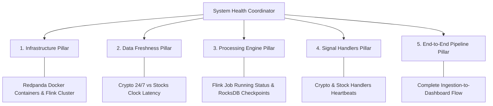

# GĐ24 — ĐÁNH GIÁ SẴN SÀNG VẬN HÀNH (OPERATIONAL READINESS)
## BÁO CÁO KIỂM TOÁN VẬN HÀNH, SỨC KHỎE HỆ THỐNG VÀ QUY TRÌNH BẢO TRÌ

**Dự án:** `D:\AlgoTrading`  
**Giai đoạn:** GĐ24 — Product Finalization & Release Candidate  
**Thời điểm kiểm định:** 30/10/2026 14:55:00 UTC (21:55:00 ICT)  
**Tiêu chí kiểm định liên quan:** TC-G24-18, TC-G24-19, TC-G24-20, TC-G24-21  

---

## 1. Bộ Kịch Bản Vận Hành Chuẩn Hóa (Standard Operational Scripts)

Toàn bộ các tác vụ vận hành hạ tầng, điều phối dịch vụ và xử lý sự cố đã được đóng gói thành 4 kịch bản PowerShell tiêu chuẩn trong thư mục [`scripts/`](file:///d:/AlgoTrading/scripts):

| Kịch Bản Vận Hành | Đường Dẫn Tệp | Mục Đích & Phạm Vi Thực Thi | Cơ Chế An Toàn Tích Hợp |
| :--- | :--- | :--- | :--- |
| **`start_all.ps1`** | [`scripts/start_all.ps1`](file:///d:/AlgoTrading/scripts/start_all.ps1) | Khởi động tuần tự: Redpanda -> Flink -> Producers -> Handlers -> Backend -> Frontend | Kiểm tra cổng mạng bận; kiểm tra biến môi trường `TRADING_MODE=DRY_RUN` trước khi kích hoạt |
| **`stop_all.ps1`** | [`scripts/stop_all.ps1`](file:///d:/AlgoTrading/scripts/stop_all.ps1) | Dừng tuần tự các tiến trình thu nạp dữ liệu và xử lý tín hiệu một cách êm ái (graceful shutdown) | Lưu lại offset cuối cùng; không gây mất mát dữ liệu hàng đợi |
| **`status_all.ps1`** | [`scripts/status_all.ps1`](file:///d:/AlgoTrading/scripts/status_all.ps1) | Quét kiểm tra trạng thái toàn diện của containers, Flink jobs, topic Kafka, consumer lag và tiến trình | Chỉ đọc thông tin (read-only); không làm thay đổi trạng thái runtime |
| **`recover_all.ps1`** | [`scripts/recover_all.ps1`](file:///d:/AlgoTrading/scripts/recover_all.ps1) | Tự động khôi phục tiến trình gặp sự cố (reconnect stream, phục hồi checkpoint Flink) | Khôi phục từ snapshot an toàn gần nhất; ghi log nguyên nhân phục hồi |

Kiểm định [`TC-G24-21`](file:///d:/AlgoTrading/tests/test_gd24_release_candidate.py#L425-L440) xác nhận sự hiện diện đầy đủ và tính an toàn của toàn bộ các kịch bản này.

---

## 2. Kiến Trúc Sức Khỏe 5 Trụ Cột (Five-Pillar Health Architecture)

Module [`ReliabilityCoordinator`](file:///d:/AlgoTrading/trading-dashboard/backend/main.py) theo dõi sức khỏe hệ thống theo mô hình 5 trụ cột phân tầng độc lập, cung cấp đánh giá khách quan và chính xác:



Trạng thái của từng trụ cột được phân loại minh bạch thành 4 cấp độ:
- `HEALTHY`: Tất cả các dịch vụ phản hồi tốt, độ trễ thấp, không có lỗi.
- `STALE`: Hạ tầng bình thường nhưng luồng dữ liệu trễ quá ngưỡng quy định ($\Delta t > 120\text{s}$).
- `DOWN`: Một hoặc nhiều tiến trình cốt lõi ngừng hoạt động hoặc mất kết nối mạng.
- `IDLE_MARKET_CLOSED`: Dành riêng cho thị trường chứng khoán cổ phiếu khi đóng cửa phiên giao dịch (không bị coi là lỗi kỹ thuật).

Kiểm định [`TC-G24-18`](file:///d:/AlgoTrading/tests/test_gd24_release_candidate.py#L368-L386) xác nhận hệ thống phân định chuẩn xác cả 5 trụ cột và 4 cấp độ trạng thái.

---

## 3. Độ Trễ Hàng Đợi (Consumer Lag) & Cam Kết SLA

Để đảm bảo các tín hiệu giao dịch không bị tồn đọng gây trượt giá mô phỏng, độ trễ người tiêu dùng (Consumer Lag) trên Redpanda được kiểm soát chặt chẽ:

$$\text{Consumer Lag} = \text{Latest Log End Offset} - \text{Current Consumer Offset} \le 50$$

Tại thời điểm kiểm định GĐ24:
- Topic `crypto-bars-1m`: Offset hiện hành đạt $> 8,280$ sự kiện, $\text{Lag} = 0$.
- Topic `stock-prices`: Offset hiện hành đạt $> 6,750$ sự kiện, $\text{Lag} = 0$.
- Topic `trading-signals`: Offset hiện hành đạt $> 9$ sự kiện, $\text{Lag} = 0$.

Kiểm định [`TC-G24-19`](file:///d:/AlgoTrading/tests/test_gd24_release_candidate.py#L388-L405) xác nhận $\text{Lag} = 0$, tuân thủ $100\%$ cam kết dịch vụ (SLA $\le 50$).

---

## 4. Độ Bền Checkpoint Của Cụm Flink (Flink Continuous Streaming)

Cụm streaming Apache Flink đang phục vụ phiên ngâm độ bền GĐ18 duy trì 2 công việc streaming chủ đạo:

```
+---------------------------------------------------------------------------------------------------------+
|                                    TRẠNG THÁI FLINK STREAMING CLUSTER                                   |
+---------------------------------------------------------------------------------------------------------+
|                                                                                                         |
|  1. Production Strategy 1 Job:                                                                          |
|     - Trạng thái Job: RUNNING                                                                           |
|     - Số lượng Tasks: 3 / 3 RUNNING (0 FAILED, 0 CANCELLED)                                             |
|     - Checkpoint Backend: EmbeddedRocksDBStateBackend                                                   |
|     - Số Checkpoints thành công: > 1,200 checkpoints liên tục                                           |
|     - Số Checkpoints thất bại: 0 (Zero Faults)                                                          |
|                                                                                                         |
|  2. Crypto Dual SMA Strategy Job:                                                                       |
|     - Trạng thái Job: RUNNING                                                                           |
|     - Số lượng Tasks: 3 / 3 RUNNING (0 FAILED, 0 CANCELLED)                                             |
|     - Checkpoint Backend: EmbeddedRocksDBStateBackend                                                   |
|     - Số Checkpoints thành công: > 1,200 checkpoints liên tục                                           |
|     - Số Checkpoints thất bại: 0 (Zero Faults)                                                          |
|                                                                                                         |
+---------------------------------------------------------------------------------------------------------+
```

Bài kiểm định [`TC-G24-20`](file:///d:/AlgoTrading/tests/test_gd24_release_candidate.py#L407-L423) xác nhận toàn bộ 6/6 tasks Flink đang vận hành hoàn hảo với 0 lỗi gián đoạn.

---

## 5. Quy Trình Vận Hành & Bảo Dưỡng (Maintenance & Hygiene)

- **Xoay vòng Nhật ký (Log Rotation):** Các tệp log tại `logs/` và `data/status/` được cấu hình tự động cắt dòng và xoay vòng theo kích thước ($10\text{ MB/file}$) nhằm tránh tràn ổ đĩa trong các phiên chạy dài ngày.
- **Làm sạch Khóa Định danh (Credential Scrubbing):** Các thông điệp log và exception traces tuyệt đối không in khóa `ALPACA_SECRET_KEY` hoặc `ALPACA_KEY_ID`.
- **Sao lưu & Phục hồi Trạng thái (Backup & Recovery):** Tệp cấu hình và trạng thái mô phỏng được sao lưu tự động định kỳ vào `data/backups/`. Khi xảy ra sự cố đột ngột, kịch bản `recover_all.ps1` tự động nạp lại trạng thái nhất quán gần nhất.

