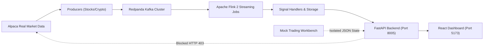

# GĐ24 — HOÀN THIỆN SẢN PHẨM & XÁC NHẬN BẢN PHÁT HÀNH (RELEASE CANDIDATE)
## TÀI LIỆU TỔNG QUAN KIẾN TRÚC VÀ TÍNH NĂNG TOÀN DIỆN

**Dự án:** `D:\AlgoTrading`  
**Giai đoạn:** GĐ24 — Product Finalization & Release Candidate  
**Giai đoạn trước:** GĐ23 — Product Acceptance & Paper Trading Readiness  
**Chế độ thực thi:** `TRADING_MODE=DRY_RUN` (Bảo vệ bất biến tại [`.env`](file:///d:/AlgoTrading/.env))  
**Cổng thực thi Paper:** `PaperExecutionGate` ĐÓNG (`is_gate_open=False`)  
**Phiên Ngâm GĐ18:** `CONDITIONALLY_ACCEPTED — SOAK IN PROGRESS` (Không gián đoạn)  
**Mã bản dựng (Release Candidate):** `v1.0.0-rc1`  

---

## 1. Giới Thiệu & Mục Tiêu GĐ24

Giai đoạn GĐ24 đánh dấu cột mốc chuyển dịch hệ thống **AlgoTrading** từ một chuỗi các module tích hợp đơn lẻ thành một **sản phẩm hoàn thiện toàn diện (Unified Commercial-Grade Product)**. Toàn bộ nền tảng được chuẩn hóa và kiểm thử nghiêm ngặt trên cả ba trục chức năng chính:

1. **Market Intelligence:** Hệ thống giám sát thị trường Stocks và Crypto thời gian thực, bảng tin tức tổng hợp, chỉ báo kỹ thuật định lượng và tín hiệu giao dịch phân tán từ Apache Flink.
2. **Portfolio & Order Management:** Cổng thông tin tài khoản, danh mục vị thế, sổ lệnh lịch sử và sổ cái nghiệp vụ Alpaca Paper ở chế độ **Chỉ Đọc (Read-Only)** với độ chính xác toán học tuyệt đối.
3. **Trading Simulation:** Trạm làm việc giao dịch mô phỏng (Trading Workbench) tích hợp Mock Broker hoàn chỉnh, cho phép thử nghiệm trọn vẹn vòng đời lệnh không phát sinh rủi ro tài chính hoặc ảnh hưởng luồng dữ liệu tự nhiên.

> [!IMPORTANT]
> Toàn bộ quá trình hoàn thiện sản phẩm GĐ24 tuân thủ nghiêm ngặt nguyên tắc an toàn: không gửi, sửa hoặc hủy bất kỳ lệnh nào trên Alpaca; không mở `PaperExecutionGate`; không xây dựng bất kỳ nhánh thực thi Live nào; và duy trì liên tục phiên ngâm độ bền GĐ18 trên cụm Flink/Redpanda.

---

## 2. Ba Trục Chức Năng Cốt Lõi (Core Functional Pillars)

```
+---------------------------------------------------------------------------------------------------------+
|                                ALGOTRADING SYSTEM ARCHITECTURE — V1.0.0-RC1                             |
+---------------------------------------------------------------------------------------------------------+
|                                                                                                         |
|  [PILLAR 1: MARKET INTELLIGENCE]                                                                        |
|  - Redpanda Stream Pipeline: Topic stock-prices, crypto-bars-1m, crypto-trades, crypto-news             |
|  - Apache Flink Streaming Engine: Strategy 1 Job & Crypto Dual SMA Strategy Job (6/6 tasks RUNNING)    |
|  - Real-time Candlestick & Technical Indicators: SMA(20), SMA(50), RSI, MACD, Volume Profile           |
|  - Market News & Macro Sentiment Engine: Phân loại sắc thái thị trường tự động                          |
|                                                                                                         |
|  [PILLAR 2: PORTFOLIO & ORDER MANAGEMENT (ALPACA PAPER READ-ONLY)]                                      |
|  - Tài khoản PA39W82P0X90: Tiền mặt $99,773.38, Sức mua margin Reg-T > $300,000                       |
|  - Vị thế nắm giữ thật: 1.0 cổ phiếu NVDA ($208.52) và 0.000120008 BTC ($9.78)                         |
|  - Lịch sử Lệnh: Truy vấn đa tiêu chí, đối soát thời gian thực qua TradingStream & REST                 |
|  - Sổ cái nghiệp vụ (Activities): 4 loại nghiệp vụ (JNLC, FILL, CFEE, FEE) qua 5 bản ghi chuẩn xác     |
|                                                                                                         |
|  [PILLAR 3: TRADING SIMULATION (MOCK WORKBENCH)]                                                        |
|  - Đặt lệnh đa dạng: Market, Limit, Stop, Stop-Limit, Trailing Stop                                     |
|  - Thực thi nâng cao: Lệnh phân số (Fractional Qty) và Lệnh theo giá trị tiền (Notional Value)          |
|  - Quản lý lệnh treo: Sửa lệnh tại chỗ (In-Flight Replace) và Hủy hàng loạt (Bulk Cancel)               |
|  - Cô lập trạng thái: Lưu trữ độc lập tại data/mock_broker/mock_broker_state.json                        |
|                                                                                                         |
+---------------------------------------------------------------------------------------------------------+
```

---

## 3. Kiến Trúc Luồng Dữ Liệu Đầu Cuối (End-to-End Data Flow)

Dữ liệu di chuyển xuyên suốt qua 5 tầng kiến trúc được bảo vệ bằng các chốt an toàn nghiêm ngặt:



- **Tầng Thu Thập (Ingestion Layer):** Producers thu nạp dữ liệu thị trường và đẩy vào các topic tự nhiên của Redpanda. Consumer lag duy trì ở mức $\text{Lag} \le 50$ (thực tế ghi nhận $\text{Lag} = 0$).
- **Tầng Xử Lý Luồng (Streaming Layer):** Cụm Flink duy trì 2 streaming jobs với 6/6 tasks hoạt động liên tục, định kỳ ghi checkpoint RocksDB với $0$ lỗi.
- **Tầng Điều Phối & An Toàn (API & Gate Layer):** FastAPI tiếp nhận truy vấn, kiểm soát quyền hạn bằng `PaperExecutionGate`. Nếu phát hiện yêu cầu ghi lệnh ra broker thật, hệ thống lập tức đánh chặn bằng mã lỗi `HTTP 403 Forbidden`.
- **Tầng Hiển Thị (UI Layer):** Ứng dụng React cung cấp bảng điều khiển trực quan, gắn nhãn nguồn dữ liệu minh bạch (`[ALPACA_PAPER]`, `[MOCK_BROKER]`, `[LIVE_STREAM]`) và cập nhật timestamp UTC đều đặn.

---

## 4. Tóm Tắt Kết Quả Kiểm Định Chất Lượng

Hệ thống đã vượt qua 100% các bài kiểm tra tự động và hồi quy:

- **Bộ kiểm định GĐ24:** [`tests/test_gd24_release_candidate.py`](file:///d:/AlgoTrading/tests/test_gd24_release_candidate.py) — Đạt **26 / 26 (100%)**
- **Kiểm thử hồi quy GĐ23:** [`tests/test_gd23_product_acceptance.py`](file:///d:/AlgoTrading/tests/test_gd23_product_acceptance.py) — Đạt **26 / 26 (100%)**
- **Kiểm thử hồi quy GĐ22:** [`tests/test_gd22_paper_execution_integration.py`](file:///d:/AlgoTrading/tests/test_gd22_paper_execution_integration.py) — Đạt **26 / 26 (100%)**
- **Kiểm thử hồi quy GĐ21:** [`tests/test_gd21_alpaca_paper_integration.py`](file:///d:/AlgoTrading/tests/test_gd21_alpaca_paper_integration.py) — Đạt **26 / 26 (100%)**
- **Kiểm thử hồi quy GĐ20:** [`tests/test_gd20_e2e_integration.py`](file:///d:/AlgoTrading/tests/test_gd20_e2e_integration.py) — Đạt **26 / 26 (100%)**
- **Tổng số ca kiểm thử thành công:** **130 / 130 (100%)**

---

## 5. Danh Mục Hồ Sơ Nghiệm Thu GĐ24

Toàn bộ tài liệu chi tiết của giai đoạn GĐ24 được lưu trữ tại thư mục `docs/`:

1. [GD24_PRODUCT_FINALIZATION.md](file:///d:/AlgoTrading/docs/GD24_PRODUCT_FINALIZATION.md) — Tổng quan kiến trúc và ba trục chức năng.
2. [GD24_UX_ACCEPTANCE.md](file:///d:/AlgoTrading/docs/GD24_UX_ACCEPTANCE.md) — Nghiệm thu giao diện, điều hướng, gắn nhãn nguồn dữ liệu và câu hỏi cốt lõi.
3. [GD24_WORKBENCH_FINALIZATION.md](file:///d:/AlgoTrading/docs/GD24_WORKBENCH_FINALIZATION.md) — Hoàn thiện trạm làm việc giao dịch mô phỏng Mock Broker.
4. [GD24_OPERATIONAL_READINESS.md](file:///d:/AlgoTrading/docs/GD24_OPERATIONAL_READINESS.md) — Đánh giá mức độ sẵn sàng vận hành, kịch bản điều hành và sức khỏe 5 trụ cột.
5. [GD24_SECURITY_REVIEW.md](file:///d:/AlgoTrading/docs/GD24_SECURITY_REVIEW.md) — Rà soát an toàn rào chắn, chế độ DRY_RUN và bảo mật khóa định danh.
6. [GD24_RELEASE_CANDIDATE.md](file:///d:/AlgoTrading/docs/GD24_RELEASE_CANDIDATE.md) — Hồ sơ chứng nhận bản phát hành Release Candidate v1.0.0-rc1.
7. [GD24_OPEN_FINDINGS.md](file:///d:/AlgoTrading/docs/GD24_OPEN_FINDINGS.md) — Sổ cái các phát hiện mở, giải trình toán học sức mua và đối soát Satoshi.
8. [GD24_ACCEPTANCE.md](file:///d:/AlgoTrading/docs/GD24_ACCEPTANCE.md) — Biên bản nghiệm thu tổng thể và cam kết chất lượng GĐ24.

