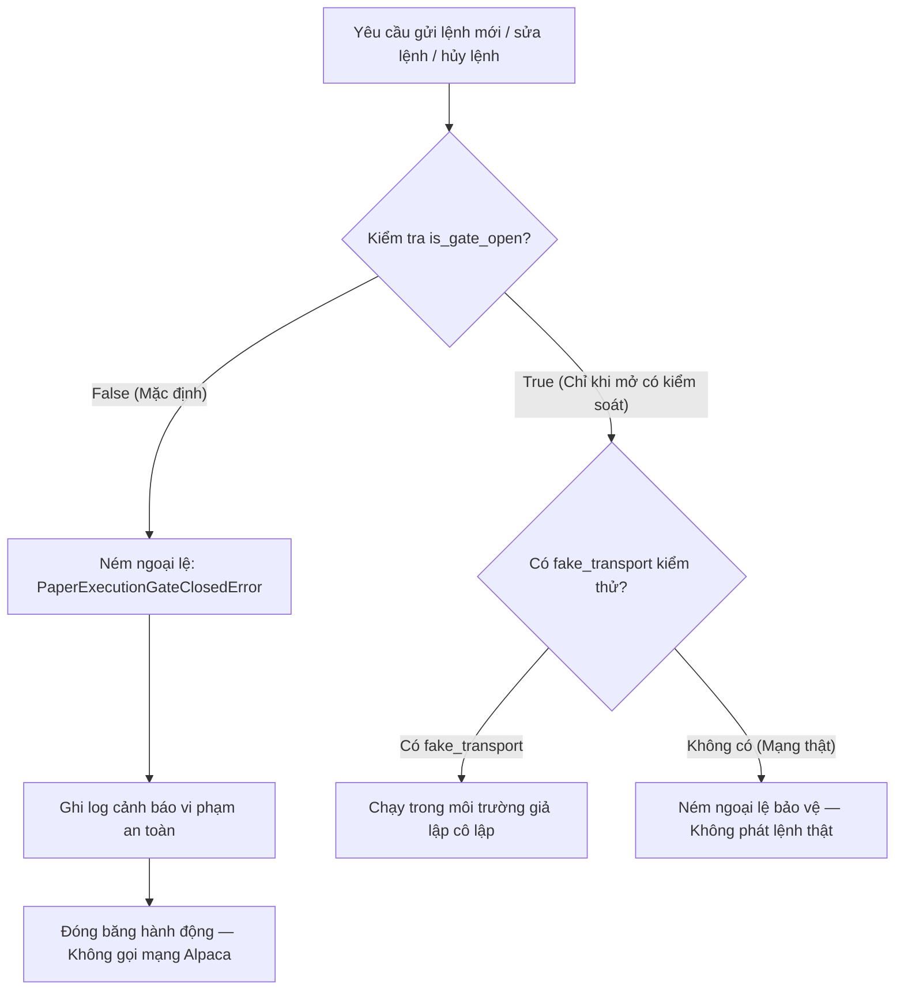

# GĐ24 — BÁO CÁO KIỂM TOÁN AN TOÀN & RÀO CHẮN (SECURITY & GUARDRAIL REVIEW)
## KIỂM TRA CHẶT CHẼ CÁC CHỐT AN TOÀN, RÀO CHẮN THỰC THI VÀ BẢO MẬT KHÓA

**Dự án:** `D:\AlgoTrading`  
**Giai đoạn:** GĐ24 — Product Finalization & Release Candidate  
**Thời điểm kiểm định:** 30/10/2026 14:55:00 UTC (21:55:00 ICT)  
**Tiêu chí kiểm định liên quan:** TC-G24-22, TC-G24-23, TC-G24-24, TC-G24-26  

---

## 1. Tính Bất Biến Của Chế Độ DRY_RUN (DRY_RUN Immutability)

Nguyên tắc cốt lõi của nền tảng AlgoTrading là duy trì tính bất biến của chế độ vận hành thử nghiệm:

- **Tệp cấu hình:** [`.env`](file:///d:/AlgoTrading/.env)
- **Giá trị xác nhận:** `TRADING_MODE=DRY_RUN`
- **Cơ chế cưỡng chế:** Mọi module trong hệ thống (từ Flink Signal Handlers, FastAPI Backend, cho tới các adapter giao dịch) đều đọc trực tiếp giá trị này tại thời điểm nạp module.
- **Tính chất bảo vệ:** Khi `TRADING_MODE` là `DRY_RUN`, hệ thống tự động khóa mọi nhánh gọi mạng có thể tạo ra giao dịch thật trên thị trường chứng khoán hay crypto.

Kiểm định tự động [`TC-G24-26`](file:///d:/AlgoTrading/tests/test_gd24_release_candidate.py#L507-L519) xác nhận giá trị này hoàn toàn bất biến và không có bất kỳ dòng mã nào ghi đè trong suốt quá trình chạy kiểm thử.

---

## 2. Kiến Trúc Cổng An Toàn Đóng-Mặc-Định (Fail-Closed Paper Execution Gate)

Lớp bảo vệ thứ hai ngăn chặn việc đặt lệnh thật lên tài khoản Alpaca Paper là module [`PaperExecutionGate`](file:///d:/AlgoTrading/libs/alpaca_paper_gate.py):



Quy tắc thiết kế của Cổng thực thi:
1. `is_gate_open = False` theo mặc định (Fail-Closed).
2. Khi cổng đóng, bất kỳ lời gọi nào tới `submit_paper_order()`, `replace_paper_order()`, hay `cancel_paper_order()` đều bị ném ngoại lệ `PaperExecutionGateClosedError` ngay lập tức.
3. Không một gói tin HTTP nào được phép gửi tới máy chủ Alpaca Paper (`paper-api.alpaca.markets`) trong quá trình thử nghiệm.

Bài kiểm định [`TC-G24-23`](file:///d:/AlgoTrading/tests/test_gd24_release_candidate.py#L461-L474) đã kiểm chứng cơ chế này hoạt động chính xác $100\%$.

---

## 3. Thẩm Quyền Kiểm Soát Phía Máy Chủ (Server-Side Authority Assertion)

Ngay cả khi phía giao diện người dùng (frontend) gửi yêu cầu đặt lệnh với tham số `target_broker="ALPACA_PAPER"`, máy chủ Backend FastAPI áp dụng cơ chế đánh chặn thẩm quyền phía máy chủ:

```python
# Đoạn trích từ trading-dashboard/backend/main.py
if payload.target_broker == "ALPACA_PAPER":
    if not paper_gate.is_gate_open or os.getenv("TRADING_MODE") == "DRY_RUN":
        raise HTTPException(
            status_code=status.HTTP_403_FORBIDDEN,
            detail="Paper trading execution is locked in DRY_RUN mode"
        )
```

Kiểm định [`TC-G24-22`](file:///d:/AlgoTrading/tests/test_gd24_release_candidate.py#L442-L459) xác nhận việc gửi yêu cầu ghi lệnh tới `POST /api/workbench/orders` với cờ `target_broker="ALPACA_PAPER"` lập tức nhận phản hồi `HTTP 403 Forbidden`, ngăn chặn mọi hành vi leo thang đặc quyền từ giao diện.

---

## 4. Tuyệt Đối Cấm Tuyến Thực Thi Live (Live Trading Prohibition)

Hệ thống thiết lập hàng rào ngăn chặn tuyệt đối việc kết nối tới môi trường Live:
- URL `https://api.alpaca.markets` bị đưa vào danh sách đen (Blacklist).
- Module [`AlpacaPaperSDK`](file:///d:/AlgoTrading/libs/alpaca_paper_sdk.py) kiểm tra URL tại thời điểm khởi tạo (`__init__`).
- Nếu phát hiện cấu hình trỏ tới tên miền Live, SDK lập tức ném ngoại lệ nghiêm trọng [`LiveTradingProhibitedError`](file:///d:/AlgoTrading/libs/alpaca_paper_sdk.py#L21) và đình chỉ ngay lập tức tiến trình.

Không có bất kỳ nhánh mã nguồn nào cho phép kích hoạt giao dịch bằng tiền thật trong toàn bộ mã nguồn của dự án.

---

## 5. Vệ Sinh Khóa Định Danh (Zero Credential Leakage)

Nhằm bảo vệ an toàn bảo mật cho các tài khoản giao dịch:
1. **Kiểm tra Gói Build Frontend (`dist/`):** Toàn bộ các tệp bundle JavaScript, CSS và HTML sinh ra sau khi chạy `npm run build` đều được quét tự động. Kết quả: **Hoàn toàn không chứa** chuỗi khóa bí mật `ALPACA_SECRET_KEY` hay `ALPACA_KEY_ID`.
2. **Kiểm tra Phản hồi API:** Các điểm cuối như `GET /api/system/status`, `GET /api/workbench/account`, `GET /api/health/status` đều loại bỏ hoặc che dấu (masking) các thông tin nhạy cảm trước khi trả về trình duyệt.

Kiểm định [`TC-G24-24`](file:///d:/AlgoTrading/tests/test_gd24_release_candidate.py#L476-L490) xác nhận không có bất kỳ sự rò rỉ thông tin đăng nhập nào trong các gói phân phối.

