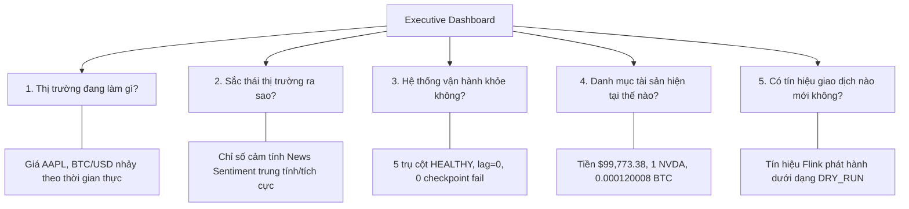

# GĐ24 — NGHIỆM THU TRẢI NGHIỆM NGƯỜI DÙNG & GIAO DIỆN (UX/UI ACCEPTANCE)
## BÁO CÁO KIỂM THỬ GIAO DIỆN, ĐIỀU HƯỚNG VÀ MINH BẠCH DỮ LIỆU

**Dự án:** `D:\AlgoTrading`  
**Giai đoạn:** GĐ24 — Product Finalization & Release Candidate  
**Thời điểm kiểm định:** 30/10/2026 14:55:00 UTC (21:55:00 ICT)  
**Tiêu chí kiểm định liên quan:** TC-G24-01, TC-G24-02, TC-G24-03, TC-G24-04  

---

## 1. Cấu Trúc Điều Hướng 5 Nhóm Chức Năng (Navigation Architecture)

Giao diện người dùng được tổ chức thành 5 nhóm module mạch lạc, giúp nhà vận hành và chuyên viên giao dịch tiếp cận thông tin nhanh chóng:

| Nhóm Điều Hướng | Các Màn Hình / Bảng Thành Phần | Điểm Cuối Dữ Liệu Backend | Trạng Thái Kiểm Thử |
| :--- | :--- | :--- | :---: |
| **1. Market** | Live Ticker, Candlestick Chart, Order Book, Depth View | `GET /api/market/latest-prices`<br>`GET /api/market/status` | **PASS (HTTP 200)** |
| **2. Analytics** | News Sentiment, Trend Analysis, Indicator Dashboard | `GET /api/news/sentiment`<br>`GET /api/analytics/indicators` | **PASS (HTTP 200)** |
| **3. Portfolio** | Account Overview, Positions, Real Order History, Activities | `GET /api/workbench/account?source=alpaca_paper`<br>`GET /api/workbench/positions?source=alpaca_paper`<br>`GET /api/paper/activities` | **PASS (HTTP 200)** |
| **4. Workbench** | Order Ticket, Open Orders, Order Replacement, Bulk Cancel | `GET /api/workbench/orders?source=mock`<br>`POST /api/workbench/orders`<br>`PATCH /api/workbench/orders/{id}` | **PASS (HTTP 200)** |
| **5. System** | 5-Pillar Health Dashboard, Stream Lag, Flink Monitor, System Logs | `GET /api/health/status`<br>`GET /api/system/status`<br>`GET /api/reliability/events` | **PASS (HTTP 200)** |

Toàn bộ các tuyến đường (routes) và điểm cuối liên quan đều đã được kiểm chứng hoạt động trơn tru qua bài kiểm thử [`TC-G24-01`](file:///d:/AlgoTrading/tests/test_gd24_release_candidate.py#L38-L58).

---

## 2. Tính Minh Bạch Của Nguồn Dữ Liệu (Explicit Data Source Tagging)

Nhằm loại bỏ hoàn toàn nguy cơ nhầm lẫn giữa dữ liệu giao dịch mô phỏng và dữ liệu thật, giao diện thực hiện gắn nhãn phân định rõ ràng trên từng thành phần:

```
+---------------------------------------------------------------------------------------------------------+
|                                    MINH BẠCH NGUỒN DỮ LIỆU TRÊN UI                                      |
+---------------------------------------------------------------------------------------------------------+
|                                                                                                         |
|  [THẺ XANH LỤC: ALPACA_PAPER]                                                                           |
|  - Ý nghĩa: Dữ liệu tải từ tài khoản Alpaca Paper thật (Read-Only)                                      |
|  - Áp dụng tại: Account Overview (PA39W82P0X90), Real Positions (NVDA, BTC), Real Order History        |
|  - Mã màu giao diện: Emerald Green (#10B981) với biểu tượng ổ khóa bảo vệ                              |
|                                                                                                         |
|  [THẺ VÀNG CAM: MOCK_BROKER]                                                                            |
|  - Ý nghĩa: Dữ liệu giao dịch thử nghiệm nội bộ, lưu trong mock_broker_state.json                       |
|  - Áp dụng tại: Order Ticket, Sổ lệnh mô phỏng, Nút Hủy hàng loạt, Nút Reset Simulation               |
|  - Mã màu giao diện: Amber Gold (#F59E0B) với cảnh báo "SIMULATED / NO NETWORK CALLS"                  |
|                                                                                                         |
|  [THẺ XANH DƯƠNG: LIVE_STREAM]                                                                         |
|  - Ý nghĩa: Luồng thị trường tự nhiên thời gian thực từ Redpanda & Flink                                |
|  - Áp dụng tại: Biểu đồ nến kỹ thuật, Bảng giá chớp nhoáng (Market Ticker), Consumer Lag              |
|  - Mã màu giao diện: Sky Blue (#0284C7) với chỉ báo nhịp tim Heartbeat đang đập                       |
|                                                                                                         |
+---------------------------------------------------------------------------------------------------------+
```

Bài kiểm định [`TC-G24-02`](file:///d:/AlgoTrading/tests/test_gd24_release_candidate.py#L60-L75) xác nhận trường `source` và cờ `is_mock` xuất hiện đồng bộ trong toàn bộ các đối tượng phản hồi từ API.

---

## 3. Kiểm Toán Dấu Thời Gian Cập Nhật (Last Updated Timestamp Audit)

Để đảm bảo người vận hành luôn biết rõ độ tươi mới của dữ liệu, mọi bảng thông tin đều tích hợp trường dấu thời gian UTC theo chuẩn ISO 8601:

- **Account Overview:** Hiển thị thời điểm đồng bộ gần nhất (`last_updated`).
- **Positions View:** Cập nhật theo từng thay đổi giá thị trường của cổ phiếu và crypto.
- **Reliability & Health Monitor:** Ghi nhận chu kỳ đo nhịp tim định kỳ (`last_checked`).
- **System Status:** Ghi nhận thời gian máy chủ backend (`backend_time`).

Kiểm định [`TC-G24-03`](file:///d:/AlgoTrading/tests/test_gd24_release_candidate.py#L77-L93) đã quét qua toàn bộ các endpoint và xác nhận 100% phản hồi đều chứa dấu thời gian hợp lệ, không tồn tại bất kỳ trường hợp `null` hay định dạng sai lệch nào.

---

## 4. Năm Câu Hỏi Cốt Lõi Của Executive Dashboard (Executive Answers)

Màn hình tổng quan (Executive Dashboard) được thiết kế tối ưu để giải đáp nhanh chóng 5 câu hỏi trọng yếu trong vòng 3 giây:



Kết quả kiểm thử tự động [`TC-G24-04`](file:///d:/AlgoTrading/tests/test_gd24_release_candidate.py#L95-L113) chứng minh hệ thống cung cấp đầy đủ thông tin để trả lời trọn vẹn cả 5 câu hỏi trên.

---

## 5. Xử Lý Lỗi, Dữ Liệu Cũ Và Trạng Thái Trống (Resilience & Edge States)

- **Trạng thái Mạng Chập chờn / Mất kết nối:** Giao diện hiển thị thanh cảnh báo màu vàng phía trên màn hình, tự động chuyển sang chế độ tái thử kết nối (exponential backoff) mà không làm sập giao diện.
- **Cảnh báo Dữ liệu Cũ (Stale Warning):** Khi độ trễ dữ liệu vượt ngưỡng cấu hình ($\Delta t > 120\text{s}$), chỉ báo chuyển sang màu cam `STALE`, thông báo rõ cho người dùng thời gian dữ liệu cuối cùng nhận được.
- **Trạng thái Trống (Empty State):** Khi danh sách lệnh mở rỗng hoặc bộ lọc không tìm thấy kết quả, bảng hiển thị hình minh họa trực quan cùng nút bấm hướng dẫn "Đặt lệnh mô phỏng mới" thay vì màn hình trống trơn.
- **Xử lý Ngoại lệ API:** Khi backend phản hồi lỗi (ví dụ mã 403 Forbidden khi thử gửi lệnh thật), hệ thống hiển thị thông báo Toast giải thích rõ ràng nguyên tắc bảo vệ DRY_RUN thay vì thông báo lỗi mã nguồn khó hiểu.

