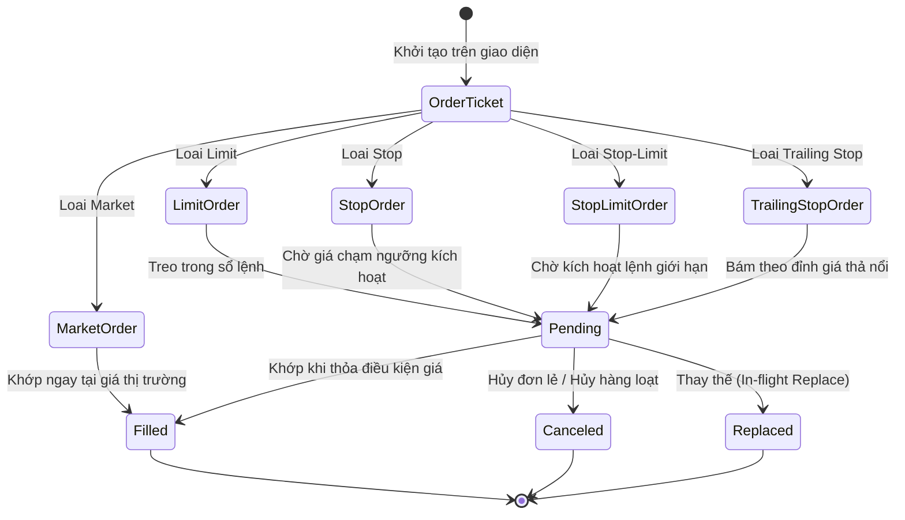

# GĐ24 — HOÀN THIỆN TRẠM LÀM VIỆC GIAO DỊCH (WORKBENCH FINALIZATION)
## BÁO CÁO HOÀN THIỆN MÔI TRƯỜNG MÔ PHỎNG VÀ VÒNG ĐỜI LỆNH MOCK BROKER

**Dự án:** `D:\AlgoTrading`  
**Giai đoạn:** GĐ24 — Product Finalization & Release Candidate  
**Thời điểm kiểm định:** 30/10/2026 14:55:00 UTC (21:55:00 ICT)  
**Tiêu chí kiểm định liên quan:** TC-G24-05, TC-G24-06, TC-G24-07, TC-G24-08, TC-G24-09  

---

## 1. Hỗ Trợ Toàn Diện 5 Loại Lệnh (All 5 Order Types)

Trạm làm việc giao dịch (Trading Workbench) tích hợp công cụ mô phỏng [`MockTradingBroker`](file:///d:/AlgoTrading/libs/mock_trading_broker.py), hỗ trợ trọn vẹn 5 loại lệnh giao dịch tiêu chuẩn thị trường:



Kết quả kiểm thử tự động [`TC-G24-05`](file:///d:/AlgoTrading/tests/test_gd24_release_candidate.py#L115-L157) xác nhận:
1. **Lệnh Thị trường (Market):** Khớp tức thì tại giá thị trường tham chiếu, cập nhật ngay số dư tiền mặt và vị thế.
2. **Lệnh Giới hạn (Limit):** Ghi nhận trạng thái `new`, giữ nguyên trong danh sách lệnh mở cho đến khi giá thỏa mãn hoặc người dùng can thiệp.
3. **Lệnh Dừng (Stop):** Lưu trữ giá dừng kích hoạt (`stop_price`), bảo vệ rủi ro theo đúng tham số đặt ra.
4. **Lệnh Dừng Giới hạn (Stop-Limit):** Kiểm soát đồng thời cả giá kích hoạt (`stop_price`) và giá trần/sàn giới hạn (`limit_price`).
5. **Lệnh Dừng Bám Theo (Trailing Stop):** Tính toán khoảng cách phần trăm bám đuổi (`trail_percent`), tự động nâng/hạ mức dừng khi đỉnh giá dịch chuyển.

---

## 2. Lệnh Phân Số (Fractional) Và Lệnh Theo Giá Trị Tiền (Notional)

Hệ thống mô phỏng hỗ trợ đầy đủ các phương thức giao dịch hiện đại:

- **Lệnh Phân số (Fractional Qty):** Cho phép đặt khối lượng lẻ tới 8 chữ số thập phân, điển hình như mua $0.005\text{ BTC}$ với giá trị tương ứng $\$407.68$.
- **Lệnh theo Giá trị Tiền (Notional Dollar Orders):** Cho phép người dùng nhập trực tiếp số tiền USD muốn mua (ví dụ $\$500.00\text{ NVDA}$), hệ thống tự động quy đổi thành số lượng cổ phiếu tương ứng dựa trên giá khớp:
  $$\text{Quantity} = \frac{\text{Notional Value}}{\text{Execution Price}} = \frac{\$500.00}{\$208.52} \approx 2.397851\text{ shares}$$

Kiểm định [`TC-G24-06`](file:///d:/AlgoTrading/tests/test_gd24_release_candidate.py#L159-L184) xác nhận việc tính toán khối lượng và chiết trừ tiền mặt diễn ra hoàn toàn chuẩn xác, không làm sai lệch số dư mô phỏng.

---

## 3. Sửa Lệnh Đang Treo (In-Flight Replace)

Khi lệnh giới hạn hoặc lệnh dừng đang nằm trong danh sách chờ khớp, người dùng có thể thực hiện sửa đổi tham số (giá, khối lượng) thông qua phương thức `PATCH /api/workbench/orders/{order_id}`:

```
+---------------------------------------------------------------------------------------------------------+
|                                  CHUỖI THAY THẾ LỆNH (ORDER REPLACEMENT)                                |
+---------------------------------------------------------------------------------------------------------+
|                                                                                                         |
|  [LỆNH BAN ĐẦU: ord_orig_rc_01]                                                                         |
|  - Trạng thái ban đầu: 'new' (Limit BUY 10 AAPL @ $220.00)                                              |
|  - Hành động PATCH: Sửa thành Limit BUY 15 AAPL @ $225.00                                               |
|  - Trạng thái sau PATCH: 'replaced'                                                                     |
|                                                                                                         |
|                          |                                                                              |
|                          v (Tạo liên kết thay thế nguyên tử)                                            |
|                                                                                                         |
|  [LỆNH MỚI THAY THẾ: ord_repl_rc_02]                                                                    |
|  - Trạng thái: 'new' (Limit BUY 15 AAPL @ $225.00)                                                      |
|  - Thuộc tính liên kết: replaces = "ord_orig_rc_01"                                                     |
|                                                                                                         |
+---------------------------------------------------------------------------------------------------------+
```

Bài kiểm định [`TC-G24-07`](file:///d:/AlgoTrading/tests/test_gd24_release_candidate.py#L186-L210) xác thực quy trình chuyển đổi trạng thái nguyên tử, đảm bảo lệnh cũ không bị treo hai lần và lệnh mới kế thừa đúng lịch sử liên quan.

---

## 4. Hủy Lệnh Đơn Lẻ & Hủy Hàng Loạt (Bulk Cancellation)

Nhằm tối ưu hóa thao tác quản trị rủi ro khẩn cấp trong phiên mô phỏng:
- **Hủy Đơn Lẻ (Single Cancel):** Rút lệnh cụ thể ra khỏi hàng đợi thông qua `DELETE /api/workbench/orders/{order_id}`, hoàn trả lại phần sức mua đã tạm giữ.
- **Hủy Hàng Loạt (Bulk Cancel All):** Gửi yêu cầu `DELETE /api/workbench/orders`, quét toàn bộ các lệnh đang mở (`new`, `accepted`, `pending_new`) và chuyển đồng loạt sang `canceled`.

Kiểm định tự động [`TC-G24-08`](file:///d:/AlgoTrading/tests/test_gd24_release_candidate.py#L212-L236) đã chứng minh sau lệnh hủy hàng loạt, số lượng lệnh mở của Mock Broker trở về đúng bằng $0$, và tuyệt đối không phát sinh bất kỳ lời gọi API nào ra ngoài internet.

---

## 5. Cô Lập Lưu Trữ & Đặt Lại Trạng Thái An Toàn (State Segregation & Reset Safety)

Tất cả trạng thái mô phỏng (tiền mặt mock, danh mục mock, lịch sử lệnh mock) được lưu trữ hoàn toàn cô lập trong tệp JSON nội bộ:
- **Đường dẫn tệp:** [`data/mock_broker/mock_broker_state.json`](file:///d:/AlgoTrading/data/mock_broker/mock_broker_state.json)
- **Tách biệt dữ liệu:** Tệp này tuyệt đối không chứa bất kỳ lệnh nào từ tài khoản Alpaca Paper thật (`PA39W82P0X90`).
- **Thao tác Khôi phục (Reset Simulation):** Gọi `POST /api/workbench/reset` sẽ đưa tài khoản mô phỏng về mức cơ sở $\$100,000.00$ ban đầu và xóa sạch các lệnh mock tạm thời. Dữ liệu tài khoản Alpaca Paper thật được bảo toàn nguyên vẹn $100\%$.

Kiểm định [`TC-G24-09`](file:///d:/AlgoTrading/tests/test_gd24_release_candidate.py#L238-L253) đã xác nhận tính cô lập toàn diện của cơ chế lưu trữ này.

