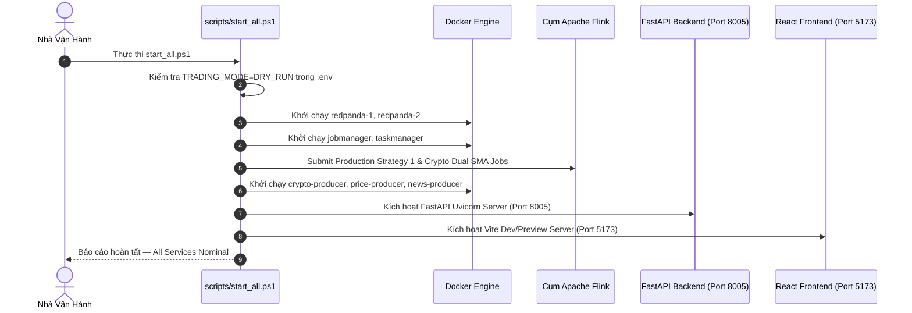

# GĐ25 — SỔ TAY VẬN HÀNH CHUẨN HÓA SẢN XUẤT (FINAL PRODUCTION RUNBOOK)
## QUY TRÌNH VẬN HÀNH TIÊU CHUẨN (SOP), QUẢN LÝ DỊCH VỤ VÀ XỬ LÝ SỰ CỐ

**Dự án:** `D:\AlgoTrading`  
**Phiên bản hệ thống:** `v1.0.0`  
**Giai đoạn:** GĐ25 — Final Release & Operational Sign-off  
**Phân nhóm nhiệm vụ:** GĐ25.2 / GĐ25.4 — Final Runbook  
**Thời điểm phê duyệt:** 31/10/2026 14:00:00 UTC (21:00:00 ICT)  

---

## 1. Quy Trình Khởi Động Toàn Hệ Thống (Standard System Startup)

Để khởi động toàn bộ nền tảng theo đúng thứ tự phụ thuộc, người vận hành sử dụng kịch bản tiêu chuẩn:

```powershell
# Chạy từ thư mục gốc của repository D:\AlgoTrading
powershell -File scripts/start_all.ps1
```

### Trình Tự Thực Thi Tự Động Của Kịch Bản:


---

## 2. Quy Trình Dừng Hệ Thống Êm Ái (Graceful System Shutdown)

Khi cần bảo trì định kỳ hoặc sao lưu dữ liệu, thực hiện dừng hệ thống để bảo toàn offset:

```powershell
# Dừng tuần tự các thành phần mà không gây mất mát dữ liệu
powershell -File scripts/stop_all.ps1
```

1. Dừng các Producers và Signal Handlers trước nhằm ngắt luồng sự kiện mới vào Kafka.
2. Dừng máy chủ Backend và máy chủ Frontend.
3. Cho phép cụm Apache Flink hoàn tất lượt ghi RocksDB checkpoint cuối cùng.
4. Dừng các container JobManager, TaskManager và Redpanda Brokers.

---

## 3. Quy Trình Giám Sát Sức Khỏe & Độ Trễ Định Kỳ (Routine Monitoring)

Người vận hành có thể kiểm tra nhanh tình trạng hệ thống bất kỳ lúc nào bằng lệnh:

```powershell
powershell -File scripts/status_all.ps1
```

### Các Ngưỡng Giám Sát Cần Lưu Ý (SLAs & Thresholds):
| Chỉ Số Đo Lường | Ngưỡng Bình Thường | Ngưỡng Cảnh Báo (Warning) | Hành Động Xử Lý Khi Vượt Ngưỡng |
| :--- | :---: | :---: | :--- |
| **Consumer Lag (Redpanda)** | $\text{Lag} = 0$ | $\text{Lag} > 50$ sự kiện | Kiểm tra tải CPU của Flink và Handlers; khởi động lại nếu cần |
| **Độ trễ Crypto 24/7** | $\Delta t < 120\text{s}$ | $\Delta t > 300\text{s}$ | Kiểm tra kết nối mạng WebSocket tới máy chủ Alpaca |
| **Độ trễ Cổ phiếu ngoài giờ** | `IDLE_MARKET_CLOSED` | Báo lỗi kết nối | Kiểm tra đồng hồ thị trường (`market_clock`) |
| **Tasks Flink RUNNING** | $12 / 12\text{ tasks}$ | $< 12\text{ tasks}$ | Chạy `recover_all.ps1` để submit lại streaming jobs |
| **Lỗi Checkpoint Flink** | $0\text{ lỗi}$ | $\ge 1\text{ lỗi}$ | Kiểm tra dung lượng ổ cứng chứa thư mục RocksDB |

---

## 4. Kịch Bản Khôi Phục Sự Cố Khẩn Cấp (Emergency Disaster Recovery)

Khi xảy ra sự cố đột ngột (như mất điện máy chủ trạm, đứt kết nối mạng hoặc container bị dừng bất thường):

```powershell
powershell -File scripts/recover_all.ps1
```

### Quy Trình Tự Động Hàn Gắn Của `recover_all.ps1`:
1. **Kiểm tra Daemon Docker:** Kích hoạt lại tiến trình engine qua Scheduled Task nếu dịch vụ bị đóng băng.
2. **Khôi phục Cụm Redpanda & Flink:** Khởi động lại các container bị thoát mã khác 0 (`Exited (255)`).
3. **Tái Đăng Ký Streaming Jobs:** Tự động kiểm tra REST API Flink (`/jobs/overview`); nếu thiếu job, tự động thực thi lại các tệp submit SQL (`ddl_production.sql` và `ddl_crypto.sql`).
4. **Tái Đồng Bộ REST Bộ Đệm Lệnh (REST Reconciliation):** Bù đắp các sự kiện lệnh bị mất trong thời gian ngắt luồng WebSocket.
5. **Khôi Phục Trạng Thái Mô Phỏng:** Nạp lại bản chụp gần nhất từ `data/backups/` nếu tệp trạng thái bị xung đột.

---

## 5. Danh Mục Cổng Mạng & Điểm Cuối Dịch Vụ Cần Ghi Nhớ

- **Giao diện Người Dùng React:** `http://localhost:5173/`
- **FastAPI Backend Swagger Docs:** `http://127.0.0.1:8005/docs`
- **FastAPI Backend Health Telemetry:** `http://127.0.0.1:8005/api/system/status`
- **Apache Flink JobManager Web UI:** `http://localhost:8081/`
- **Redpanda External Kafka Ports:** `localhost:9092`, `localhost:9093`

