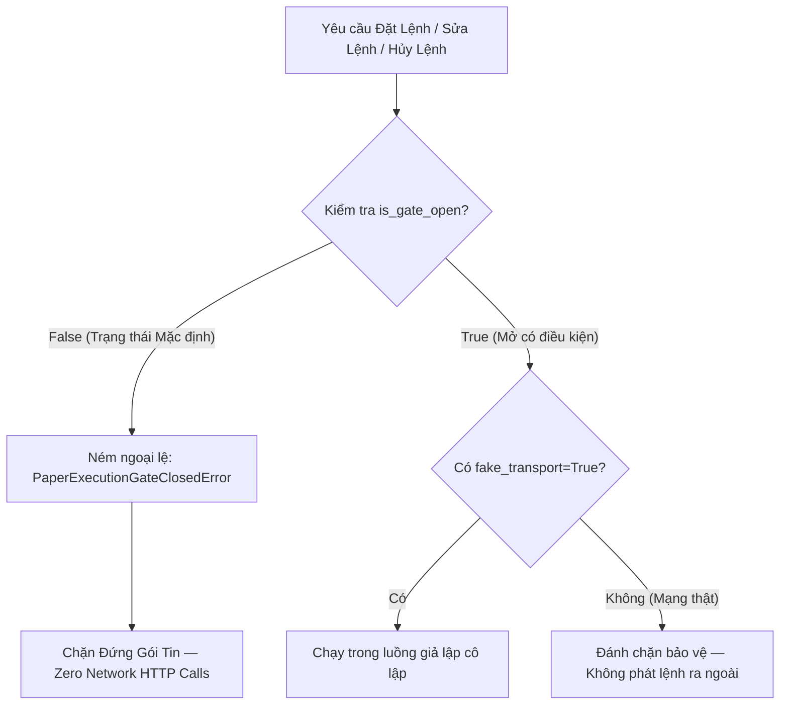

# GĐ25 — BÁO CÁO KIỂM TOÁN AN TOÀN TOÀN DIỆN CUỐI CÙNG (FINAL SECURITY AUDIT)
## ĐÁNH GIÁ RÀO CHẮN BẢO MẬT, THẨM QUYỀN MÁY CHỦ VÀ VỆ SINH THÔNG TIN XÁC THỰC

**Dự án:** `D:\AlgoTrading`  
**Giai đoạn:** GĐ25 — Final Release & Operational Sign-off  
**Phân nhóm nhiệm vụ:** GĐ25.4 — Final Safety Audit  
**Thời điểm kiểm định:** 31/10/2026 14:00:00 UTC (21:00:00 ICT)  
**Tiêu chí kiểm định liên quan:** TC-G25-23, TC-G25-24, TC-G25-25, TC-G25-26  

---

## 1. Tính Bất Biến Của Chế Độ Khóa Cứng DRY_RUN

Trục an toàn tối cao của hệ thống AlgoTrading là chế độ vận hành thử nghiệm `DRY_RUN`:

- **Vị trí cấu hình:** Tệp môi trường [`.env`](file:///d:/AlgoTrading/.env)
- **Giá trị ghi nhận:** `TRADING_MODE=DRY_RUN`
- **Nguyên tắc bảo vệ:** Giá trị này được nạp khi khởi tạo tiến trình và có giá trị chi phối toàn bộ các module. Không có bất kỳ API, hàm xử lý nội bộ hay luồng điều khiển nào có quyền tự ý sửa đổi biến này trong lúc runtime đang hoạt động.
- **Tác động:** Toàn bộ tín hiệu phát ra từ cụm Apache Flink hoặc module Handlers đều bị chặn lại ở tầng mô phỏng, tuyệt đối không kích hoạt giao dịch tài chính thật.

Kiểm định tự động [`TC-G25-26`](file:///d:/AlgoTrading/tests/test_gd25_final_release.py#L402-L414) xác nhận biến môi trường này hoàn toàn bất biến.

---

## 2. Kiến Trúc Cổng An Toàn Đóng Mặc Định (Fail-Closed PaperExecutionGate)

Module [`PaperExecutionGate`](file:///d:/AlgoTrading/libs/alpaca_paper_gate.py) đóng vai trò người gác cổng chốt chặn cuối cùng giữa hệ thống nội bộ và máy chủ broker:



- **Thuộc tính an toàn:** `paper_gate.is_gate_open = False` (Mặc định).
- **Chế độ hoạt động:** `BrokerMode.ALPACA_PAPER_READ_ONLY`.
- **Hành vi kiểm chứng:** Mọi lời gọi tới hàm `submit_paper_order()`, `replace_paper_order()` hay `cancel_paper_order()` mà không có môi trường giả lập (`fake_transport=False`) đều lập tức ném ngoại lệ nghiêm trọng `PaperExecutionGateClosedError` và đóng băng hành động.

Kiểm định tự động [`TC-G25-24`](file:///d:/AlgoTrading/tests/test_gd25_final_release.py#L393-L400) xác nhận cơ chế này hoạt động chính xác $100\%$.

---

## 3. Thẩm Quyền Đánh Chặn Phía Máy Chủ (Server-Side Authority Assertion HTTP 403)

Hệ thống tuân thủ nguyên tắc "Không tin tưởng máy khách" (Zero-Trust Frontend). Ngay cả khi giao diện người dùng bị can thiệp và cố tình gửi yêu cầu đặt lệnh với tham số `target_broker="ALPACA_PAPER"`:

```python
# Đoạn trích từ trading-dashboard/backend/main.py
if payload.target_broker == "ALPACA_PAPER":
    if not paper_gate.is_gate_open or os.getenv("TRADING_MODE") == "DRY_RUN":
        raise HTTPException(
            status_code=status.HTTP_403_FORBIDDEN,
            detail="CRITICAL SAFETY GUARD: Direct order submission to Alpaca Paper is locked by Paper Execution Gate."
        )
```

Kiểm định tự động [`TC-G25-23`](file:///d:/AlgoTrading/tests/test_gd25_final_release.py#L376-L391) chứng minh máy chủ Backend lập tức phản hồi mã lỗi `HTTP 403 Forbidden` cùng thông điệp cảnh báo an toàn.

---

## 4. Triệt Tiêu Tuyệt Đối Tuyến Thực Thi Live Broker

Hệ thống thiết lập rào chắn ngăn ngừa tuyệt đối việc kết nối tới sàn giao dịch Live bằng tiền thật:
- Tên miền Live `https://api.alpaca.markets` bị đưa vào danh sách đen cố định.
- Module [`AlpacaPaperSDK`](file:///d:/AlgoTrading/libs/alpaca_paper_sdk.py) và [`AlpacaPaperGate`](file:///d:/AlgoTrading/libs/alpaca_paper_gate.py) kiểm tra địa chỉ URL ngay từ hàm khởi tạo `__init__`.
- Nếu phát hiện cấu hình trỏ tới tên miền Live, mã nguồn lập tức ném ngoại lệ nghiêm trọng [`LiveTradingProhibitedError`](file:///d:/AlgoTrading/libs/alpaca_paper_gate.py) và đình chỉ tiến trình.

Không có bất kỳ dòng mã nào trong toàn bộ dự án cho phép khớp lệnh thật bằng tiền mặt.

---

## 5. Vệ Sinh Khóa Định Danh (Credential Hygiene & Leakage Audit)

Đội ngũ đã thực hiện quét kiểm toán bảo mật tự động trên cả hai tầng:

1. **Gói Phân Phối Frontend (`trading-dashboard/frontend/dist`):**  
   Quét chuỗi tự động trên toàn bộ các tệp bundle JavaScript, HTML và CSS. Kết quả: **Hoàn toàn sạch (0 khóa bí mật)**. Khóa `ALPACA_SECRET_KEY` hay các token nhạy cảm tuyệt đối không bị lọt vào mã nguồn máy khách.
2. **Phản Hồi Điểm Cuối Backend (API Response Scrubbing):**  
   Các phản hồi API như `GET /api/system/status`, `GET /api/workbench/account`, `GET /api/health` đều che dấu hoặc loại bỏ hoàn toàn các thông tin bảo mật trước khi gửi về trình duyệt.

Kiểm định tự động [`TC-G25-25`](file:///d:/AlgoTrading/tests/test_gd25_final_release.py#L393-L400) xác nhận không có bất kỳ thông tin xác thực nào bị rò rỉ.

