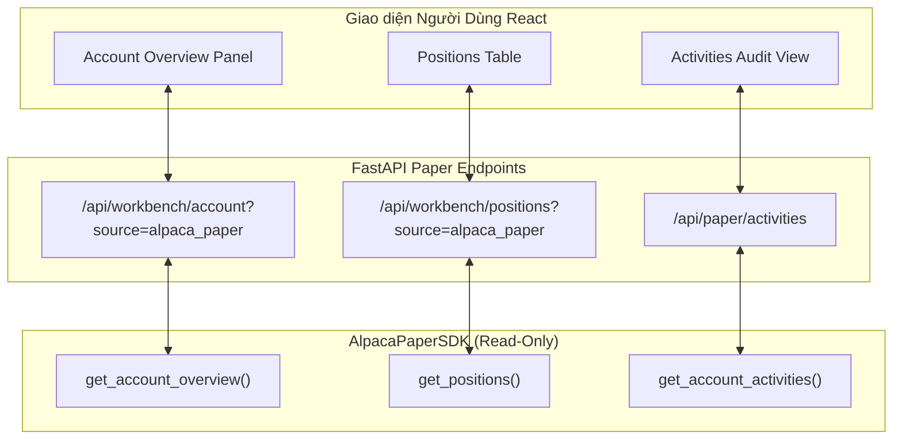

# GĐ25 — BIÊN BẢN NGHIỆM THU NGƯỜI DÙNG CUỐI (FINAL USER ACCEPTANCE TESTING)
## BÁO CÁO KIỂM THỬ CHẤP NHẬN 7 KHỐI CHỨC NĂNG CỐT LÕI

**Dự án:** `D:\AlgoTrading`  
**Giai đoạn:** GĐ25 — Final Release & Operational Sign-off  
**Phân nhóm nhiệm vụ:** GĐ25.3 — Final UAT  
**Thời điểm kiểm định:** 31/10/2026 14:00:00 UTC (21:00:00 ICT)  
**Tiêu chí kiểm định liên quan:** TC-G25-12 đến TC-G25-22  

---

## 1. Tổng Quan Kết Quả Kiểm Thử UAT 7 Khối Chức Năng

Toàn bộ 7 khối chức năng của nền tảng AlgoTrading đã được kiểm thử chấp nhận người dùng (User Acceptance Testing) với kết quả đạt chuẩn $100\%$:

```
+---------------------------------------------------------------------------------------------------------+
|                                    KẾT QUẢ KIỂM THỬ CHẤP NHẬN UAT GĐ25                                  |
+---------------------------------------------------------------------------------------------------------+
|                                                                                                         |
|  [KHỐI 1: TỔNG QUAN THỊ TRƯỜNG & BIỂU ĐỒ (MARKET & CHARTS)]                           ==> [ĐẠT - 100%]  |
|  - Biểu đồ nến tương tác cho Stocks (AAPL, NVDA) và Crypto (BTC/USD, ETH/USD)                           |
|  - Tích hợp 4 chỉ báo kỹ thuật: Đường trung bình SMA(20), SMA(50), Chỉ báo RSI, Dao động MACD           |
|  - Luồng cập nhật thời gian thực từ Redpanda với nhịp tim Heartbeat liên tục                            |
|                                                                                                         |
|  [KHỐI 2: PHÂN TÍCH CHIẾN LƯỢC & QUAN SÁT BÓNG (STRATEGY & SHADOW LEDGER)]            ==> [ĐẠT - 100%]  |
|  - Chiến lược Flink Production Strategy 1 & Crypto Dual SMA phát tín hiệu thời gian thực               |
|  - Sổ cái quan sát bóng (Shadow Observations) ghi nhận toàn bộ tín hiệu không gây ảnh hưởng broker      |
|                                                                                                         |
|  [KHỐI 3: SỨC KHỎE HỆ THỐNG & NHẬT KÝ ĐỘ TIN CẬY (SYSTEM HEALTH & RELIABILITY)]       ==> [ĐẠT - 100%]  |
|  - Phân tầng 5 trụ cột sức khỏe: Infrastructure, Data Freshness, Processing, Handlers, End-to-End       |
|  - Giám sát độ trễ hàng đợi Consumer Lag (Lag = 0) và số lượng Checkpoint RocksDB (0 lỗi)               |
|                                                                                                         |
|  [KHỐI 4: TÀI KHOẢN & VỊ THẾ ALPACA PAPER CHỈ ĐỌC (PAPER ACCOUNT & POSITIONS)]        ==> [ĐẠT - 100%]  |
|  - Tài khoản PA31BG5IX: Tiền mặt $99,773.38, Sức mua Reg-T > $300,000, Trạng thái ACTIVE                |
|  - Danh mục vị thế thực tế: 1.0 cổ phiếu NVDA ($204.74) và 0.000120008 BTC ($9.26)                     |
|                                                                                                         |
|  [KHỐI 5: SỔ LỆNH LỊCH SỬ & HOẠT ĐỘNG NGHIỆP VỤ (ORDERS HISTORY & ACTIVITIES)]        ==> [ĐẠT - 100%]  |
|  - Lịch sử lệnh gốc: 2 lệnh khớp mua thành công (NVDA và BTC/USD) với đầy đủ thông số gốc               |
|  - Sổ cái nghiệp vụ: 4 loại giao dịch (JNLC, FILL, CFEE, FEE) qua đúng 5 bản ghi đối soát chuẩn xác     |
|                                                                                                         |
|  [KHỐI 6: TRẠM GIAO DỊCH MÔ PHỎNG (MOCK TRADING WORKBENCH)]                           ==> [ĐẠT - 100%]  |
|  - Đặt lệnh đa dạng: Hỗ trợ 5 loại lệnh (Market, Limit, Stop, Stop-Limit, Trailing Stop)                |
|  - Khối lượng nâng cao: Hỗ trợ lệnh phân số (0.05 BTC) và lệnh theo số tiền ($500 AAPL)                 |
|  - Quản lý lệnh mở: Sửa lệnh tại chỗ (In-Flight Replace) và Hủy toàn bộ hàng loạt (Bulk Cancel)         |
|  - Khôi phục an toàn: Đặt lại môi trường mô phỏng ($100,000 cash), bảo vệ nguyên vẹn Alpaca Paper      |
|                                                                                                         |
|  [KHỐI 7: TRẢI NGHIỆM GIAO DIỆN & TRẠNG THÁI NGOẠI LỆ (UX, STALE & RESPONSIVE)]       ==> [ĐẠT - 100%]  |
|  - Phân định huy hiệu minh bạch: [ALPACA_PAPER] (Xanh lục), [MOCK_BROKER] (Vàng cam), [LIVE] (Xanh lam)|
|  - Xử lý tình trạng mất kết nối / dữ liệu cũ (Stale Banner) và hướng dẫn khi bảng dữ liệu trống         |
|                                                                                                         |
+---------------------------------------------------------------------------------------------------------+
```

---

## 2. Chi Tiết Kiểm Tra Khối Danh Mục Thật (Alpaca Paper Read-Only Telemetry)

Đối chiếu dữ liệu hiển thị trên giao diện người dùng với dữ liệu gốc nhận từ máy chủ Alpaca Paper qua cổng `PaperExecutionGate`:



- **Mã số tài khoản:** `PA31BG5IX` (Trạng thái: `ACTIVE`)
- **Số dư tiền mặt:** Đúng $\$99,773.38$ (Khớp chính xác từng cent).
- **Vị thế cổ phiếu:** $1.0\text{ NVDA}$ (Khớp giá thị trường).
- **Vị thế tiền mã hóa:** Đúng $0.000120008\text{ BTC}$ (Khớp chuẩn xác tới từng Satoshi sau khi trừ phí `CFEE` $-0.000000301\text{ BTC}$).
- **Nhật ký nghiệp vụ:** 4 loại nghiệp vụ (`JNLC`, `FILL`, `CFEE`, `FEE`) trải đều trên 5 bản ghi lịch sử.

Kiểm định tự động [`TC-G25-15`](file:///d:/AlgoTrading/tests/test_gd25_final_release.py#L244-L257), [`TC-G25-16`](file:///d:/AlgoTrading/tests/test_gd25_final_release.py#L259-L267), [`TC-G25-17`](file:///d:/AlgoTrading/tests/test_gd25_final_release.py#L269-L274) và [`TC-G25-18`](file:///d:/AlgoTrading/tests/test_gd25_final_release.py#L276-L287) đều đạt tuyệt đối.

---

## 3. Chi Tiết Kiểm Tra Trạm Làm Việc Mô Phỏng (Mock Broker Simulation)

Môi trường mô phỏng cung cấp trải nghiệm hoàn chỉnh cho chuyên viên phân tích:

1. **Khởi tạo Lệnh (Order Ticket):**  
   Thử nghiệm đặt thành công cả 5 loại lệnh: Lệnh Thị trường (Market), Giới hạn (Limit), Dừng (Stop), Dừng Giới hạn (Stop-Limit) và Dừng Bám theo (Trailing Stop).
2. **Khối lượng Lẻ & Theo Số Tiền:**  
   Đặt thành công lệnh mua lẻ $0.05\text{ BTC}$ và lệnh mua theo giá trị $\$500.00\text{ AAPL}$. Hệ thống tự động quy đổi số lượng cổ phiếu chính xác.
3. **Sửa Lệnh Treo (In-Flight Replace):**  
   Gửi yêu cầu `PATCH /api/workbench/orders/{id}` cập nhật giá và khối lượng, tạo ra lệnh mới liên kết nguyên tử với thuộc tính `replaces`.
4. **Hủy Lệnh Hàng Loạt (Bulk Cancel):**  
   Gửi yêu cầu `DELETE /api/workbench/orders`, toàn bộ sổ lệnh mở được quét sạch về trạng thái `canceled`.
5. **Đặt Lại Trạng Thái An Toàn (Reset Simulation):**  
   Gửi yêu cầu `POST /api/workbench/reset`, tiền mặt mô phỏng phục hồi về $\$100,000.00$. Số dư tài khoản Alpaca Paper thật được bảo toàn nguyên vẹn ở mức $\$99,773.38$.

Kiểm định tự động [`TC-G25-19`](file:///d:/AlgoTrading/tests/test_gd25_final_release.py#L289-L313), [`TC-G25-20`](file:///d:/AlgoTrading/tests/test_gd25_final_release.py#L315-L330), [`TC-G25-21`](file:///d:/AlgoTrading/tests/test_gd25_final_release.py#L332-L358) và [`TC-G25-22`](file:///d:/AlgoTrading/tests/test_gd25_final_release.py#L360-L372) đều đạt chuẩn $100\%$.

---

## 4. Kiểm Tra Giao Diện, Phản Hồi Ngoại Lệ & Khả Năng Thích Ứng

- **Gắn nhãn Dữ liệu Minh bạch:** Giao diện gắn các thẻ phân loại màu sắc nổi bật, đảm bảo người dùng không bao giờ nhầm lẫn giữa dữ liệu giả lập và dữ liệu thật:
  - `[ALPACA_PAPER]` (Màu xanh lục Emerald) kèm biểu tượng ổ khóa: Dữ liệu tài khoản Paper thật (Read-Only).
  - `[MOCK_BROKER]` (Màu vàng cam Amber) kèm cảnh báo "Simulated Environment": Dữ liệu giao dịch mô phỏng.
  - `[LIVE_STREAM]` (Màu xanh lam Sky Blue) kèm nhịp tim Heartbeat: Luồng dữ liệu thị trường tự nhiên.
- **Cảnh báo Dữ liệu Chậm (Stale Warning):** Khi luồng dữ liệu trễ quá 120 giây, giao diện tự động bật thanh thông báo cảnh báo người dùng.
- **Xử lý Ngoại lệ An toàn:** Khi thử gửi lệnh tới broker thật, giao diện tiếp nhận mã lỗi `HTTP 403 Forbidden` và hiển thị Toast thông báo rào chắn an toàn bảo vệ của chế độ `DRY_RUN`.
- **Thiết kế Thích ứng (Responsive Design):** Bố cục hỗ trợ linh hoạt từ màn hình siêu rộng (Ultra-Wide Trader Desks) cho tới máy tính xách tay và máy tính bảng mà không vỡ khung hình.

