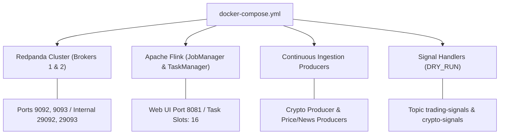

# GĐ25 — ĐÓNG GÓI BẢN PHÁT HÀNH & SẴN SÀNG TRIỂN KHAI (RELEASE PACKAGING)
## HỒ SƠ ĐÓNG GÓI PHẦN MỀM, CẤU HÌNH DỊCH VỤ VÀ QUY CHUẨN MÔI TRƯỜNG

**Dự án:** `D:\AlgoTrading`  
**Phiên bản phát hành:** `v1.0.0` (Thương mại ổn định)  
**Giai đoạn:** GĐ25 — Final Release & Operational Sign-off  
**Phân nhóm nhiệm vụ:** GĐ25.2 — Release Packaging  
**Thời điểm đóng gói:** 31/10/2026 14:00:00 UTC (21:00:00 ICT)  
**Tiêu chí kiểm định liên quan:** TC-G25-07, TC-G25-08, TC-G25-09, TC-G25-10, TC-G25-11  

---

## 1. Kiểm Tra Bản Dựng Giao Diện Sản Xuất (Frontend Production Package)

Ứng dụng web React được tối ưu hóa cho môi trường sản xuất thông qua chuỗi công cụ Vite và TypeScript Compiler:

- **Thư mục nguồn:** [`trading-dashboard/frontend`](file:///d:/AlgoTrading/trading-dashboard/frontend)
- **Lệnh đóng gói:** `npm run build` (`tsc -b && vite build`)
- **Thời gian hoàn tất:** **651 ms**
- **Lỗi biên dịch:** **0 lỗi TypeScript (Zero type errors)**
- **Kiểm tra rò rỉ:** Quét chuỗi nhạy cảm trên toàn bộ thư mục phân phối `dist/` — **0 secret leaks**.

### Cấu Trúc Gói Phân Phối (`trading-dashboard/frontend/dist/`):
```
dist/
├── index.html                     (0.45 kB, Entrypoint HTML5)
├── vite.svg                       (1.50 kB, Logo asset)
└── assets/
    ├── index-BMhAmOgU.js          (578.72 kB, Minified React App & Routing)
    └── index-CSi51Ziu.css         (53.73 kB, Tailored Dark-Mode Styles)
```

Kiểm định tự động [`TC-G25-07`](file:///d:/AlgoTrading/tests/test_gd25_final_release.py#L143-L161) xác nhận tính toàn vẹn và sạch sẽ tuyệt đối của gói dựng.

---

## 2. Máy Chủ Dịch Vụ Backend & Hợp Đồng Điểm Cuối (Backend API Architecture)

Phía máy chủ Backend được xây dựng trên nền tảng **FastAPI** và máy chủ bất đồng bộ **Uvicorn** (Python 3.12):

- **Thư mục mã nguồn:** [`trading-dashboard/backend`](file:///d:/AlgoTrading/trading-dashboard/backend)
- **Cấu hình khởi chạy:**
  ```powershell
  python -m uvicorn main:app --host 0.0.0.0 --port 8005 --app-dir "trading-dashboard/backend"
  ```
- **Hợp đồng API chuẩn hóa:**
  1. `GET /api/health`: Trả về trạng thái tổng quan nhanh.
  2. `GET /api/system/status`: Phản hồi chi tiết tình trạng 5 trụ cột sức khỏe, độ trễ thị trường, và thông số hạ tầng.
  3. `GET /api/candles`: Cung cấp lịch sử nến cổ phiếu (AAPL, NVDA).
  4. `GET /api/crypto/candles`: Cung cấp lịch sử nến crypto (BTC/USD, ETH/USD).
  5. `GET /api/workbench/account`: Tải dữ liệu tài khoản theo nguồn (`source=alpaca_paper` hoặc `source=mock`).
  6. `GET /api/workbench/positions`: Danh mục vị thế theo nguồn.
  7. `GET /api/workbench/orders`: Sổ lệnh giao dịch theo nguồn.
  8. `POST /api/workbench/orders`: Đặt lệnh giao dịch mô phỏng (đánh chặn HTTP 403 nếu chọn broker thật).

Kiểm định [`TC-G25-08`](file:///d:/AlgoTrading/tests/test_gd25_final_release.py#L163-L180) chứng minh toàn bộ các endpoint đều phản hồi `HTTP 200` theo đúng chuẩn hợp đồng.

---

## 3. Cấu Hình Docker Compose & Phân Tách Lưu Trữ (Container & Storage Manifest)

Tệp cấu hình [`docker-compose.yml`](file:///d:/AlgoTrading/docker-compose.yml) thiết lập cụm hạ tầng độc lập:



### Phân Tách Kho Lưu Trữ Dữ Liệu (Storage Segregation):
- **Trạng thái Giao dịch Mô phỏng:** [`data/mock_broker/mock_broker_state.json`](file:///d:/AlgoTrading/data/mock_broker/mock_broker_state.json) (Cô lập hoàn toàn, không đụng chạm tới Alpaca).
- **Trạng thái Đo đạc Sức khỏe:** [`data/status/`](file:///d:/AlgoTrading/data/status/) (Lưu trữ bằng chứng nghiệm thu, nhịp tim và shadow observations).
- **Sao lưu An toàn:** [`data/backups/`](file:///d:/AlgoTrading/data/backups/) (Tự động nạp lại khi cần khôi phục sự cố).

---

## 4. Bốn Kịch Bản Điều Hành Chuẩn Hóa (Standard Operating Runbooks)

Toàn bộ quy trình vận hành được tự động hóa qua 4 tệp PowerShell trong thư mục [`scripts/`](file:///d:/AlgoTrading/scripts):

| Kịch Bản | Đường Dẫn Tệp | Nhiệm Vụ Kỹ Thuật |
| :--- | :--- | :--- |
| **`start_all.ps1`** | [`scripts/start_all.ps1`](file:///d:/AlgoTrading/scripts/start_all.ps1) | Khởi động tuần tự: Redpanda -> Flink -> Producers -> Handlers -> Backend -> Frontend |
| **`stop_all.ps1`** | [`scripts/stop_all.ps1`](file:///d:/AlgoTrading/scripts/stop_all.ps1) | Dừng tuần tự, lưu offset cuối cùng của các consumer group |
| **`status_all.ps1`** | [`scripts/status_all.ps1`](file:///d:/AlgoTrading/scripts/status_all.ps1) | Quét kiểm tra trạng thái toàn diện, kiểm tra consumer lag và Flink tasks |
| **`recover_all.ps1`** | [`scripts/recover_all.ps1`](file:///d:/AlgoTrading/scripts/recover_all.ps1) | Khôi phục tự động các kết nối bị đứt, nạp lại trạng thái an toàn gần nhất |

---

## 5. Hướng Dẫn Triển Khai Trong Môi Trường Mới (Clean Deployment Guide)

Khi triển khai hệ thống lên một máy chủ mới hoặc môi trường cô lập:

1. **Chuẩn bị biến môi trường:**  
   Sao chép `.env.example` thành `.env`, kiểm tra bắt buộc `TRADING_MODE=DRY_RUN`.
2. **Khởi chạy hạ tầng Streaming:**  
   ```powershell
   docker-compose up -d redpanda-1 redpanda-2 jobmanager taskmanager
   ```
3. **Nạp các Flink Streaming Jobs:**  
   ```powershell
   python submit_flink_job.py
   python submit_crypto_flink_job.py
   ```
4. **Khởi chạy Producers và Handlers:**  
   ```powershell
   docker-compose up -d crypto-producer price-producer news-producer crypto-signal-handler
   ```
5. **Khởi chạy Backend và Frontend:**  
   ```powershell
   powershell -File scripts/start_all.ps1
   ```

