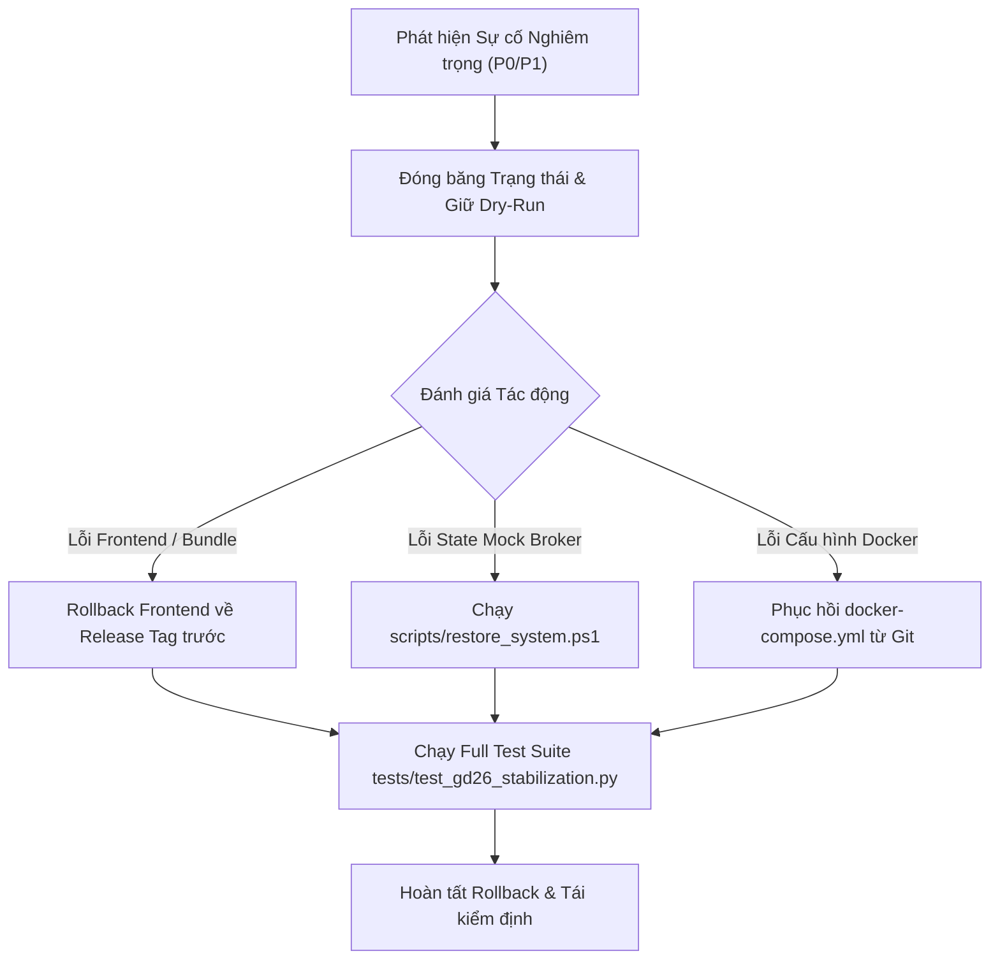

# GĐ26: Operational Maintenance & Rollback Plan

**Repository:** `D:\AlgoTrading`  
**Release:** `v1.0.0`  
**Phase:** GĐ26 — Post-Release Stabilization & Maintenance  
**Status:** `APPROVED — MAINTENANCE_READY`  
**Evaluation Timestamp:** `2026-10-31T21:46:00+07:00`

---

## 1. Mục tiêu Kế hoạch Bảo trì

Xác lập khung quy trình chuẩn mực (Standard Operating Procedures - SOP) phục vụ công tác bảo trì định kỳ, nâng cấp phụ thuộc, xoay vòng nhật ký (log rotation), và xử lý sự cố khẩn cấp (disaster recovery / rollback) cho phiên bản phát hành v1.0.0.

---

## 2. Lịch trình Bảo trì Định kỳ (Maintenance Schedule)

| Chu kỳ | Nhiệm vụ | Phạm vi & Công cụ | Tác động Hệ thống |
| :--- | :--- | :--- | :--- |
| **Hàng ngày (Daily)** | - Kiểm tra tài nguyên RAM / Disk / CPU.<br>- Rà soát trạng thái Flink Checkpoints & Consumer Lag.<br>- Sao lưu trạng thái Mock Broker tự động. | `GET /api/system/status`<br>[scripts/backup_system.ps1](file:///d:/AlgoTrading/scripts/backup_system.ps1) | Không gián đoạn (Zero downtime) |
| **Hàng tuần (Weekly)** | - Xoay vòng file log lớn $\ge 10\text{ MB}$.<br>- Dọn dẹp các tệp tạm trong thư mục `logs/`.<br>- Đối soát số dư Alpaca Paper Read-Only. | [scripts/rotate_logs.ps1](file:///d:/AlgoTrading/scripts/rotate_logs.ps1)<br>`GET /api/workbench/account` | Không gián đoạn (Zero downtime) |
| **Hàng tháng (Monthly)** | - Audit bảo mật các gói phụ thuộc (npm & pip).<br>- Diễn tập kịch bản khôi phục (Restore Dry-Run).<br>- Đánh giá hiệu năng và phân bổ lại lưu trữ. | `npm audit`, `pip audit`<br>[scripts/restore_system.ps1](file:///d:/AlgoTrading/scripts/restore_system.ps1) `-DryRunTest` | Không gián đoạn (Chạy trên môi trường cô lập) |

---

## 3. Quy trình Quản lý Phụ thuộc (Dependency Management)

Nhằm đảm bảo tính tái lập (Reproducibility) và triệt tiêu xung đột phiên bản:
1. **Frontend Dependencies:**
   - Quản lý phiên bản chặt chẽ qua [trading-dashboard/frontend/package.json](file:///d:/AlgoTrading/trading-dashboard/frontend/package.json) và `package-lock.json`.
   - Tất cả các gói sản xuất chính (`react`, `react-dom`, `lucide-react`, `recharts`, `tailwindcss`, `vite`) đều được ghim phiên bản cụ thể.
   - Khi cập nhật gói: Phải chạy `npm test` và `npm run build` trước khi merge vào nhánh chính.
2. **Backend Dependencies:**
   - Quản lý thông qua môi trường ảo `.venv` và tài liệu hóa tại [requirements.txt](file:///d:/AlgoTrading/requirements.txt) / pyproject.
   - Ghim phiên bản các framework cốt lõi (`fastapi`, `uvicorn`, `websockets`, `requests`, `pydantic`).

---

## 4. Chuẩn hóa Quy trình Xoay vòng Nhật ký (Log Rotation)

Để ngăn ngừa tệp log ghi đầy dung lượng ổ đĩa theo thời gian, quy trình xoay vòng tự động được đóng gói trong script PowerShell:

```powershell
# Chạy xoay vòng log định kỳ (ngưỡng 10 MB)
powershell -ExecutionPolicy Bypass -File scripts/rotate_logs.ps1 -MaxSizeMB 10
```

### Cơ chế hoạt động:
1. Quét tất cả các tệp `*.log` trong thư mục [logs/](file:///d:/AlgoTrading/logs/).
2. Nếu kích thước tệp vượt quá $10\text{ MB}$, script tự động nén/di chuyển tệp vào [logs/archive/](file:///d:/AlgoTrading/logs/archive/) với hậu tố timestamp `_YYYYMMDD_HHMMSS`.
3. Khởi tạo lại tệp log rỗng mới để các tiến trình daemon tiếp tục ghi mà không bị crash.

---

## 5. Chính sách Phiên bản & Quy trình Rollback (Versioning & Rollback Protocol)

Hệ thống tuân thủ nghiêm ngặt chuẩn Semantic Versioning (**SemVer 2.0.0**): `MAJOR.MINOR.PATCH`.



### 5.1. Kịch bản Rollback Frontend
Nếu bản build production mới phát sinh lỗi hồi quy trên UI:
1. Chuyển Git HEAD về commit phát hành ổn định trước đó (ví dụ tag `v1.0.0`).
2. Biên dịch lại bundle tĩnh: `cd trading-dashboard/frontend && npm run build`.
3. Kiểm tra tính sẵn sàng của `dist/` trên port 4173 (`npx vite preview --port 4173`).

### 5.2. Kịch bản Rollback State Mock Broker
Nếu file trạng thái `mock_broker_state.json` bị hỏng hoặc mất tính nhất quán:
1. Xác định bản snapshot sao lưu mới nhất trong `data/backups/`.
2. Kiểm tra tính hợp lệ qua lệnh Dry-Run:
   ```powershell
   powershell -ExecutionPolicy Bypass -File scripts/restore_system.ps1 -BackupDir data/backups/backup_YYYYMMDD_HHMMSSZ -DryRunTest
   ```
3. Thực hiện khôi phục chính thức:
   ```powershell
   powershell -ExecutionPolicy Bypass -File scripts/restore_system.ps1 -BackupDir data/backups/backup_YYYYMMDD_HHMMSSZ
   ```

---

## 6. Các Ràng buộc Bất biến trong Quá trình Bảo trì

Trong mọi hoạt động bảo trì, kiểm thử hoặc xử lý sự cố:
1. Tuyệt đối duy trì `TRADING_MODE=DRY_RUN` trong [.env](file:///d:/AlgoTrading/.env).
2. Không mở `PaperExecutionGate` (`is_gate_open = False`).
3. Không gửi, sửa, hủy bất kỳ lệnh nào trên tài khoản Alpaca Paper thật.
4. Nghiêm cấm triển khai bất kỳ tuyến mã Live Trading nào.
5. Bảo toàn nguyên vẹn các artifact nghiệm thu từ GĐ18 đến GĐ25.

