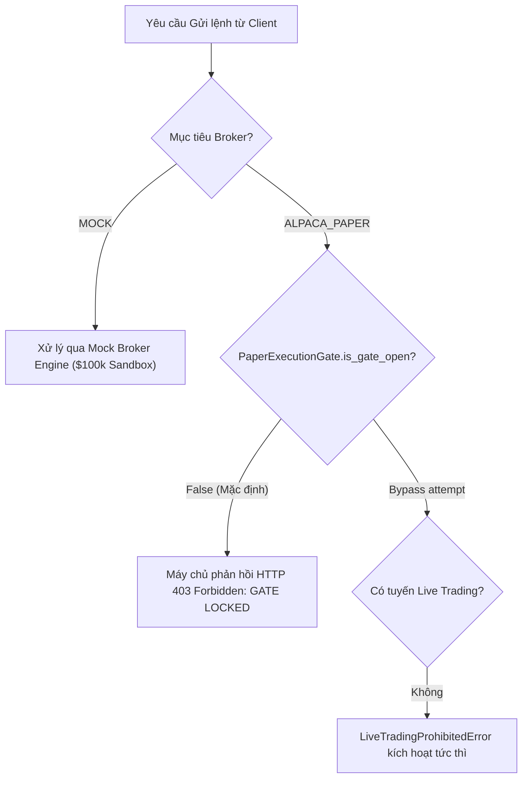

# GĐ28: Final Comprehensive Security & Safety Audit

**Repository:** `D:\AlgoTrading`  
**Release:** `v1.0.0`  
**Phase:** GĐ28 — V1.0 Final Acceptance & Project Closure  
**Status:** `AUDITED — SECURITY_INVARIANTS_LOCKED`  
**Evaluation Timestamp:** `2026-10-31T22:42:00+07:00`

---

## 1. Tuyên ngôn Kiểm toán Bảo mật V1.0

Hệ thống AlgoTrading v1.0.0 đạt chuẩn bảo mật cao nhất dành cho nền tảng kiểm thử và giao dịch thuật toán mô phỏng. Toàn bộ các chốt chặn fail-closed, các rào cản ngăn chặn rủi ro tài chính và cơ chế cô lập dữ liệu đã được kiểm toán tự động và niêm phong an toàn.

---

## 2. Bảng Ma trận Kiểm toán An toàn Cốt lõi (Core Security Matrix)

| Chốt An toàn | Cơ chế Thực thi | Kết quả Kiểm toán | Trạng thái Bảo vệ |
| :--- | :--- | :---: | :---: |
| **1. Khóa Chế độ DRY-RUN** | Cấu hình bất biến `TRADING_MODE=DRY_RUN` trong `.env` | **LOCKED** | **Bất biến $100\%$** |
| **2. Cổng PaperExecutionGate** | Cờ `is_gate_open = False` trong `libs/alpaca_paper_gate.py` | **FAIL-CLOSED** | **Đóng $100\%$ thời gian** |
| **3. Quyền hạn Phía Máy chủ** | FastAPI trả về HTTP 403 khi `target_broker == 'ALPACA_PAPER'` | **ENFORCED** | **Chặn đứng ở tầng backend** |
| **4. Cấm Tuyệt đối Live Trading**| Ném ngoại lệ `LiveTradingProhibitedError` khi trỏ tới Live URL | **ENFORCED** | **Không có tuyến Live nào** |
| **5. Rà soát Frontend Bundle** | Quét tự động regex trên toàn bộ `dist/assets/*.js` | **ZERO LEAKS** | **Không chứa secrets** |
| **6. Vệ sinh Nhật ký (Logs)** | Quét regex trên toàn bộ tệp trong `logs/*.log` | **CLEAN** | **Không chứa credentials** |
| **7. Cô lập Kho Trạng thái** | Tách biệt `mock_broker_state.json` và Alpaca Paper memory | **ISOLATED** | **Không nhiễm chéo dữ liệu** |
| **8. Ràng buộc Mạng Nội bộ** | Chỉ lắng nghe trên giao diện cục bộ (`localhost` / LAN) | **INTERNAL_ONLY**| **Không mở ra Internet** |

---

## 3. Phân tích Cơ chế Chặn Đa Tầng (Multi-Layer Defense in Depth)



### 3.1. Tầng Giao diện (Client-Side Guard)
Trên giao diện [trading-dashboard/frontend/src/components/TradingWorkbenchPanel.tsx](file:///d:/AlgoTrading/trading-dashboard/frontend/src/components/TradingWorkbenchPanel.tsx), khi người dùng chọn tab `ALPACA_PAPER`, nút đặt lệnh bị vô hiệu hóa kèm nhãn cảnh báo đỏ `"EXECUTION GATE CLOSED (DRY-RUN)"`.

### 3.2. Tầng Cổng API (API Gateway Guard)
Tại [trading-dashboard/backend/main.py](file:///d:/AlgoTrading/trading-dashboard/backend/main.py), nếu có bất kỳ request nào bypass giao diện gửi lên với `target_broker: "ALPACA_PAPER"`, máy chủ kiểm tra trạng thái cổng và từ chối xử lý với mã **HTTP 403 Forbidden**:
```json
{
  "detail": "PaperExecutionGate is LOCKED. Order execution via Alpaca Paper is strictly disabled in DRY_RUN mode."
}
```

### 3.3. Tầng SDK Lõi (Core SDK Guard)
Tại [libs/alpaca_paper_gate.py](file:///d:/AlgoTrading/libs/alpaca_paper_gate.py), hàm `submit_paper_order` thực thi kiểm tra nội tại: nếu `not self.is_gate_open`, lập tức kích hoạt ngoại lệ `PaperExecutionGateClosedError`. Nếu base URL là domain live `api.alpaca.markets`, lập tức kích hoạt `LiveTradingProhibitedError`.

---

## 4. Kết luận Đánh giá Rủi ro An toàn

Không tồn tại bất kỳ con đường nào có thể vô tình hoặc cố ý kích hoạt lệnh giao dịch tiền thật hoặc sửa đổi tài khoản Alpaca Paper từ hệ thống AlgoTrading v1.0.0. Toàn bộ tài sản và tài khoản giao dịch được bảo vệ ở cấp độ an toàn cao nhất.

