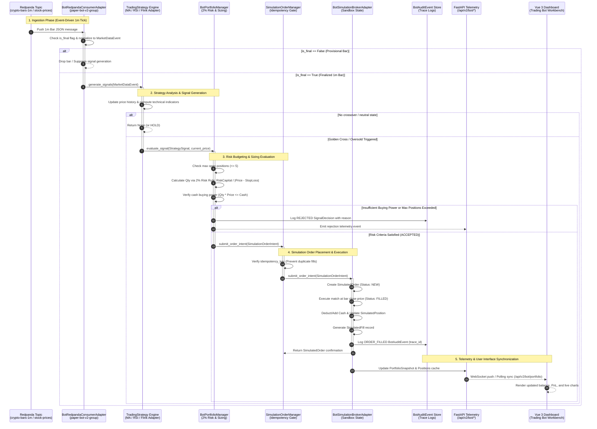

# GĐ29 — End-to-End Data Flow Specification
**AlgoTrading V2.0 Paper Trading Bot Data Flow & Sequence**  
**Repository:** `D:\AlgoTrading`  
**Primary Timeframe:** `1m` (1 Minute)  
**Execution Latency Target:** $< 50\text{ms}$ (In-Memory Simulation)

---

## 1. Sơ Đồ Trình Tự Luồng Dữ Liệu Đầu-Cuối (End-to-End Sequence Diagram)

Dưới đây là sơ đồ chi tiết biểu diễn luồng dữ liệu thời gian thực từ khi một nến 1 phút hình thành trên Redpanda, đi qua các tầng xử lý của Bot, cho tới khi khớp lệnh giả lập và cập nhật telemetry lên Web Dashboard.

---

## 2. Các Giai Đoạn Chi Tiết Của Luồng Dữ Liệu

### Giai đoạn 1: Hấp thụ dữ liệu nến 1m (Data Ingestion & Normalization)
1. Tiến trình nạp dữ liệu nền của V1 (`continuous_price_producer.py` hoặc `continuous_crypto_producer.py`) đẩy thông điệp nến 1m vào Redpanda topic.
2. `BotRedpandaConsumerAdapter` tiêu thụ thông điệp với Consumer Group riêng `paper-bot-v2-group`.
3. Kiểm tra trường `is_final`:
   - Nếu `is_final == False`: Nến đang trong quá trình tích lũy intra-minute, adapter bỏ qua để tránh phát sinh tín hiệu giả mạo (repainting).
   - Nếu `is_final == True`: Nến đã chốt phiên phút, adapter đóng gói thành đối tượng `MarketDataEvent` bất biến mang nhãn `environment="SIMULATION"`.

### Giai đoạn 2: Đánh giá kỹ thuật & Phát tín hiệu (Strategy Evaluation)
1. `TradingStrategy` nhận `MarketDataEvent` và cập nhật vào chuỗi giá lịch sử nội bộ của mã tài sản tương ứng.
2. Kiểm tra điều kiện kỹ thuật:
   - Với `MovingAverageCrossoverStrategy`: Tính toán SMA ngắn hạn ($SMA_9$) và dài hạn ($SMA_{21}$). Khi phát hiện giao cắt vàng (Golden Cross), tạo đối tượng `StrategySignal` với `signal_type="BUY"`.
   - Với `RSIStrategy`: Tính toán RSI trên 14 nến. Khi $RSI < 30$, tạo `StrategySignal` với `signal_type="BUY"`.
   - Với `V1StrategyAdapter`: Chuyển đổi trực tiếp các tín hiệu sinh ra từ Apache Flink SQL vào định dạng `StrategySignal`.
3. Nếu không có điều kiện kỹ thuật nào được thỏa mãn, hàm trả về `None` và kết thúc vòng lặp.

### Giai đoạn 3: Quản trị danh mục & Thẩm định rủi ro (Risk Evaluation)
1. `BotPortfolioManager` tiếp nhận `StrategySignal` và giá thị trường hiện tại.
2. Thực hiện thẩm tra 3 lớp an toàn:
   - **Lớp 1: Số lượng vị thế mở:** Đảm bảo tổng số vị thế mở không vượt quá ngưỡng tối đa cho phép (`max_open_positions = 5`).
   - **Lớp 2: Định cỡ vị thế theo quy tắc 2% rủi ro:** Tính toán số tiền rủi ro tối đa:
     $$\text{Risk Capital} = \text{Equity} \times 0.02$$
     Xác định khối lượng đặt lệnh tương ứng.
   - **Lớp 3: Sức mua thực tế:** Kiểm tra số dư tiền mặt khả dụng ($Cash$) có đủ để chi trả giá trị lệnh ($Qty \times Price$) hay không.
3. Nếu bất kỳ điều kiện nào thất bại: Phát hành `SignalDecision` với trạng thái `REJECTED`, ghi nhật ký kiểm toán và dừng luồng xử lý.
4. Nếu tất cả đạt chuẩn: Phát hành `SignalDecision` với trạng thái `ACCEPTED` kèm theo khối lượng `calculated_qty`.

### Giai đoạn 4: Tạo ý định lệnh & Khớp lệnh giả lập (Execution Sandbox)
1. Hệ thống chuyển đổi `SignalDecision` được chấp thuận thành `SimulationOrderIntent` với mã bảo vệ trùng lặp duy nhất (`idempotency_key`).
2. `SimulationOrderManager` kiểm tra sổ lệnh xem `idempotency_key` đã được xử lý chưa. Nếu đã xử lý, trả về lệnh cũ, không khớp lại.
3. Chuyển ý định tới `BotSimulationBrokerAdapter`:
   - Tạo bản ghi `SimulatedOrder` với trạng thái `NEW`.
   - Khớp lệnh ngay tại giá nến chốt (`fill_price = bar.close`).
   - Cập nhật số dư tiền mặt ($Cash$) và vị thế nắm giữ (`SimulatedPosition`).
   - Tạo bản ghi `SimulatedFill`.
   - Cập nhật trạng thái lệnh thành `FILLED`.
   - Ghi lại bản ghi `BotAuditEvent` có `trace_id`.

### Giai đoạn 5: Đồng bộ Telemetry & Hiển thị Dashboard
1. `BotSimulationBrokerAdapter` tự động tính toán lại bảng cân đối tài sản (`PortfolioSnapshot`): Tổng tài sản ròng ($Equity$), lãi lỗ chưa thực hiện ($Unrealized PnL$), và lãi lỗ đã chốt ($Realized PnL$).
2. Bộ nhớ đệm của FastAPI backend được làm mới qua endpoint `/api/v2/bot/portfolio`.
3. Giao diện Vue 3 Dashboard cập nhật hiển thị theo thời gian thực cho người dùng quan sát.

---

## 3. Ngân Sách Độ Trễ & Đảm Bảo Idempotency

- **Ngân sách độ trễ (Latency Budget):**
  - Redpanda Consumer fetch -> Parse: $< 5\text{ms}$
  - Strategy Evaluation (MA / RSI in Python): $< 2\text{ms}$
  - Risk & Position Sizing Check: $< 1\text{ms}$
  - Simulation Sandbox Fill & Position Recalculation: $< 3\text{ms}$
  - In-Memory Audit Logging: $< 1\text{ms}$
  - **Tổng thời gian xử lý một nến 1m:** $\approx 12\text{ms}$ (thỏa mãn mục tiêu $< 50\text{ms}$).
- **Bảo đảm Idempotency:**
  Mỗi `SimulationOrderIntent` mang khóa định danh dạng:
  $$\text{idempotency\_key} = \text{hash}(\text{session\_id} + \text{symbol} + \text{signal\_id} + \text{bar\_timestamp})$$
  Ngăn chặn tuyệt đối việc một nến 1m bị tiêu thụ lại (ví dụ sau sự cố restart consumer) gây ra việc khớp trùng lệnh.
