# GĐ29 — Domain Model Specification
**AlgoTrading V2.0 Paper Trading Bot Domain Entities**  
**Repository:** `D:\AlgoTrading`  
**Package:** `libs/bot/domain.py`  
**Security Invariant:** `environment = "SIMULATION"` (Mandatory)

---

## 1. Danh Sách 10 Thực Thể Nghiệp Vụ Chuẩn V2

Hệ thống **AlgoTrading V2.0 Paper Trading Bot** được chuẩn hóa trên **10 thực thể nghiệp vụ cốt lõi (Domain Entities)**. Mọi thực thể đều bắt buộc mang thuộc tính `environment = "SIMULATION"` để đảm bảo tính minh bạch và ngăn chặn nhầm lẫn với các thực thể giao dịch thật.

```mermaid
classDiagram
    class BotSession {
        +str session_id
        +str bot_name
        +str strategy_name
        +List[str] symbols
        +str timeframe
        +str status
        +datetime start_time
        +datetime end_time
        +str environment
    }

    class MarketDataEvent {
        +str event_id
        +str symbol
        +str timeframe
        +float open
        +float high
        +float low
        +float close
        +float volume
        +bool is_final
        +datetime event_time
        +str environment
    }

    class StrategySignal {
        +str signal_id
        +str strategy_id
        +str symbol
        +str signal_type
        +float price
        +float strength
        +str reason
        +datetime signal_time
        +str environment
    }

    class SignalDecision {
        +str decision_id
        +str signal_id
        +str symbol
        +str status
        +str rejection_reason
        +float calculated_qty
        +datetime timestamp
        +str environment
    }

    class SimulationOrderIntent {
        +str intent_id
        +str bot_session_id
        +str signal_id
        +str symbol
        +str side
        +str order_type
        +float qty
        +str idempotency_key
        +datetime created_at
        +str environment
    }

    class SimulatedOrder {
        +str simulated_order_id
        +str intent_id
        +str bot_session_id
        +str symbol
        +str side
        +str status
        +float qty
        +datetime created_at
        +str environment
    }

    class SimulatedFill {
        +str simulated_fill_id
        +str simulated_order_id
        +str symbol
        +float fill_price
        +float fill_qty
        +float fee
        +datetime fill_time
        +str environment
    }

    class SimulatedPosition {
        +str symbol
        +float qty
        +float avg_entry_price
        +float current_price
        +float market_value
        +float unrealized_pnl
        +float realized_pnl
        +str environment
        +recalculate(latest_price)
    }

    class PortfolioSnapshot {
        +str snapshot_id
        +str bot_session_id
        +float cash
        +float equity
        +Dict positions
        +int open_orders_count
        +str environment
    }

    class BotAuditEvent {
        +str event_id
        +str component
        +str event_type
        +str trace_id
        +str reason
        +Dict payload
        +str environment
    }

    BotSession --> StrategySignal : generates
    MarketDataEvent --> StrategySignal : evaluates
    StrategySignal --> SignalDecision : evaluated_by
    SignalDecision --> SimulationOrderIntent : produces
    SimulationOrderIntent --> SimulatedOrder : converts_to
    SimulatedOrder --> SimulatedFill : fulfills
    SimulatedFill --> SimulatedPosition : updates
    SimulatedPosition --> PortfolioSnapshot : aggregates_in
    SimulatedOrder --> BotAuditEvent : logs
```

---

## 2. Chi Tiết Thuộc Tính & Quy Tắc Ràng Buộc Của Từng Thực Thể

### 2.1. `BotSession`
Đại diện cho một phiên chạy của bot tự động từ lúc khởi động đến khi dừng lại.
- `session_id` (`str`): Định danh duy nhất phiên chạy (`session_[hex]`).
- `bot_name` (`str`): Tên cấu hình bot (mặc định: `"PaperBotV2"`).
- `strategy_name` (`str`): Tên chiến lược gắn với phiên (VD: `"MA_CROSS_1M"`).
- `symbols` (`List[str]`): Danh sách các mã tài sản được giao dịch trong phiên.
- `timeframe` (`str`): Khung thời gian cơ sở, cố định `"1m"`.
- `status` (`str`): Trạng thái vòng đời (`STOPPED`, `STARTING`, `RUNNING`, `PAUSED`, `STOPPING`, `ERROR`).
- `start_time` / `end_time` (`datetime`, optional): Mốc thời gian bắt đầu và kết thúc phiên.
- `environment` (`str`): Luôn luôn là `"SIMULATION"`.

### 2.2. `MarketDataEvent`
Nén gói dữ liệu nến 1 phút chuẩn hóa nhận được từ streaming bus.
- `event_id` (`str`): Định danh sự kiện nến (`mde_[hex]`).
- `symbol` (`str`): Mã chứng khoán/crypto (VD: `"NVDA"`, `"BTC/USD"`).
- `timeframe` (`str`): Cố định `"1m"`.
- `open`, `high`, `low`, `close` (`float`): Giá mở cửa, cao nhất, thấp nhất, đóng cửa của nến 1m.
- `volume` (`float`): Khối lượng giao dịch trong 1 phút.
- `trade_count` (`int`): Số lượng giao dịch trong nến.
- `vwap` (`float`): Giá trung bình theo khối lượng (Volume Weighted Average Price).
- `is_final` (`bool`): `True` nếu là nến đã chốt phiên phút; `False` nếu là nến tạm đang cập nhật.
- `event_time` (`datetime`): Thời điểm nến hình thành tại nguồn.
- `ingest_time` (`datetime`): Thời điểm hệ thống nhận nến.

### 2.3. `StrategySignal`
Tín hiệu phân tích kỹ thuật do chiến lược phát hành.
- `signal_id` (`str`): Định danh tín hiệu (`sig_[hex]`).
- `strategy_id` (`str`): Mã định danh chiến lược phát tín hiệu.
- `symbol` (`str`): Mã tài sản.
- `signal_type` (`str`): `"BUY"`, `"SELL"`, hoặc `"HOLD"`.
- `price` (`float`): Giá thị trường tại thời điểm phát sinh tín hiệu.
- `strength` (`float`): Độ mạnh của tín hiệu (thang điểm 0.0 đến 1.0).
- `reason` (`str`): Diễn giải logic kỹ thuật dẫn tới tín hiệu.
- `signal_time` (`datetime`): Mốc thời gian UTC phát sinh tín hiệu.

### 2.4. `SignalDecision`
Quyết định thẩm định của Quản trị rủi ro & Quản trị danh mục đối với `StrategySignal`.
- `decision_id` (`str`): Định danh quyết định (`dec_[hex]`).
- `signal_id` (`str`): Tham chiếu đến tín hiệu nguồn.
- `symbol` (`str`): Mã tài sản.
- `status` (`str`): `"ACCEPTED"` (Chấp nhận) hoặc `"REJECTED"` (Từ chối).
- `rejection_reason` (`str`, optional): Lý do từ chối nếu không đạt tiêu chuẩn rủi ro (VD: `INSUFFICIENT_BUYING_POWER`, `MAX_POSITIONS_REACHED`, `NO_EXISTING_POSITION_TO_SELL`).
- `calculated_qty` (`float`): Số lượng được phép giao dịch sau khi áp dụng quy tắc 2% rủi ro.

### 2.5. `SimulationOrderIntent`
Ý định đặt lệnh giao dịch mô phỏng được tạo ra sau khi tín hiệu được chấp thuận.
- `intent_id` (`str`): Định danh ý định (`intent_[hex]`).
- `bot_session_id` (`str`): Mã phiên chạy phát hành ý định.
- `signal_id` (`str`): Mã tín hiệu được thực thi.
- `symbol` (`str`): Mã tài sản.
- `side` (`str`): `"BUY"` hoặc `"SELL"`.
- `order_type` (`str`): `"MARKET"` hoặc `"LIMIT"`.
- `qty` (`float`): Khối lượng lệnh.
- `limit_price` (`float`, optional): Giá giới hạn nếu là lệnh LIMIT.
- `idempotency_key` (`str`): Khóa bảo vệ chống trùng lệnh (`idemp_[hex]`). Bất kỳ ý định nào trùng khóa này sẽ không được xử lý hai lần.

### 2.6. `SimulatedOrder`
Lệnh giao dịch được ghi nhận trong sổ lệnh giả lập của Simulation Broker.
- `simulated_order_id` (`str`): Định danh lệnh (`sim_ord_[hex]`).
- `intent_id` (`str`): Tham chiếu ý định ban đầu.
- `status` (`str`): Vòng đời lệnh (`NEW` -> `FILLED` / `CANCELED` / `REJECTED`).
- `qty` (`float`): Khối lượng lệnh.
- `created_at` / `updated_at` (`datetime`): Mốc thời gian tạo và cập nhật trạng thái lệnh.

### 2.7. `SimulatedFill`
Bản ghi chi tiết kết quả khớp lệnh mô phỏng.
- `simulated_fill_id` (`str`): Định danh khớp lệnh (`fill_[hex]`).
- `simulated_order_id` (`str`): Tham chiếu lệnh được khớp.
- `fill_price` (`float`): Giá khớp thực tế.
- `fill_qty` (`float`): Khối lượng khớp.
- `fee` (`float`): Phí giao dịch giả định (mặc định $0.0$).
- `slippage` (`float`): Độ trượt giá giả định (mặc định $0.0$).
- `assumptions` (`str`): Mô tả giả định khớp lệnh (`"ZERO_SLIPPAGE_BAR_CLOSE"`).

### 2.8. `SimulatedPosition`
Vị thế tài sản ảo đang nắm giữ trong danh mục.
- `symbol` (`str`): Mã tài sản.
- `qty` (`float`): Khối lượng nắm giữ hiện tại.
- `avg_entry_price` (`float`): Giá vốn trung bình.
- `current_price` (`float`): Giá thị trường cập nhật nhất.
- `cost_basis` (`float`): Tổng giá trị vốn đầu tư:
  $$\text{Cost Basis} = \text{Qty} \times \text{Avg Entry Price}$$
- `market_value` (`float`): Giá trị thị trường hiện tại:
  $$\text{Market Value} = \text{Qty} \times \text{Current Price}$$
- `unrealized_pnl` (`float`): Lợi nhuận/thua lỗ chưa thực hiện:
  $$\text{Unrealized PnL} = \text{Market Value} - \text{Cost Basis}$$
- `realized_pnl` (`float`): Lợi nhuận/thua lỗ đã chốt thực tế khi bán vị thế:
  $$\text{Realized PnL} = \sum (\text{Sell Price} - \text{Avg Entry Price}) \times \text{Sold Qty}$$

### 2.9. `PortfolioSnapshot`
Báo cáo tài chính thu nhỏ của danh mục tại một thời điểm nhất định.
- `snapshot_id` (`str`): Định danh snapshot (`snap_[hex]`).
- `cash` (`float`): Số dư tiền mặt ảo khả dụng.
- `equity` (`float`): Tổng giá trị ròng của danh mục:
  $$\text{Equity} = \text{Cash} + \sum_{i} \text{Market Value}_{i}$$
- `positions` (`Dict[str, SimulatedPosition]`): Danh sách các vị thế đang nắm giữ.
- `open_orders_count` (`int`): Số lượng lệnh đang chờ khớp.
- `realized_pnl` / `unrealized_pnl` (`float`): Tổng hợp lãi lỗ danh mục.

### 2.10. `BotAuditEvent`
Bản ghi kiểm toán bất biến (Immutable Audit Trail) phục vụ truy vết.
- `event_id` (`str`): Định danh sự kiện kiểm toán (`aud_[hex]`).
- `timestamp` (`datetime`): Mốc thời gian ghi nhận (UTC).
- `component` (`str`): Tên thành phần phát sinh sự kiện (VD: `"PORTFOLIO_MANAGER"`, `"SIMULATION_BROKER"`).
- `event_type` (`str`): Loại sự kiện (`"LIFECYCLE_CHANGE"`, `"ORDER_FILLED"`, `"SIGNAL_REJECTED"`).
- `trace_id` (`str`): Mã định danh chuỗi truy vết (`trace_[hex]`).
- `reason` (`str`): Mô tả lý do hoặc nguyên nhân kích hoạt sự kiện.
- `payload` (`Dict[str, Any]`): Dữ liệu chi tiết đính kèm.
