# GĐ29 — Implementation Roadmap (GĐ30 – GĐ38)
**AlgoTrading V2.0 Implementation & Delivery Plan**  
**Repository:** `D:\AlgoTrading`  
**Foundation Phase:** GĐ29 (Architecture & Base Adaptation)  
**Execution Target:** AlgoTrading V2.0 Release Candidate

---

## 1. Tổng Quan Lộ Trình Triển Khai (Roadmap Overview)

Lộ trình triển khai **AlgoTrading V2.0** được phân kỳ thành **9 giai đoạn kế tiếp (GĐ30 đến GĐ38)**. Mỗi giai đoạn tập trung vào việc hoàn thiện một tầng kiến trúc cụ thể đã được thiết kế và kiểm chứng giao diện trong GĐ29, đảm bảo nguyên tắc: **Không làm gián đoạn hạ tầng V1, cách ly hoàn toàn môi trường mô phỏng, và kiểm chứng từng bước trước khi tích hợp end-to-end**.

```mermaid
flowchart LR
    GD29["GĐ29: Architecture & Base Adaptation (DONE)"] --> GD30["GĐ30: Data Layer & Redpanda Engine"]
    GD30 --> GD31["GĐ31: Python Strategy Engine"]
    GD31 --> GD32["GĐ32: Portfolio & Risk Engine"]
    GD32 --> GD33["GĐ33: Simulation Fill Engine"]
    GD33 --> GD34["GĐ34: Bot Orchestrator"]
    GD34 --> GD35["GĐ35: Backend REST & WS API"]
    GD35 --> GD36["GĐ36: Frontend Bot UI Workbench"]
    GD36 --> GD37["GĐ37: 72h Simulation Soak"]
    GD37 --> GD38["GĐ38: V2.0 Final Sign-Off"]
```

---

## 2. Chi Tiết Từng Giai Đoạn Triển Khai

### GĐ30 — Data Layer & Redpanda Ingestion Engine
- **Mục tiêu:** Hiện thực hóa hoàn chỉnh module `libs/bot/data_manager.py` kết nối trực tiếp với cụm Redpanda.
- **Phạm vi công việc:**
  - Thiết lập luồng tiêu thụ song song đa tài sản (Stocks: NVDA, AAPL; Crypto: BTC/USD, ETH/USD).
  - Hoàn thiện cơ chế lọc nến chốt (`is_final == True`) và khử trùng lặp (de-duplication).
  - Xây dựng fallback backfill từ Alpaca REST API (Read-Only) để nạp nến lịch sử khi bot khởi động nguội.
- **Tiêu chí nghiệm thu:** Nến 1m được tiêu thụ ổn định, consumer group `paper-bot-v2-group` không gây ảnh hưởng tới Flink checkpoints.

### GĐ31 — Python Strategy Engine & Indicator Library
- **Mục tiêu:** Mở rộng thư viện chỉ báo kỹ thuật và hoàn thiện engine tính toán chiến lược nội bộ.
- **Phạm vi công việc:**
  - Xây dựng các chỉ báo toán học độc lập: SMA, EMA, MACD, RSI, Bollinger Bands, ATR.
  - Tích hợp `MovingAverageCrossoverStrategy` và `RSIStrategy` với bộ đệm trượt nến (sliding window buffer).
  - Hoàn thiện `V1StrategyAdapter` để dung hợp tín hiệu Flink SQL vào V2 bot.
- **Tiêu chí nghiệm thu:** Kết quả tính toán chỉ báo khớp 100% với thư viện chuẩn (TA-Lib/Pandas-TA), độ trễ tính toán $< 5\text{ms}$ mỗi nến.

### GĐ32 — Portfolio & Risk Management Engine
- **Mục tiêu:** Xây dựng module quản lý vốn, định cỡ lệnh động, và cơ chế bảo vệ sụt giảm tài sản (Max Drawdown Guard).
- **Phạm vi công việc:**
  - Thực thi quy tắc 2% rủi ro (Fixed Risk Position Sizing) theo biến động giá và mức Stop Loss.
  - Xây dựng bộ kiểm tra sức mua (Buying Power Check) và giới hạn số lượng vị thế mở (`max_open_positions = 5`).
  - Tích hợp cơ chế ngắt mạch khẩn cấp (Circuit Breaker): Tự động đình chỉ bot nếu tài sản sụt giảm quá 5% trong ngày.
- **Tiêu chí nghiệm thu:** 100% tín hiệu vi phạm hạn mức rủi ro bị từ chối (`SignalDecision.status = "REJECTED"`), không bao giờ âm tiền mặt.

### GĐ33 — Simulation Broker & Advanced Fill Engine
- **Mục tiêu:** Nâng cấp sandbox mô phỏng khớp lệnh với các yếu tố ma sát thị trường thực tế.
- **Phạm vi công việc:**
  - Hỗ trợ các loại lệnh nâng cao: Market, Limit, Stop, Stop-Limit.
  - Mô phỏng chênh lệch giá mua/bán (Bid-Ask Spread) và độ trượt giá (Slippage Model) dựa trên thanh khoản nến 1m.
  - Mô phỏng phí giao dịch (Commission & Fees).
  - Lưu trữ trạng thái mô phỏng độc lập tại `data/mock_broker/v2_bot_sim_state.json`.
- **Tiêu chí nghiệm thu:** Sổ lệnh mô phỏng ghi nhận đầy đủ vòng đời lệnh, báo cáo PnL phản ánh trung thực ma sát giao dịch.

### GĐ34 — Bot Orchestrator & State Machine
- **Mục tiêu:** Xây dựng bộ điều khiển trung tâm quản lý vòng đời và khả năng tự phục hồi của Bot.
- **Phạm vi công việc:**
  - Hiện thực máy trạng thái: `STOPPED` $\leftrightarrow$ `STARTING` $\leftrightarrow$ `RUNNING` $\leftrightarrow$ `PAUSED` $\leftrightarrow$ `STOPPING` $\leftrightarrow$ `ERROR`.
  - Cơ chế đồng bộ nhịp nến: Đảm bảo toàn bộ luồng (Ingest $\rightarrow$ Strat $\rightarrow$ Risk $\rightarrow$ Order $\rightarrow$ Fill) hoàn tất trước khi đón nến tiếp theo.
  - Xử lý lỗi ngoại lệ và tự động lưu trạng thái khi bị ngắt đột ngột (Graceful Shutdown).
- **Tiêu chí nghiệm thu:** Máy trạng thái chuyển đổi chính xác, khôi phục phiên giao dịch mượt mà sau khi restart.

### GĐ35 — Backend REST & WebSocket Telemetry APIs
- **Mục tiêu:** Mở rộng backend FastAPI để cung cấp API điều khiển và luồng telemetry thời gian thực cho V2 Bot.
- **Phạm vi công việc:**
  - Tạo FastAPI router `/api/v2/bot/*`:
    - `POST /api/v2/bot/start`, `POST /api/v2/bot/stop`, `POST /api/v2/bot/pause`, `POST /api/v2/bot/resume`
    - `GET /api/v2/bot/status`, `GET /api/v2/bot/portfolio`, `GET /api/v2/bot/orders`, `GET /api/v2/bot/positions`
    - `GET /api/v2/bot/audit-log`
  - Thiết lập kênh WebSocket `/ws/v2/bot/telemetry` phát sóng cập nhật tức thời khi có nến mới hoặc lệnh mới.
- **Tiêu chí nghiệm thu:** Toàn bộ API có OpenAPI documentation đầy đủ, phản hồi nhanh dưới 15ms.

### GĐ36 — Frontend Trading Bot UI Workbench
- **Mục tiêu:** Xây dựng giao diện điều khiển và giám sát trực quan cho V2 Paper Trading Bot trên Dashboard Vue 3.
- **Phạm vi công việc:**
  - Bảng điều khiển vòng đời Bot (Nút Start / Pause / Stop kèm chỉ báo trạng thái trực quan).
  - Biểu đồ nến thời gian thực hiển thị điểm vào/ra lệnh (Markers for BUY/SELL fills).
  - Bảng thống kê hiệu năng: Equity Curve, Realized/Unrealized PnL, Win Rate, Profit Factor.
  - Bảng quản lý vị thế mở và sổ lệnh mô phỏng thời gian thực.
  - Bảng nhật ký kiểm toán (Audit Trail) có bộ lọc theo `trace_id`.
- **Tiêu chí nghiệm thu:** Giao diện mượt mà, phản ánh tức thì trạng thái bot từ WebSocket, tương thích với theme hiện tại của website AlgoTrading.

### GĐ37 — End-to-End Simulation Soak & Performance Verification
- **Mục tiêu:** Vận hành thử nghiệm liên tục (Soak Test) trong môi trường mô phỏng suốt 72 giờ.
- **Phạm vi công việc:**
  - Chạy bot liên tục trên luồng dữ liệu thật từ Redpanda (Stocks & Crypto).
  - Giám sát rò rỉ bộ nhớ (Memory Leak), độ trôi thời gian (Clock Drift), và độ trễ xử lý (Consumer Lag).
  - Đối chiếu hiệu quả giao dịch giữa chiến lược Bot V2 và tín hiệu Flink SQL V1 (Shadow Benchmarking).
- **Tiêu chí nghiệm thu:** Không có ngoại lệ unhandled, không sập tiến trình, consumer lag duy trì $\approx 0$, không mất mát sự kiện nến.

### GĐ38 — V2.0 Final Release Acceptance & Operational Sign-off
- **Mục tiêu:** Nghiệm thu toàn diện phiên bản AlgoTrading V2.0 và đóng gói hồ sơ bàn giao.
- **Phạm vi công việc:**
  - Tổng kiểm tra an toàn hệ thống (Security Audit): Xác nhận các cổng Alpaca Paper vẫn đóng, không có rò rỉ khóa bí mật.
  - Đóng gói tài liệu vận hành (Runbook) và hướng dẫn cấu hình chiến lược cho người dùng cuối.
  - Ban hành bản phát hành chính thức `AlgoTrading v2.0.0`.
- **Tiêu chí nghiệm thu:** 100% tiêu chí nghiệm thu được ký duyệt, hệ thống sẵn sàng phục vụ người dùng.
