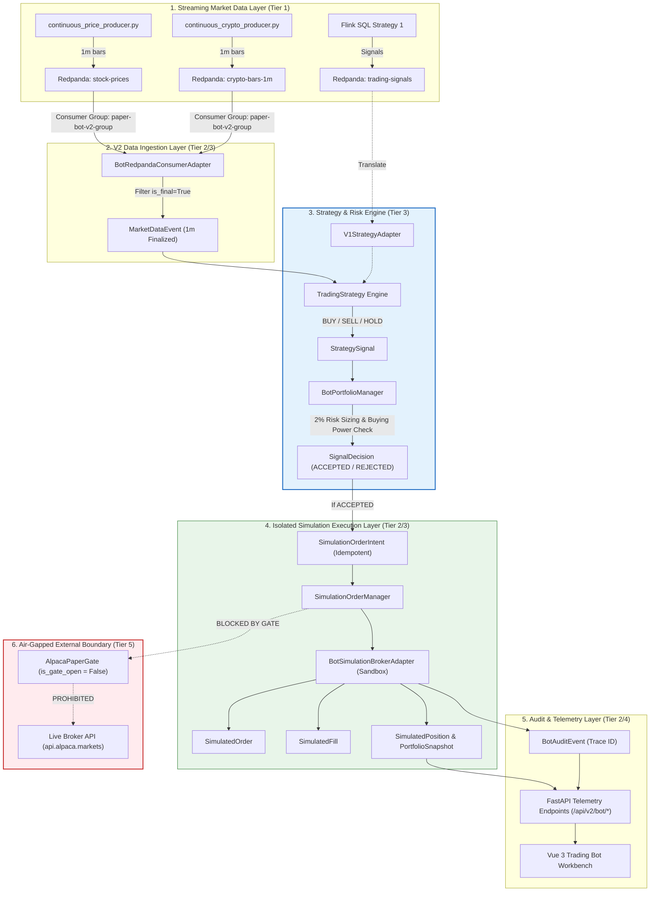

# GĐ29 — Paper Trading Bot Architecture
**AlgoTrading V2.0 Paper Trading Bot Architecture Specification**  
**Repository:** `D:\AlgoTrading`  
**Base Architecture:** Event-Driven Microservices on Redpanda & Python  
**Primary Timeframe:** `1m` (1 Minute)  
**Security Boundary:** Simulation Sandbox (Fail-Closed)

---

## 1. Tổng Quan Kiến Trúc V2 Paper Trading Bot

Kiến trúc **AlgoTrading V2.0 Paper Trading Bot** được thiết kế như một hệ thống giao dịch thuật toán mô phỏng hướng sự kiện (Event-Driven Simulation Architecture), kết hợp sức mạnh của hạ tầng streaming độ trễ thấp của V1 (Redpanda, Apache Flink) với mô hình hướng đối tượng mở rộng từ tài liệu tham khảo của tác giả Anil Gaddam.

Hệ thống hoạt động hoàn toàn trong **khung thời gian chính 1 phút (1m primary timeframe)**, loại bỏ hoàn toàn cơ chế REST polling chậm trễ, bảo vệ tuyệt đối tính bất biến của dữ liệu thị trường và cách ly 100% với các cổng thực thi tài khoản thật.

---

## 2. Phân Tích Các Tầng Kiến Trúc (Component Decomposition)

### 2.1. Tầng Dữ Liệu Thị Trường Trực Tuyến (Streaming Market Data Layer)
- **Nguồn dữ liệu:** Thừa hưởng trực tiếp từ các producers nền tảng của V1 (`continuous_price_producer.py` và `continuous_crypto_producer.py`).
- **Topics hoạt động:**
  - `stock-prices`: Stream nến 1m cho các cổ phiếu mục tiêu (NVDA, AAPL, TSLA, MSFT).
  - `crypto-bars-1m`: Stream nến 1m cho cặp tiền số (BTC/USD, ETH/USD) đi kèm cờ `is_final` để nhận diện nến đã đóng hoàn toàn.
- **Tính độc lập:** V2 Bot sử dụng Consumer Group riêng (`paper-bot-v2-group`). Bất kỳ hành động đọc, reset offset hay gián đoạn của bot đều không ảnh hưởng tới tiến trình Flink hoặc Signal Handlers của V1.

### 2.2. Tầng Hấp Thụ Dữ Liệu & Chuẩn Hóa Nến (Data Ingestion Layer)
- **Thành phần:** `BotRedpandaConsumerAdapter` kế thừa giao diện `BotDataManager`.
- **Cơ chế lọc nến chốt (Bar Finalization Filter):**
  Trong thị trường streaming, một cây nến 1 phút có thể nhận nhiều cập nhật tạm thời (provisional bars) trong suốt 60 giây. Nếu chiến lược tính toán trên nến tạm, tín hiệu sẽ bị dao động liên tục (flip-flopping / repainting).
  Adapter chỉ phát hành `MarketDataEvent` tới chiến lược khi `is_final == True` (đối với crypto) hoặc khi nhận được nến của phút kế tiếp (đối với cổ phiếu).

### 2.3. Tầng Chiến Lược Giao Dịch Thuật Toán (Strategy Engine)
- **Thành phần:** `TradingStrategy(ABC)` cùng các hiện thực chuẩn:
  - `MovingAverageCrossoverStrategy`: Khởi tạo với Short MA (9) và Long MA (21) trên nến 1m. Tính toán hoàn toàn tất định (deterministic), không phụ thuộc vào trạng thái bên ngoài.
  - `RSIStrategy`: Tính toán chỉ báo sức mạnh tương đối trên chu kỳ 14 nến 1m, phát hiện vùng quá mua (>70) và quá bán (<30).
  - `V1StrategyAdapter`: Lắng nghe tín hiệu trực tiếp từ Flink SQL Sink (`trading-signals` và `crypto-signals`), chuyển đổi thành thực thể `StrategySignal` chuẩn hóa của V2.

### 2.4. Tầng Quản Lý Danh Mục & Kiểm Soát Rủi Ro (Portfolio & Risk Manager)
- **Thành phần:** `BotPortfolioManager`.
- **Quy tắc định cỡ vị thế 2% (2% Risk Rule):**
  Bot không bao giờ mạo hiểm quá 2% tổng giá trị tài sản ($Equity$) cho một lệnh giao dịch duy nhất:
  $$\text{Risk Capital} = \text{Equity} \times 0.02$$
  Số lượng cổ phiếu/hợp đồng giao dịch ($Qty$) được tính toán tự động dựa trên khoảng dừng lỗ ($Stop Loss$):
  $$Qty = \frac{\text{Risk Capital}}{|Price - StopLossPrice|}$$
  Trường hợp không có Stop Loss cụ thể, hạn mức tối đa cho một vị thế không vượt quá sức mua khả dụng:
  $$Qty = \min\left(\frac{\text{Risk Capital}}{Price}, \frac{\text{Cash}}{Price}\right)$$
- **Kiểm soát đa vị thế:** Giới hạn tối đa không quá 5 vị thế mở đồng thời (`max_open_positions = 5`). Từ chối mọi tín hiệu BUY nếu số vị thế hiện tại đã đạt ngưỡng tối đa.

### 2.5. Tầng Khớp Lệnh Mô Phỏng Độc Lập (Simulation Execution Sandbox)
- **Thành phần:** `BotSimulationBrokerAdapter` kế thừa `SimulationOrderManager`.
- **Nguyên tắc cô lập:**
  Toàn bộ lệnh được xử lý nội bộ trong bộ nhớ hoặc file trạng thái riêng của bot (`data/mock_broker/v2_bot_sim_state.json`), hoàn toàn độc lập với `mock_broker_state.json` của V1 Manual Workbench.
- **Giả lập khớp lệnh:**
  Lệnh thị trường (Market Order) được khớp tại giá đóng cửa của nến 1m hiện tại với giả định trượt giá bằng 0 (Zero Slippage Bar Close). Hỗ trợ mô hình tính phí giao dịch và độ trễ khớp lệnh cho các giai đoạn kiểm thử nâng cao (GĐ33).

### 2.6. Tầng Giám Sát & Truy Xuất Nguồn Gốc (Audit & Telemetry)
- Mọi quyết định từ chối tín hiệu, lệnh phát sinh, khớp lệnh, và thay đổi trạng thái đều sinh ra `BotAuditEvent` có gắn mã truy vết thống nhất (`trace_id`).
- Cung cấp API REST `/api/v2/bot/status`, `/api/v2/bot/portfolio`, `/api/v2/bot/orders` phục vụ cho giao diện Web Dashboard V2.

---

## 3. Lý Do Lựa Chọn Khung Thời Gian 1 Phút (1m Primary Timeframe)

1. **Đồng bộ tự nhiên với hạ tầng Streaming V1:** Cả hai topic `stock-prices` và `crypto-bars-1m` đều được tạo ra ở chu kỳ 1 phút. Việc sử dụng khung thời gian 1m giúp dữ liệu chuyển thẳng vào chiến lược mà không cần tầng tổng hợp đa khung thời gian (resampling) phức tạp.
2. **Loại bỏ độ trễ của REST Polling:** So với chu kỳ 1 ngày (1d) hoặc 1 giờ (1h) trong tài liệu gốc của Anil Gaddam, khung thời gian 1m cho phép bot phản ứng linh hoạt trước các biến động giá ngắn hạn, tối ưu hóa quá trình kiểm thử soak và backtest trong thời gian thực.
3. **Kiểm soát rủi ro tức thì:** Trên nến 1m, Portfolio Manager có thể phát hiện và cắt lỗ nhanh chóng khi thị trường đảo chiều đột ngột, thay vì phải chờ đến cuối ngày giao dịch.
