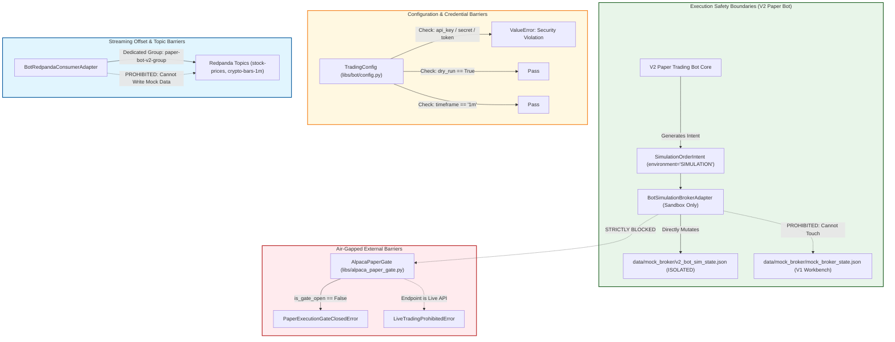

# GĐ29 — Safety Boundaries & Fail-Closed Guards
**AlgoTrading V2.0 Safety Architecture & Execution Boundary Specification**  
**Repository:** `D:\AlgoTrading`  
**Operational Mode:** `TRADING_MODE=DRY_RUN`  
**Paper Execution Gate:** `is_gate_open = False` (LOCKED)

---

## 1. Nguyên Tắc An Toàn Bất Biến (Core Safety Invariants)

Hệ thống **AlgoTrading V2.0 Paper Trading Bot** được thiết kế dựa trên triết lý **An toàn chủ động (Defense-in-Depth)** và **Tự động đóng cổng khi có sự cố (Fail-Closed Architecture)**. Mọi thao tác phát triển, thử nghiệm, và tích hợp bot tự động đều phải tuân thủ nghiêm ngặt các ranh giới an toàn sau:

---

## 2. Chi Tiết 6 Ranh Giới An Toàn (The 6 Safety Boundaries)

### 2.1. Ranh Giới 1: Khóa Cổng Thực Thi Alpaca Paper (Gate Fail-Closed)
- **Cơ chế:** Module `libs/alpaca_paper_gate.py` duy trì thuộc tính cứng:
  $$\text{is\_gate\_open} = \text{False}$$
- **Hành vi phòng vệ:** Bất kỳ lời gọi hàm nào tới `submit_paper_order` (ngoại trừ chế độ `fake_transport=True` trong unit test) sẽ lập tức phát sinh ngoại lệ `PaperExecutionGateClosedError` và đình chỉ phiên xử lý.
- **Ranh giới:** Bot V2 không được cấp quyền mở cổng này trong toàn bộ giai đoạn thiết kế và thử nghiệm ban đầu (GĐ29–GĐ36).

### 2.2. Ranh Giới 2: Cấm Tuyệt Đối Kết Nối Giao Dịch Thật (Live Trading Prohibition)
- **Cơ chế:** Kiểm tra toàn bộ URL cơ sở (Base URL). Nếu URL chứa chuỗi `api.alpaca.markets` mà không có tiền tố `paper-`, hệ thống phát sinh ngoại lệ nghiêm trọng:
  `LiveTradingProhibitedError: CRITICAL SECURITY VIOLATION: Endpoint points to Live Alpaca!`
- **Cấu hình môi trường:** Biến môi trường `.env` bắt buộc duy trì `TRADING_MODE=DRY_RUN`.

### 2.3. Ranh Giới 3: Loại Bỏ Hoàn Toàn Thông Tin Nhạy Cảm (Zero Secret Storage)
- **Cơ chế:** Trong tài liệu tham khảo của Anil Gaddam, tác giả lưu API Key và Secret Key trực tiếp bên trong đối tượng `TradingConfig`. Đây là lỗ hổng bảo mật nghiêm trọng.
- **Giải pháp V2:** Lớp `TradingConfig` trong `libs/bot/config.py` thực hiện kiểm tra chủ động trong phương thức `validate()`:
  Nếu bất kỳ trường nào trong số `[api_key, secret_key, token, password]` mang giá trị khác rỗng, hệ thống sẽ ném `ValueError` và từ chối khởi tạo cấu hình. Mọi kết nối đọc dữ liệu từ Alpaca (nếu có) phải đi qua cơ chế inject secret an toàn từ biến môi trường của hệ điều hành.

### 2.4. Ranh Giới 4: Cách Ly Nhóm Tiêu Thụ Streaming (Consumer Group Isolation)
- **Cơ chế:** V2 Paper Bot lắng nghe dữ liệu thị trường trực tuyến từ các topic Redpanda của V1 bằng một nhóm tiêu thụ độc lập:
  $$\text{Consumer Group} = \text{"paper-bot-v2-group"}$$
- **Bảo vệ:**
  - Không dùng chung offset với các tiến trình `signal-handler.py` hay `crypto_signal_handler.py` của V1.
  - Việc dừng, chạy lại hoặc reset vị trí đọc của Bot không làm lệch con trỏ watermark hoặc gây gián đoạn checkpointing của Apache Flink.

### 2.5. Ranh Giới 5: Bảo Vệ Tính Toàn Vẹn Của Topic Thị Trường (Topic Immutability)
- **Quy định bất biến:** Tuyệt đối không ghi dữ liệu giả lập (mock data) hoặc lệnh mô phỏng vào các topic thị trường tự nhiên (`stock-prices`, `crypto-bars-1m`, `finnhub-trades`, `binance-trades`).
- Dữ liệu lệnh mô phỏng và khớp lệnh của Bot chỉ được lưu hành nội bộ trong sandbox hoặc phát hành vào topic telemetry riêng nếu được cấu hình.

### 2.6. Ranh Giới 6: Cách Ly Trạng Thái Mô Phỏng Giữa Các Phiên (Simulation State Isolation)
- **Quy định:** Trạng thái tài khoản mô phỏng của V2 Bot được lưu trữ tách biệt hoàn toàn tại `data/mock_broker/v2_bot_sim_state.json` (hoặc hoàn toàn in-memory trong các bài test).
- Tuyệt đối không ghi đè hoặc làm xáo trộn số dư, danh mục và lịch sử lệnh của Trading Workbench thủ công tại `data/mock_broker/mock_broker_state.json`.

---

## 3. Ma Trận Ứng Phó Sự Cố An Toàn (Incident Response Matrix)

| Tình Huống Vi Phạm Phát Hiện | Cơ Chế Phát Hiện | Hành Động Tự Động Của Hệ Thống | Hậu Quả & Biện Pháp Khắc Phục |
|:---|:---|:---|:---|
| Phát hiện Base URL trỏ vào Live Alpaca | `AlpacaPaperGate._verify_safety_invariants()` | Ném ngay `LiveTradingProhibitedError`, dừng toàn bộ ứng dụng | Không có bất kỳ gói tin mạng nào được gửi ra ngoài. Kiểm tra lại `.env`. |
| Cố ý gọi lệnh ghi broker Alpaca khi Gate đóng | `AlpacaPaperGate.submit_paper_order()` | Ném `PaperExecutionGateClosedError`, ghi nhận `BotAuditEvent` | Lệnh bị hủy bỏ ngay tại tầng adapter cục bộ. |
| Truyền API Key vào cấu hình `TradingConfig` | `TradingConfig.validate()` | Ném `ValueError`, từ chối khởi tạo bot | Ngăn ngừa việc lưu trữ key vào logs, JSON status hoặc git repository. |
| Nến 1m đến chưa chốt (`is_final=False`) | `BotRedpandaConsumerAdapter.process_bar()` | Lọc bỏ nến tạm thời, không gọi hàm sinh tín hiệu | Ngăn chặn việc sinh tín hiệu giả mạo và giao dịch quá mức (over-trading). |
| Rủi ro lệnh vượt quá hạn mức vốn hoặc sức mua | `BotPortfolioManager.evaluate_signal()` | Chuyển trạng thái `SignalDecision` thành `REJECTED` | Không sinh ra `SimulationOrderIntent`. Bảo toàn an toàn tài chính danh mục. |
| Trùng lặp ý định đặt lệnh (Duplicate intent) | `SimulationOrderManager.submit_order_intent()` | Đối chiếu `idempotency_key`, trả về lệnh cũ | Không phát sinh lệnh trùng lặp, bảo đảm tính toàn vẹn số dư. |
