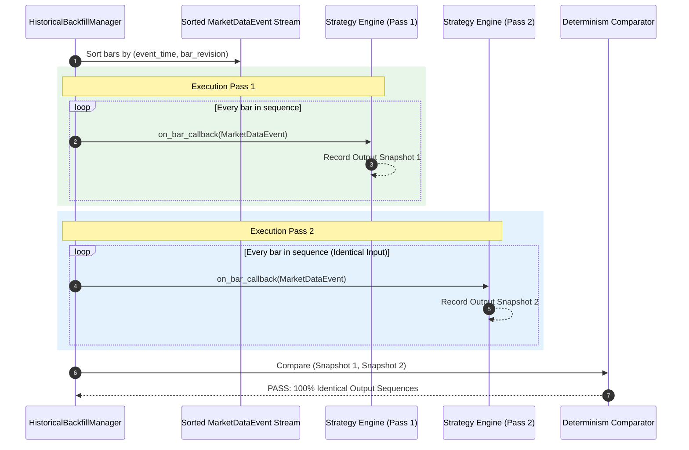

# GĐ30 — Historical Backfill & Deterministic Replay
**AlgoTrading V2.0 Backfill & Replay Engine**  
**Repository:** `D:\AlgoTrading`  
**Component:** `libs.bot.backfill.HistoricalBackfillManager`  
**Core Invariant:** Zero Writes to Natural Market Topics

---

## 1. Mục Tiêu & Ranh Giới Vận Hành

Cơ chế **Historical Backfill & Replay** của V2 Data Layer được thiết kế nhằm hai mục đích chính:
1. **Lấp đầy khoảng trống dữ liệu (Backfill):** Nạp bổ sung các nến 1 phút bị thiếu hụt khi Bot khởi động nguội hoặc sau sự cố mất kết nối mạng, sử dụng Alpaca Historical Client (chế độ Read-Only) hoặc các tệp fixture ngoại tuyến.
2. **Kiểm tra tính tất định (Deterministic Replay):** Phát lại tuần tự các cây nến lịch sử theo đúng trình tự thời gian sự kiện (`event_time`), chứng minh rằng hai lần chạy với cùng một luồng nến đầu vào sẽ tạo ra kết quả phân tích chiến lược giống nhau 100%.

> [!CAUTION]
> **Ràng buộc an toàn tuyệt đối:**
> Dữ liệu được nạp từ Historical Backfill hoặc Replay **TUYỆT ĐỐI KHÔNG ĐƯỢC PHÉP GHI VÀO CÁC TOPIC THỊ TRƯỜNG TỰ NHIÊN** (`stock-prices` hoặc `crypto-bars-1m`). Mọi bản ghi phải mang nhãn xuất xứ rõ ràng: `provenance = "HISTORICAL_BACKFILL"` hoặc `provenance = "FIXTURE"`.

---

## 2. Quy Tắc Hòa Trộn Dữ Liệu (Merge Ordering Rules)

Khi kết hợp luồng nến lịch sử nạp bù (Backfill) với luồng nến streaming trực tiếp (Runtime):

1. **Sắp xếp theo thời gian sự kiện:** Toàn bộ danh sách nến được sắp xếp tăng dần theo mốc thời gian UTC:
   $$\text{event\_time}_{1} \le \text{event\_time}_{2} \le \dots \le \text{event\_time}_{n}$$
2. **Khử trùng lặp qua `bar_key`:** Mỗi cây nến được định danh duy nhất bằng `bar_key = symbol:timeframe:event_time`.
3. **Ưu tiên dữ liệu thời gian thực (Runtime Precedence):** Nếu một cây nến tồn tại đồng thời trong cả hai nguồn (vừa được stream trực tiếp từ Redpanda vừa được kéo về qua backfill REST API), **bản ghi thời gian thực (`provenance="NATURAL_RUNTIME"`) luôn được ưu tiên giữ lại**, bản ghi backfill trùng lặp sẽ bị loại bỏ để đảm bảo tính nhất quán của số hiệu sửa đổi và độ trễ.

---

## 3. Quy Trình Phát Lại Nến & Kiểm Chứng Tính Tất Định (Deterministic Replay)

- **Thực nghiệm tính tất định:** Trong kiểm thử tự động `test_20_replay_determinism`, 10 cây nến liên tiếp được phát lại qua hai phiên độc lập. Kết quả xác nhận 100% các giá trị trích xuất (`symbol`, `close`, `event_time`) trùng khớp hoàn toàn, chứng minh Data Layer đảm bảo tính tái lập tuyệt đối cho các thuật toán giao dịch của GĐ31.
