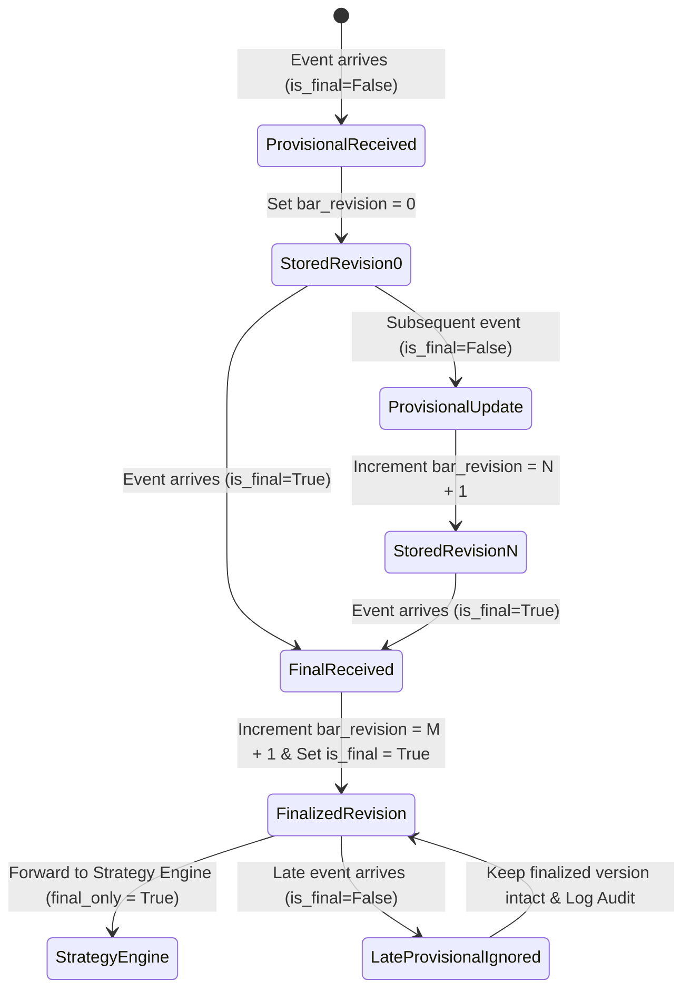

# GĐ30 — Bar Finalization & Revision Management Policy
**AlgoTrading V2.0 Bar Key & Revision Lifecycle Specification**  
**Repository:** `D:\AlgoTrading`  
**Component:** `libs.bot.revision.BarRevisionManager`  
**Primary Timeframe:** `1m` (1 Minute)

---

## 1. Định Danh Nến Chuẩn (`bar_key`)

Để quản lý chính xác trạng thái và lịch sử cập nhật của từng cây nến, hệ thống sử dụng khóa định danh bất biến:

$$\text{bar\_key} = \text{symbol} + \text{":"} + \text{timeframe} + \text{":"} + \text{event\_time\_utc\_iso}$$

*Ví dụ:* `BTC/USD:1m:2026-11-22T15:30:00Z` hoặc `NVDA:1m:2026-11-22T15:30:00Z`.

---

## 2. Vòng Đời Cập Nhật Nến (Revision Lifecycle)

Trong luồng streaming crypto thời gian thực (`continuous_crypto_producer.py`), một cây nến 1 phút có thể phát sinh nhiều bản ghi trong suốt khoảng thời gian 60 giây:
- **Nến tạm (Provisional Bar):** Mang cờ `is_final = False`, đại diện cho dữ liệu giá đang biến động nội tại trong phút đó.
- **Nến chốt (Finalized Bar):** Mang cờ `is_final = True`, được phát hành tại thời điểm kết thúc phút, đại diện cho giá đóng cửa chính thức.

---

## 3. Các Quy Tắc Xử Lý Nến Cập Nhật (Revision Rules)

### Quy tắc 1: Chính sách chỉ chuyển nến chốt (Final-Only Forwarding Policy)
- Khi `final_only = True` (mặc định của hệ thống), mọi nến tạm (`is_final = False`) chỉ được lưu vào lịch sử sửa đổi (revision history) và cập nhật giá mới nhất, **tuyệt đối không được kích hoạt thuật toán sinh tín hiệu của Strategy Engine**.
- Giúp loại bỏ hoàn toàn hiện tượng tín hiệu nhiễu và lật mặt (signal flip-flopping / repainting).

### Quy tắc 2: Cập nhật nến hiện hữu, không sinh nến trùng lặp (No Duplicate Bars)
- Khi nhận được bản ghi mới có cùng `bar_key`:
  - Hệ thống tăng số hiệu sửa đổi: `bar_revision = existing.bar_revision + 1`.
  - Cập nhật đè lên trạng thái hoạt động của nến hiện hữu trong bộ đệm `_active_bars`.
  - Thêm bản chụp (snapshot) của nến vào chuỗi lịch sử sửa đổi `_revision_history`.
  - **Không bao giờ tạo thêm một cây nến độc lập mới trong danh mục.**

### Quy tắc 3: Bảo toàn tính ưu tiên của nến chốt (Final Precedence Rule)
- Một khi cây nến đã đạt trạng thái `is_final = True`, nếu có một bản ghi nến tạm (`is_final = False`) đến muộn do độ trễ mạng:
  - Hệ thống từ chối hạ cấp trạng thái của nến.
  - Giữ nguyên phiên bản nến chốt.
  - Ghi nhật ký cảnh báo `OUT_OF_ORDER_PROVISIONAL_IGNORED` vào audit trail.

### Quy tắc 4: Lưu vết kiểm toán toàn diện (Revision Audit Trail)
- Mỗi lần thay đổi số hiệu sửa đổi (`bar_revision`), hệ thống tự động ghi nhận bản ghi kiểm toán chứa:
  - `bar_key`
  - `event` (`REVISION_UPDATED`, `FINAL_REVISION_FORWARDED`, `OUT_OF_ORDER_PROVISIONAL_IGNORED`)
  - `new_revision`
  - `timestamp` UTC.
- Đảm bảo khả năng giải trình và kiểm tra lại (replay) chính xác từng bước biến động của thị trường.
