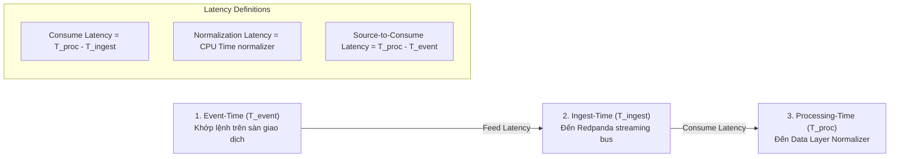

# GĐ30 — Data Observability & Latency Accounting
**AlgoTrading V2.0 Telemetry & Monitoring Specification**  
**Repository:** `D:\AlgoTrading`  
**Component:** `libs.bot.observability.DataTelemetryCollector`  
**Storage:** `data/paper_bot/market_data/`

---

## 1. Phân Rã Các Mốc Thời Gian & Độ Trễ (Temporal Breakdown)

Để đo lường chính xác hiệu năng hấp thụ dữ liệu mà không nhầm lẫn giữa **độ tươi của dữ liệu thị trường ngoài đời thực** và **độ trễ xử lý nội bộ của ứng dụng**, V2 Data Layer phân tách rõ ràng 3 mốc thời gian:

### 1.1. Ba Mốc Thời Gian Chuẩn
1. **Thời gian sự kiện (`event_time`):** Mốc thời gian cây nến 1 phút hình thành tại sàn giao dịch hoặc nhà cung cấp dữ liệu (Alpaca IEX hoặc Crypto exchange).
2. **Thời gian hấp thụ nguồn (`ingest_time`):** Mốc thời gian bản tin được ghi nhận vào cụm Redpanda của V1 (`stock-prices` hoặc `crypto-bars-1m`).
3. **Thời gian xử lý (`processing_time`):** Mốc thời gian bộ điều hợp `PaperBotConsumer` nhận và bắt đầu chuẩn hóa bản ghi trong tiến trình V2.

### 1.2. Các Chỉ Số Độ Trễ Đo Lường
- **Độ trễ tiêu thụ (Consume Latency):**
  $$\text{Consume Latency} = \text{Processing Time} - \text{Ingest Time}$$
  Đo lường độ trễ của đường truyền từ Redpanda tới ứng dụng Python. Giá trị mục tiêu: $< 15\text{ms}$.
- **Độ trễ chuẩn hóa (Normalization Latency):**
  Thời gian CPU cần thiết để parse JSON, kiểm tra kiểu `Decimal`, chuẩn hóa symbol, và đóng gói `MarketDataEvent`. Giá trị mục tiêu: $< 1.0\text{ms}$.
- **Độ trễ toàn trình từ nguồn (Source-to-Consume Latency):**
  $$\text{Source-to-Consume Latency} = \text{Processing Time} - \text{Event Time}$$
  Bao gồm độ trễ của đường truyền Internet từ sàn giao dịch Alpaca, độ trễ trễ 15 phút của gói tin IEX (nếu có đối với cổ phiếu miễn phí), và độ trễ nội bộ.

---

## 2. Hệ Thống Chỉ Số Telemetry Toàn Diện (Operational Metrics)

Động cơ `DataTelemetryCollector` duy trì và cập nhật liên tục các bộ đếm đo lường:

| Nhóm Chỉ Số | Tên Chỉ Số | Mô Tả Ý Nghĩa Nghiệp Vụ |
|:---|:---|:---|
| **Lưu lượng (Throughput)** | `messages_consumed` | Tổng số lượng bản tin nhận được từ Redpanda topics. |
| | `valid_bars` | Số lượng nến vượt qua toàn bộ các bước kiểm định chất lượng. |
| | `invalid_bars` | Số lượng nến bị từ chối do vi phạm schema, giá âm hoặc sai lệch timestamp. |
| **Bất thường (Anomalies)** | `duplicates` | Số lượng nến trùng lặp phát hiện được. |
| | `revisions` | Số lượng nến được cập nhật lại số hiệu sửa đổi (`bar_revision > 0`). |
| | `late_events` | Số lượng nến đến muộn hơn 5 phút so với tiến độ thị trường. |
| | `missing_intervals` | Số lượng khoảng trống thời gian phát hiện được ($\Delta t > 1\text{m}$). |
| | `stale_events` | Số lượng sự kiện bị trôi thời gian vượt ngưỡng cấu hình. |
| **Độ trễ & Tồn đọng** | `total_consumer_lag` | Tổng số lượng bản tin chưa được tiêu thụ trên tất cả các phân vùng. |
| | `avg_consume_latency_ms` | Độ trễ trung bình từ Redpanda tới V2 Consumer. |
| | `avg_normalization_latency_ms` | Thời gian trung bình để chuẩn hóa một bản ghi. |
| | `avg_source_to_consume_latency_ms`| Độ trễ trung bình tính từ mốc phát sinh giao dịch gốc. |

---

## 3. Báo Cáo Chất Lượng Dữ Liệu Tự Động (Data Quality Summary Report)

Định kỳ hoặc khi được yêu cầu, hệ thống xuất bản bản chụp báo cáo ra tệp JSON:
`data/paper_bot/market_data/reports/data_quality_report.json` và `data/status/gd30_data_quality_summary.json`.

Báo cáo ghi nhận tỷ lệ đạt chuẩn (Pass Rate Percentage), chi tiết các lý do từ chối (Rejection Reason Codes), và 5 sự kiện vi phạm gần nhất phục vụ việc khắc phục sự cố nhanh chóng.
