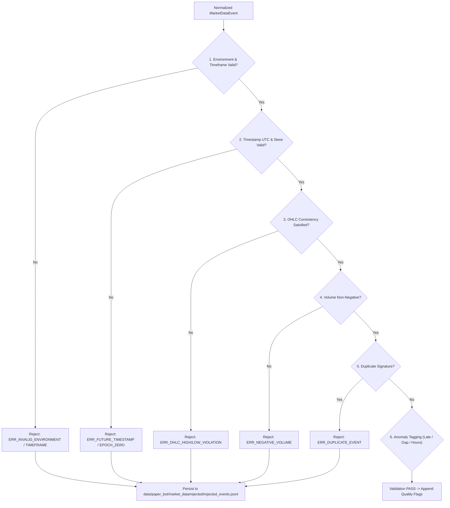

# GĐ30 — Data Quality, Freshness & Calendar Validation
**AlgoTrading V2.0 Data Quality Assurance Engine**  
**Repository:** `D:\AlgoTrading`  
**Component:** `libs.bot.quality.DataQualityEngine`  
**Standard:** Zero Silent Data Dropping

---

## 1. Tổng Quan Kiến Trúc Kiểm Định Chất Lượng Dữ Liệu

Động cơ `DataQualityEngine` chịu trách nhiệm sàng lọc và thẩm định toàn bộ nến 1 phút trước khi nạp vào bộ lưu trữ hoặc cung cấp cho chiến lược. Mọi vi phạm đều được phân loại với mã lỗi cụ thể (Reason Code) và ghi nhận vào tệp kiểm toán `rejected_events.jsonl`.

---

## 2. Chi Tiết Các Bộ Kiểm Tra Chất Lượng (Quality Checks)

### 2.1. Kiểm Tra Tính Nhất Quán OHLC (OHLC Consistency)
Mọi cây nến bắt buộc phải tuân thủ chặt chẽ các bất đẳng thức giá học:
1. Giá dương: $\text{open} > 0 \land \text{high} > 0 \land \text{low} > 0 \land \text{close} > 0$.
2. Đỉnh nến là giá cao nhất:
   $$\text{high} \ge \max(\text{open}, \text{close}, \text{low})$$
   *(Nếu vi phạm: ném mã lỗi `ERR_OHLC_HIGH_VIOLATION`).*
3. Đáy nến là giá thấp nhất:
   $$\text{low} \le \min(\text{open}, \text{close}, \text{high})$$
   *(Nếu vi phạm: ném mã lỗi `ERR_OHLC_LOW_VIOLATION`).*

### 2.2. Kiểm Tra Tính Hợp Lệ Của Mốc Thời Gian (Timestamp Validity)
- Bắt buộc là `datetime` có gắn múi giờ chuẩn UTC (`tzinfo=timezone.utc`).
- Không được rơi vào tương lai xa quá 5 phút so với đồng hồ hệ thống ($\text{event\_time} \le \text{now\_utc} + 300\text{s}$). Nếu vượt quá: gán cờ `FUTURE_TIMESTAMP` và từ chối `ERR_FUTURE_TIMESTAMP_SKEW`.
- Không được là mốc thời gian trước năm 2000 hoặc epoch 0: từ chối `ERR_EPOCH_ZERO_TIMESTAMP`.

### 2.3. Phát Hiện Trùng Lặp (Duplicate Detection)
- Tính toán chữ ký nội dung duy nhất cho từng nến:
  $$\text{sig} = \text{symbol} + \text{timeframe} + \text{event\_time} + \text{OHLCV} + \text{bar\_revision}$$
- Nếu nến có cùng `event_id` hoặc cùng chữ ký $\text{sig}$ xuất hiện lần thứ hai với cùng số hiệu sửa đổi: gán cờ `DUPLICATE_BAR` và từ chối `ERR_DUPLICATE_EVENT`.

### 2.4. Phát Hiện Đến Muộn & Sai Thứ Tự (Late & Out-of-Order Events)
- So sánh `event_time` của nến đến với mốc thời gian mới nhất đã quan sát được của cùng mã tài sản.
- Nếu $\text{event\_time} < \text{latest\_observed}$:
  - Trễ hơn 5 phút: gán cờ `LATE_EVENT`.
  - Trễ dưới 5 phút: gán cờ `OUT_OF_ORDER_EVENT`.
  - Nến vẫn được chấp nhận hợp lệ nhưng mang cờ để phục vụ phân tích độ trễ của nguồn phát dữ liệu.

### 2.5. Phát Hiện Khoảng Trống Dữ Liệu (Missing Interval Detection)
- Đối với nến 1 phút, nếu khoảng cách giữa hai nến kế tiếp $\Delta t > 1\text{ phút}$:
  - Gán cờ `MISSING_INTERVAL_GAP_{X}M` để cảnh báo hệ thống đã mất mát $X$ cây nến, kích hoạt cơ chế backfill bù đắp nếu cần.

---

## 3. Quy Tắc Lịch Thị Trường Cho Stocks Và Crypto

| Tiêu Chí | Cổ Phiếu (Stocks) | Tiền Số (Crypto) |
|:---|:---|:---|
| **Lịch Hoạt Động** | Thứ Hai – Thứ Sáu, 09:30 – 16:00 US/Eastern (Giờ chuẩn sàn giao dịch New York). | 24/7/365, hoạt động liên tục không ngừng nghỉ. |
| **Xử Lý Ngoài Giờ** | Khi nến phát sinh ngoài giờ giao dịch (Pre-market, After-hours, Cuối tuần, Ngày lễ): gắn cờ `STOCKS_PRE_MARKET`, `STOCKS_AFTER_HOURS`, hoặc `STOCKS_WEEKEND`. | Không áp dụng các ràng buộc giờ mở/đóng cửa. Nến được chấp nhận ở mọi mốc thời gian. |
| **Đánh Giá Stale / Lỗi**| Không coi việc thiếu nến trong giờ đóng cửa hoặc ngày nghỉ cuối tuần là lỗi của Producer. | Khoảng trống dữ liệu $> 5\text{ phút}$ lập tức bị đánh dấu là sự cố mất kết nối mạng. |
