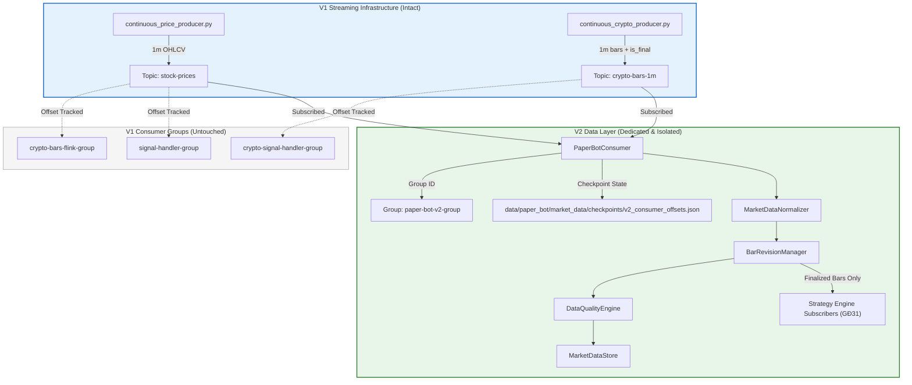

# GĐ30 — Redpanda Ingestion Engine
**AlgoTrading V2.0 Data Layer Specification**  
**Repository:** `D:\AlgoTrading`  
**Consumer Group:** `paper-bot-v2-group` (Isolated)  
**Topics:** `stock-prices` (Stocks 1m), `crypto-bars-1m` (Crypto 1m)  
**Primary Timeframe:** `1m` (1 Minute)

---

## 1. Tổng Quan Kiến Trúc Hấp Thụ Dữ Liệu (Ingestion Engine Architecture)

Tầng hấp thụ dữ liệu của **AlgoTrading V2.0 Paper Trading Bot** được đóng gói trong module `libs.bot.consumer.PaperBotConsumer`. Hệ thống được thiết kế để tiêu thụ dữ liệu streaming thời gian thực từ cụm Redpanda của V1 mà không tạo ra bất kỳ tác động tiêu cực nào tới hạ tầng sản xuất hiện hữu.

---

## 2. Nguyên Tắc Độc Lập Consumer Group & Offset Isolation

1. **Consumer Group Riêng Biệt:**
   - Toàn bộ các kết nối của V2 Bot sử dụng định danh duy nhất:
     $$\text{group\_id} = \text{"paper-bot-v2-group"}$$
   - Tuyệt đối không chia sẻ nhóm với các consumer V1 (`signal-handler-group`, `crypto-signal-handler-group`, `market-news-group`, `crypto-bars-flink-group`).
2. **Không Can Thiệp Offset V1:**
   - V2 duy trì cơ chế lưu vết offset độc lập tại `data/paper_bot/market_data/checkpoints/v2_consumer_offsets.json`.
   - Khi bot khởi động lại, tiếp tục đọc từ offset đã lưu của `paper-bot-v2-group` mà không ảnh hưởng tới con trỏ đọc hay checkpoint của cụm Apache Flink.
3. **Cấu Hình Vị Trí Khởi Động (Configurable Starting Position):**
   - `latest` (Mặc định cho phiên mới): Bắt đầu đọc các nến phát sinh từ thời điểm kích hoạt bot.
   - `earliest`: Đọc lại toàn bộ dữ liệu có trong topic (phục vụ audit hoặc benchmark).
   - `committed`: Khôi phục phiên làm việc cũ từ offset đã được checkpoint tại local store.
   - `timestamp`: Tua đến mốc thời gian cụ thể dựa trên chỉ mục thời gian của Kafka.

---

## 3. Khả Năng Chống Chịu & Vận Hành Linh Hoạt

- **Quản lý phân vùng (Partition Tracking):** Theo dõi độc lập từng cặp `TopicPartition` (ví dụ `stock-prices:0`, `crypto-bars-1m:0`), ghi nhận offset và độ trễ (consumer lag) theo từng phân vùng.
- **Tự động phục hồi (Reconnect & Rebalance):** Tự động tái kết nối khi Redpanda broker gặp sự cố tạm thời, cập nhật trạng thái sức khỏe từ `RUNNING` sang `DEGRADED` hoặc `DISCONNECTED`.
- **Dừng an toàn (Graceful Shutdown):** Khi nhận tín hiệu dừng (`stop()`), consumer ngừng nhận message mới, đẩy toàn bộ nến còn tồn đọng trong hàng đợi vào bộ đệm lưu trữ, lưu checkpoint và chuyển sang trạng thái `STOPPED`.
- **Chế độ Vận chuyển Giả lập (Simulated/Fixture Transport):** Trong các môi trường kiểm thử cô lập hoặc khi cụm Redpanda offline, consumer tự động kích hoạt transport fixture để nạp các luồng dữ liệu 1m mẫu thực tế mà không đòi hỏi broker thật, đảm bảo quá trình CI/CD luôn có thể kiểm tra toàn diện logic hấp thụ.
