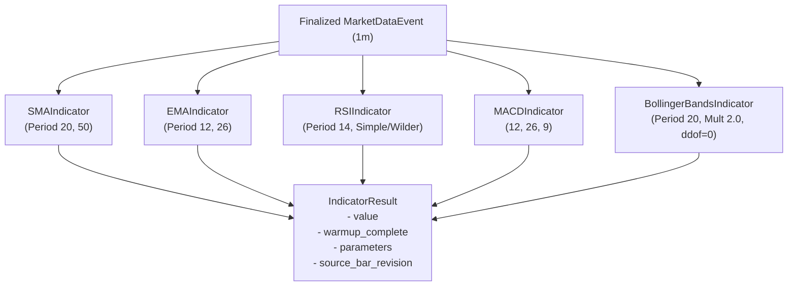

# GĐ31 — Technical Indicator Library Specification
**AlgoTrading V2.0 Indicator Library Documentation**  
**Repository:** `D:\AlgoTrading`  
**Package:** `libs.bot.indicators`  
**Primary Timeframe:** `1m` (1 Minute)  
**Standard:** Deterministic Calculation & Explicit Warmup Enforcement

---

## 1. Tổng Quan Về Thư Viện Chỉ Báo Kỹ Thuật

Thư viện chỉ báo kỹ thuật của **AlgoTrading V2.0** được thiết kế như một tập hợp các module độc lập, hiệu năng cao, dựa trên nền tảng tính toán chuẩn mực của Python và NumPy/Pandas. 

Mọi chỉ báo đều hoạt động theo phương thức cập nhật gia tăng (Incremental State Update) trên luồng nến 1 phút đã chốt (`is_final = True`), trả về cấu trúc dữ liệu chuẩn hóa `IndicatorResult` có lưu giữ đầy đủ tham số cấu hình, trạng thái warmup, và phiên bản thuật toán.

---

## 2. Đặc Tả Chi Tiết Từng Chỉ Báo Kỹ Thuật

### 2.1. Simple Moving Average (SMA)
- **Công thức:**
  $$\text{SMA}_{n}(t) = \frac{1}{n} \sum_{i=0}^{n-1} \text{Close}_{t-i}$$
- **Cấu hình chuẩn:** SMA20 và SMA50.
- **Ràng buộc Warmup:** Bắt buộc phải tích lũy tối thiểu đủ $n$ cây nến 1 phút hợp lệ. Nếu số lượng nến $< n$, chỉ báo trả về `warmup_complete = False` và `value = None`.

### 2.2. Exponential Moving Average (EMA)
- **Hệ số làm mượt (Smoothing Factor):**
  $$\alpha = \frac{2}{n + 1}$$
  *Ví dụ: Với EMA12, $\alpha = \frac{2}{13} \approx 0.1538$; với EMA26, $\alpha = \frac{2}{27} \approx 0.0741$.*
- **Khởi tạo (Seeding):** Giá trị EMA đầu tiên tại thời điểm $t = n$ được khởi tạo bằng chính giá trị SMA của $n$ cây nến đầu tiên:
  $$\text{EMA}_{n} = \frac{1}{n} \sum_{i=1}^{n} \text{Close}_{i}$$
- **Công thức đệ quy (Recurrence):**
  $$\text{EMA}_{t} = \text{Close}_{t} \times \alpha + \text{EMA}_{t-1} \times (1 - \alpha)$$
- **Ràng buộc Warmup:** Yêu cầu tối thiểu $n$ cây nến để khởi tạo. Giá trị tính toán đảm bảo tính tất định 100% qua mọi lần phát lại (replay).

### 2.3. Relative Strength Index (RSI)
Thư viện cung cấp hai phiên bản thuật toán độc lập để đối chiếu với tài liệu nghiên cứu:
1. **Phiên bản 1: `RSI_SIMPLE_ROLLING` (v1.0.0):**
   - Sử dụng trung bình trượt đơn giản (Rolling Mean) của các mức tăng (Gain) và giảm (Loss) trên cửa sổ $n$ nến gần nhất:
     $$\text{AvgGain} = \frac{\sum \text{Gains}}{n}, \quad \text{AvgLoss} = \frac{\sum \text{Losses}}{n}$$
   - Đây là phương pháp được sử dụng trong mã nguồn tham khảo của tác giả Anil Gaddam (*Topic 4 - Paper Trading Bot.pdf*).
2. **Phiên bản 2: `RSI_WILDER` (v1.0.0):**
   - Sử dụng phương pháp làm mượt cấp số nhân của J. Welles Wilder ($\alpha = \frac{1}{n}$):
     $$\text{AvgGain}_{t} = \frac{\text{AvgGain}_{t-1} \times (n - 1) + \text{Gain}_{t}}{n}$$
- **Xử lý các trường hợp biên đặc thù (Edge Cases):**
  - $\text{AvgLoss} == 0 \land \text{AvgGain} > 0$: Toàn bộ các nến đều tăng $\rightarrow \text{RSI} = 100.0$.
  - $\text{AvgGain} == 0 \land \text{AvgLoss} > 0$: Toàn bộ các nến đều giảm $\rightarrow \text{RSI} = 0.0$.
  - $\text{AvgGain} == 0 \land \text{AvgLoss} == 0$: Thị trường đi ngang tuyệt đối (Flat Price) $\rightarrow \text{RSI} = 50.0$.
  - Chưa đủ $n + 1$ nến để tính $n$ mức thay đổi: Trả về `warmup_complete = False` và `value = None`.

### 2.4. Moving Average Convergence Divergence (MACD)
- **Cấu hình chuẩn:** Fast EMA = 12, Slow EMA = 26, Signal EMA = 9.
- **Ràng buộc kiểm tra:** Bắt buộc $\text{fast\_period} < \text{slow\_period}$.
- **Công thức tính:**
  $$\text{MACD Line} = \text{EMA}_{12}(\text{Close}) - \text{EMA}_{26}(\text{Close})$$
  $$\text{Signal Line} = \text{EMA}_{9}(\text{MACD Line})$$
  $$\text{Histogram} = \text{MACD Line} - \text{Signal Line}$$
- **Ràng buộc Warmup:** Yêu cầu tối thiểu $\text{slow\_period} + \text{signal\_period} = 35$ nến để đường Signal hoàn tất khởi tạo.

### 2.5. Bollinger Bands
- **Cấu hình chuẩn:** Chu kỳ $n = 20$, Hệ số nhân độ lệch chuẩn $k = 2.0$.
- **Chính sách độ lệch chuẩn (Standard Deviation Policy):**
  - Mặc định sử dụng độ lệch chuẩn tổng thể (`ddof = 0`):
    $$\sigma = \sqrt{\frac{1}{n} \sum_{i=0}^{n-1} (\text{Close}_{t-i} - \text{SMA}_{20})^2}$$
  - Hỗ trợ tùy chọn độ lệch chuẩn mẫu hiệu chỉnh (`ddof = 1`): chia cho $n - 1$.
- **Đầu ra:**
  $$\text{Middle Band} = \text{SMA}_{20}$$
  $$\text{Upper Band} = \text{Middle Band} + k \times \sigma$$
  $$\text{Lower Band} = \text{Middle Band} - k \times \sigma$$
  $$\text{Band Width} = \frac{\text{Upper Band} - \text{Lower Band}}{\text{Middle Band}}$$

---

## 3. Cấu Trúc Đầu Ra Chuẩn Hóa `IndicatorResult`

Mọi chỉ báo đều đóng gói kết quả vào thực thể `IndicatorResult`:
* `indicator_id` (`str`): Định danh duy nhất kèm tham số (VD: `SMA_20`, `RSI_14_SIMPLE_ROLLING`, `BB_20_2.0_0`).
* `indicator_version` (`str`): Phiên bản thuật toán (`1.0.0`).
* `symbol` (`str`): Mã tài sản được tính toán.
* `timeframe` (`str`): Cố định `"1m"`.
* `event_time` (`datetime`): Mốc thời gian UTC của cây nến nguồn.
* `value` (`Any`): Giá trị số hoặc từ điển kết quả (VD: float cho SMA/RSI, Dict cho MACD/Bollinger). Mang giá trị `None` nếu warmup chưa hoàn thành.
* `parameters` (`Dict[str, Any]`): Bộ tham số đã sử dụng để tính toán.
* `warmup_complete` (`bool`): Cờ xác nhận chỉ báo đã vượt qua giai đoạn khởi động và sẵn sàng cho chiến lược.
