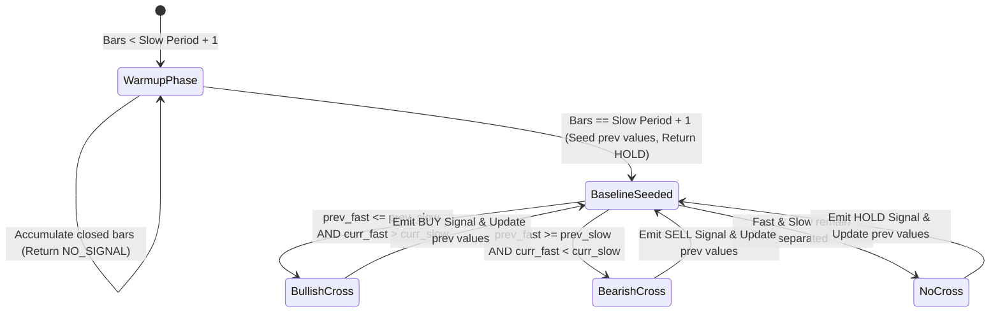

# GĐ31 — Moving Average Crossover Strategy Specification
**AlgoTrading V2.0 Moving Average Crossover Plugin**  
**Repository:** `D:\AlgoTrading`  
**Component:** `libs.bot.strategies.ma_crossover.MovingAverageCrossoverStrategy`  
**Primary Timeframe:** `1m` (1 Minute)  
**Baseline Configuration:** Fast SMA = 20, Slow SMA = 50

---

## 1. Cơ Chế Hoạt Động & Quy Tắc Giao Cắt

Chiến lược **Moving Average Crossover** trên nến 1 phút dựa trên sự tương quan biến động giữa hai đường trung bình động: Đường ngắn hạn (Fast SMA) phản ánh xu hướng giá tức thời, và đường dài hạn (Slow SMA) đại diện cho xu hướng chủ đạo.

---

## 2. Đặc Tả Toán Học & Điều Kiện Phát Tín Hiệu

### 2.1. Điều Kiện Giao Cắt Vàng (Bullish Golden Cross $\rightarrow$ BUY)
Tín hiệu **BUY** chỉ được kích hoạt khi đồng thời thỏa mãn:
$$\text{Fast SMA}_{t-1} \le \text{Slow SMA}_{t-1} \quad \land \quad \text{Fast SMA}_{t} > \text{Slow SMA}_{t}$$
- **Mã lý do (Reason Code):** `BULLISH_CROSSOVER`.
- **Diễn giải:** Đường Fast SMA đã chính thức cắt lên phía trên đường Slow SMA tại thời điểm đóng cửa của nến phút hiện tại.

### 2.2. Điều Kiện Giao Cắt Tử Thần (Bearish Death Cross $\rightarrow$ SELL)
Tín hiệu **SELL** chỉ được kích hoạt khi đồng thời thỏa mãn:
$$\text{Fast SMA}_{t-1} \ge \text{Slow SMA}_{t-1} \quad \land \quad \text{Fast SMA}_{t} < \text{Slow SMA}_{t}$$
- **Mã lý do (Reason Code):** `BEARISH_CROSSOVER`.
- **Diễn giải:** Đường Fast SMA đã chính thức cắt xuống phía dưới đường Slow SMA tại thời điểm đóng cửa của nến phút hiện tại.

### 2.3. Trạng Thái Không Giao Cắt ($\rightarrow$ HOLD)
Nếu không có giao cắt xảy ra, chiến lược xác định trạng thái là `HOLD` với mã lý do `NO_STRATEGY_CONDITION`. Khi chạy ở chế độ tối ưu băng thông (`emit_hold = False`), chiến lược trả về `None` để giảm tải xử lý cho các tầng tiếp theo.

---

## 3. Các Biện Pháp Phòng Ngừa Rủi Ro Kỹ Thuật

1. **Tuyệt Đối Không Dùng Dữ Liệu Tương Lai (No Look-Ahead Bias):**
   - Giá trị $SMA_{t}$ và $SMA_{t-1}$ được tính toán nghiêm ngặt trên chuỗi giá đóng cửa của các cây nến đã hình thành.
   - Không so sánh hai giá trị của hai mốc thời gian không tương ứng.
2. **Khóa Nến Tạm (Bar Finalization Lock):**
   - Mọi nến tạm (`is_final = False`) phát sinh trong khoảng thời gian giữa phút lập tức bị chặn với mã lý do `BAR_NOT_FINAL`, ngăn chặn hiện tượng tín hiệu xuất hiện rồi biến mất (repainting).
3. **Quản Lý Warmup Rõ Ràng:**
   - Chiến lược yêu cầu tối thiểu $\text{slow\_period} + 1 = 51$ nến 1 phút liên tục.
   - Nếu dữ liệu không đủ, chiến lược trả về `signal_type = "NO_SIGNAL"` kèm mã lý do `INSUFFICIENT_WARMUP`.
4. **Cách Ly Trạng Thái Đa Tài Sản (Multi-Symbol State Isolation):**
   - Chuỗi giá lịch sử và giá trị previous của từng mã cổ phiếu/tiền số (NVDA, AAPL, BTC/USD, ETH/USD) được lưu trữ hoàn toàn tách biệt trong các bộ đệm riêng, không làm xáo trộn lẫn nhau.
