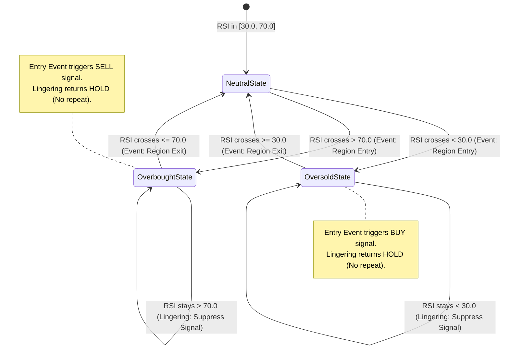

# GĐ31 — RSI Mean Reversion Strategy Specification
**AlgoTrading V2.0 Relative Strength Index Plugin**  
**Repository:** `D:\AlgoTrading`  
**Component:** `libs.bot.strategies.rsi_strategy.RSIStrategy`  
**Primary Timeframe:** `1m` (1 Minute)  
**Baseline Configuration:** Period = 14, Lower Threshold = 30.0, Upper Threshold = 70.0

---

## 1. Cơ Chế Hoạt Động & Máy Trạng Thái Vùng Giá

Chiến lược **RSI Mean Reversion** được xây dựng dựa trên nguyên lý giá có xu hướng phục hồi về mức cân bằng sau khi rơi vào trạng thái quá bán hoặc quá mua cực đoan.

Điểm cải tiến cốt lõi so với các thuật toán thông thường là chiến lược tích hợp **máy trạng thái theo dõi vùng giá (Region State Machine)**, phân biệt rõ ràng giữa **sự kiện vượt ngưỡng (Region Entry)** và **trạng thái duy trì trong vùng (Lingering)** để ngăn chặn hiện tượng phát sinh tín hiệu trùng lặp liên tục trên từng nến.

---

## 2. Đặc Tả Tín Hiệu & Quy Tắc Chuyển Đổi Vùng

| Sự Kiện Thị Trường | Điều Kiện Kỹ Thuật | Loại Tín Hiệu | Mã Lý Do (`reason_codes`) | Diễn Giải Nghiệp Vụ |
|:---|:---|:---:|:---|:---|
| **Vào Vùng Quá Bán** | $\text{RSI}_{t} < 30.0 \land \text{Zone}_{t-1} \ne \text{"OVERSOLD"}$ | **`BUY`** | `RSI_OVERSOLD_ENTRY` | Giá đã giảm quá sâu, xác suất phục hồi kỹ thuật cao. |
| **Duy Trì Vùng Quá Bán**| $\text{RSI}_{t} < 30.0 \land \text{Zone}_{t-1} == \text{"OVERSOLD"}$ | **`HOLD`** | `RSI_IN_ZONE_NO_REPEAT` | Giá tiếp tục ở vùng quá bán; **chặn không phát thêm lệnh mua**. |
| **Thoát Vùng Quá Bán** | $\text{RSI}_{t} \ge 30.0 \land \text{Zone}_{t-1} == \text{"OVERSOLD"}$ | **`HOLD`** | `RSI_REGION_EXIT` | Chỉ số RSI phục hồi trở lại vùng trung tính. |
| **Vào Vùng Quá Mua** | $\text{RSI}_{t} > 70.0 \land \text{Zone}_{t-1} \ne \text{"OVERBOUGHT"}$ | **`SELL`** | `RSI_OVERBOUGHT_ENTRY` | Giá tăng quá nóng, rủi ro điều chỉnh giảm cao. |
| **Duy Trì Vùng Quá Mua**| $\text{RSI}_{t} > 70.0 \land \text{Zone}_{t-1} == \text{"OVERBOUGHT"}$ | **`HOLD`** | `RSI_IN_ZONE_NO_REPEAT` | Giá tiếp tục ở vùng quá mua; **chặn không phát thêm lệnh bán**. |
| **Thoát Vùng Quá Mua** | $\text{RSI}_{t} \le 70.0 \land \text{Zone}_{t-1} == \text{"OVERBOUGHT"}$ | **`HOLD`** | `RSI_REGION_EXIT` | Chỉ số RSI hạ nhiệt trở lại vùng trung tính. |

---

## 3. Tuyên Bố Tham Số Nghiên Cứu (Research Parameters Disclaimer)

Các giá trị ngưỡng cấu hình mặc định ($\text{Period} = 14$, $\text{Oversold} = 30$, $\text{Overbought} = 70$) được trích xuất từ tài liệu tham khảo kỹ thuật chuẩn mực (*Topic 4 - Paper Trading Bot.pdf*). 

> [!NOTE]
> Các tham số này đóng vai trò là **giá trị cấu hình nghiên cứu cơ sở (Research Baseline Configuration)** phục vụ việc kiểm thử và xác minh tính đúng đắn của phần mềm. Chúng không cấu thành lời khuyên đầu tư hay bộ tham số đã qua tối ưu hóa lợi nhuận tài chính.
