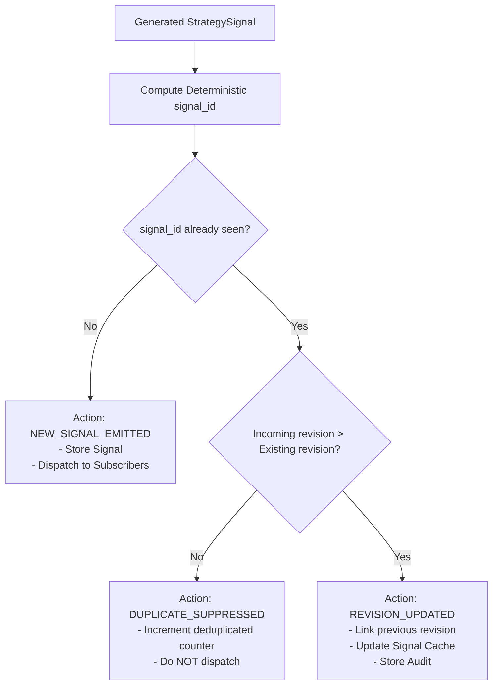

# GĐ31 — Signal Traceability & Deduplication
**AlgoTrading V2.0 Signal Audit & Reproducibility Specification**  
**Repository:** `D:\AlgoTrading`  
**Components:** `libs.bot.signal_validator`, `libs.bot.signal_store`  
**Standard:** Cryptographic Determinism & Zero Replay Duplication

---

## 1. Định Danh Tín Hiệu Xác Định (Deterministic Signal ID)

Mỗi tín hiệu `StrategySignal` được gán một mã định danh bất biến, được tính toán thông qua hàm băm mật mã học SHA256 dựa trên toàn bộ ngữ cảnh nguồn gốc sinh ra nó:

$$\text{seed} = \text{strategy\_id} + \text{":"} + \text{version} + \text{":"} + \text{symbol} + \text{":"} + \text{timeframe} + \text{":"} + \text{bar\_key} + \text{":"} + \text{config\_hash}$$

$$\text{signal\_id} = \text{"sig\_"} + \text{SHA256}(\text{seed})[:16]$$

*Ưu điểm:* Khi hệ thống phát lại (replay) cùng một luồng nến lịch sử với cùng một cấu hình chiến lược, mã `signal_id` sinh ra luôn giống hệt nhau, loại bỏ hoàn toàn việc phụ thuộc vào UUID ngẫu nhiên.

---

## 2. Quy Trình Khử Trùng Lặp Tín Hiệu (Signal Deduplication)

Động cơ [SignalValidator](file:///d:/AlgoTrading/libs/bot/signal_validator.py) đảm bảo:
1. **Chặn trùng lặp khi phát lại (Replay Idempotency):**
   - Nếu một cây nến với cùng số hiệu sửa đổi (`bar_revision`) được đánh giá lần thứ hai, `SignalValidator` trả về hành vi `DUPLICATE_SUPPRESSED` và không chuyển tín hiệu vào sổ lưu trữ.
2. **Hỗ trợ cập nhật nến sửa đổi (Revision Re-Evaluation):**
   - Nếu cây nến đến có cùng `bar_key` nhưng mang số hiệu sửa đổi cao hơn (`bar_revision > existing.bar_revision`), hệ thống cho phép đánh giá lại.
   - Tín hiệu mới được liên kết với số hiệu sửa đổi cũ trong trường `metadata['previous_revision']`.
   - Lịch sử tín hiệu cũ được bảo toàn nguyên vẹn, không bị xóa.

---

## 3. Danh Mục Các Mã Lý Do Kỹ Thuật Chuẩn Hóa (Standard Reason Codes)

Hệ thống loại bỏ hoàn toàn các điểm số xác suất hoặc độ tin cậy trừu tượng chưa được chứng minh. Mọi tín hiệu đều bắt buộc mang danh sách các mã lý do kỹ thuật rõ ràng:

| Mã Lý Do (`reason_codes`) | Phân Loại | Ý Nghĩa Kỹ Thuật |
|:---|:---:|:---|
| `INSUFFICIENT_WARMUP` | Điều kiện | Chưa đủ số lượng nến tối thiểu để chỉ báo kỹ thuật hoàn tất khởi động. |
| `BAR_NOT_FINAL` | An toàn | Nến nhận được là nến tạm; bị lọc bỏ theo chính sách `final_only`. |
| `DATA_QUALITY_REJECTED`| Chất lượng | Nến không vượt qua bộ kiểm định chất lượng (sai mốc thời gian, OHLC lỗi). |
| `MISSING_INTERVAL` | Bất thường | Phát hiện khoảng trống dữ liệu trong chuỗi nến. |
| `BULLISH_CROSSOVER` | Kỹ thuật | Giao cắt vàng: Fast SMA cắt lên phía trên Slow SMA. |
| `BEARISH_CROSSOVER` | Kỹ thuật | Giao cắt tử thần: Fast SMA cắt xuống phía dưới Slow SMA. |
| `RSI_OVERSOLD_ENTRY` | Kỹ thuật | Chỉ số RSI chính thức rơi xuống dưới ngưỡng quá bán ($< 30.0$). |
| `RSI_OVERBOUGHT_ENTRY` | Kỹ thuật | Chỉ số RSI chính thức vượt lên trên ngưỡng quá mua ($> 70.0$). |
| `RSI_IN_ZONE_NO_REPEAT`| Chống trùng | RSI tiếp tục nằm trong vùng quá mua/bán; chặn phát sinh tín hiệu lặp. |
| `RSI_REGION_EXIT` | Kỹ thuật | RSI phục hồi từ vùng cực đoan trở lại ngưỡng trung tính. |
| `NO_STRATEGY_CONDITION`| Trạng thái | Nến hợp lệ nhưng không thỏa mãn bất kỳ điều kiện giao cắt/vượt ngưỡng nào. |
| `FLINK_TRIGGER` | Đối soát | Tín hiệu được dịch chuyển trực tiếp từ Flink SQL Sink. |
