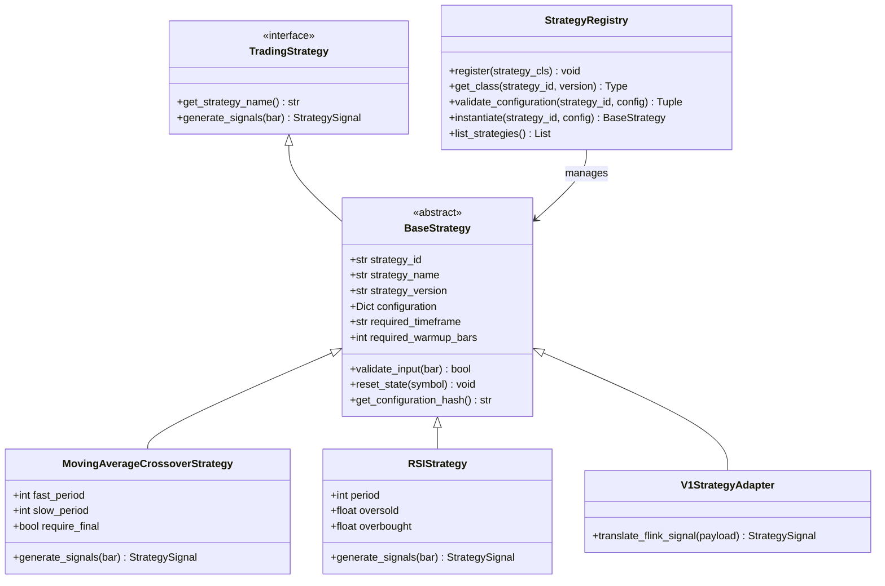
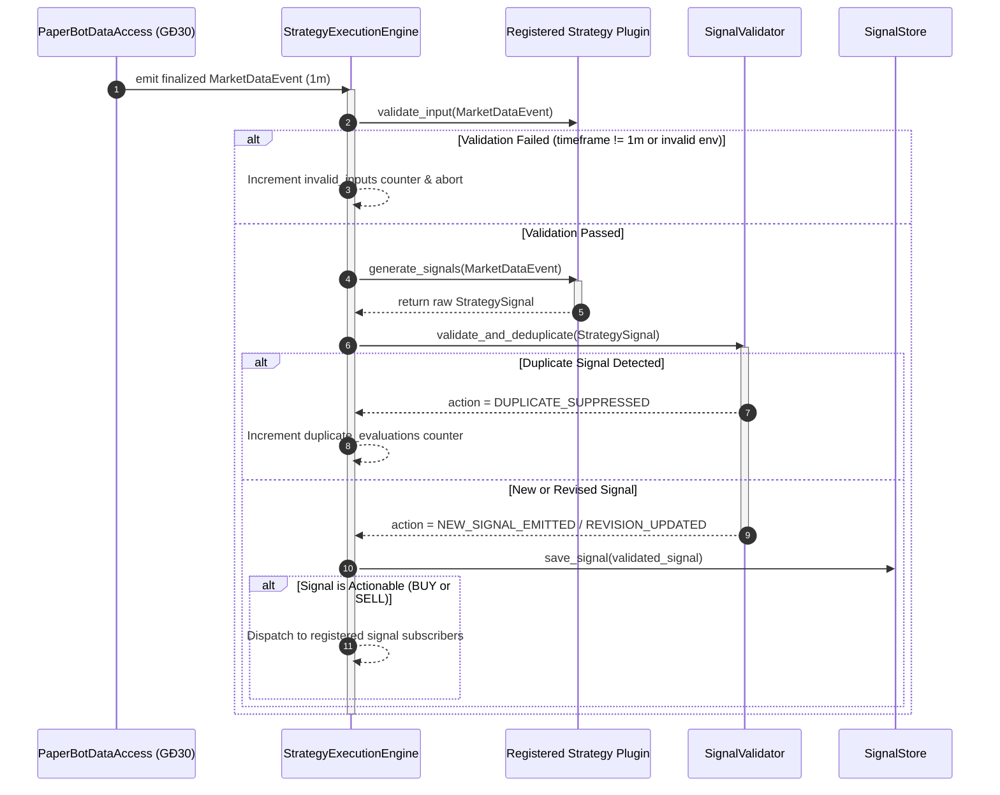

# GĐ31 — Strategy Plugin Engine Architecture
**AlgoTrading V2.0 Strategy Engine & Plugin Registry**  
**Repository:** `D:\AlgoTrading`  
**Packages:** `libs.bot.strategies`, `libs.bot.strategy_registry`, `libs.bot.strategy_engine`  
**Pattern:** Strategy Pattern with Dynamic Plugin Registry

---

## 1. Kiến Trúc Hướng Đối Tượng & Nguyên Tắc Tách Biệt

Engine chiến lược của **AlgoTrading V2.0** áp dụng triệt để mẫu thiết kế **Strategy Pattern**. Mọi chiến lược giao dịch phải kế thừa từ lớp cơ sở [BaseStrategy](file:///d:/AlgoTrading/libs/bot/strategies/base.py) và tuân thủ các nguyên tắc tách biệt nghiêm ngặt:

### Nguyên Tắc Bất Biến Của Strategy:
1. **Cô Lập Truy Xuất (Zero Infrastructure Coupling):** Chiến lược không được phép tạo kết nối mạng, không import client Kafka/Redpanda, không gọi Alpaca SDK, và không thao tác với tệp hệ thống ngoài phạm vi cho phép.
2. **Chỉ Nhận Dữ Liệu Chuẩn:** Chiến lược chỉ tiếp nhận đầu vào thông qua đối tượng `MarketDataEvent` đã chốt và các kết quả tính toán từ `IndicatorResult`.
3. **Tính Tất Định (Determinism):** Cùng một chuỗi nến 1 phút và cùng một cấu hình tham số bắt buộc phải sinh ra chuỗi `StrategySignal` giống hệt nhau 100%.

---

## 2. Trung Tâm Đăng Ký Chiến Lược (Strategy Registry)

Lớp `StrategyRegistry` trong module `libs.bot.strategy_registry` đóng vai trò là danh bạ trung tâm quản lý toàn bộ các plugin chiến lược:

- **Đăng ký động (Dynamic Registration):** Các chiến lược được đăng ký vào hệ thống kèm theo số hiệu phiên bản (`version`).
- **Thẩm định cấu hình theo Schema (Schema Validation):** Khi người dùng hoặc hệ thống khởi tạo chiến lược, các tham số cấu hình được đối soát chặt chẽ với thuộc tính `configuration_schema` (kiểm tra kiểu số, giá trị min/max, trường bắt buộc, danh sách lựa chọn enum).
- **Mã băm cấu hình (Configuration Hash):** Mỗi cấu hình được mã hóa thành chuỗi SHA256 (16 ký tự đầu), gắn chặt vào mọi tín hiệu được sinh ra để phục vụ việc truy xuất nguồn gốc cấu hình sau này.
- **Rào cản an toàn (Sandbox Security Boundary):** Từ chối tuyệt đối việc tự động nạp (load) hoặc thực thi mã nguồn Python nằm ngoài cấu trúc mã nguồn của repository.

---

## 3. Đường Ống Xử Lý Tín Hiệu (Strategy Execution Pipeline)

Tiến trình điều phối [StrategyExecutionEngine](file:///d:/AlgoTrading/libs/bot/strategy_engine.py) vận hành theo cơ chế hướng sự kiện:

> [!IMPORTANT]
> **Ranh giới giai đoạn GĐ31:**
> `StrategyExecutionEngine` chỉ hoàn tất quy trình ở bước lưu trữ và phát sóng `StrategySignal`. Tuyệt đối không gọi tới `PortfolioManager` để tính toán khối lượng lệnh và không gửi lệnh vào `OrderManager` trong giai đoạn này.
