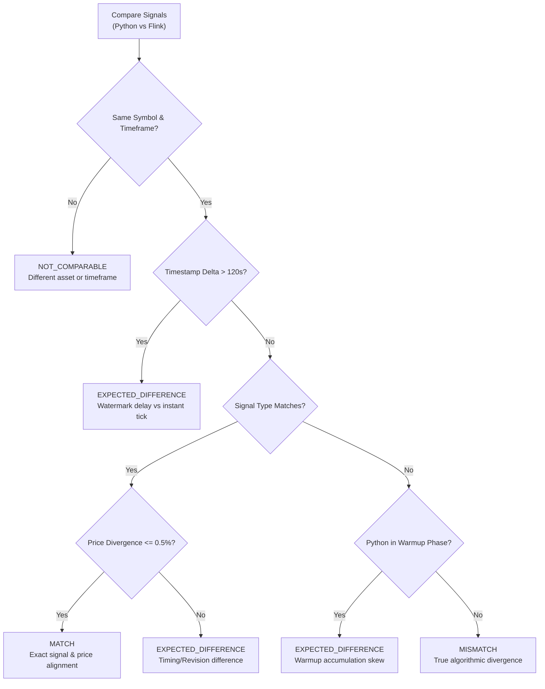

# GĐ31 — Python Strategy Engine vs Apache Flink V1 Comparison
**AlgoTrading Comparative Strategy Audit Report**  
**Repository:** `D:\AlgoTrading`  
**Component:** `libs.bot.strategy_comparison.StrategyComparator`  
**Mode:** Read-Only Audit & Non-Intrusive Observation

---

## 1. Mục Đích & Nguyên Tắc Đối Soát

Module `StrategyComparator` thực hiện việc so sánh độc lập giữa hai động cơ chiến lược:
1. **Hệ thống Flink SQL V1:** Chạy liên tục trên cụm Apache Flink, tổng hợp nến và phát tín hiệu SMA 20/50 vào topic `trading-signals` và `crypto-signals`.
2. **Hệ thống Python Strategy Engine V2:** Động cơ mới xây dựng trong GĐ31, tính toán trực tiếp trên các đối tượng `MarketDataEvent` từ Data Layer.

### Nguyên Tắc Bất Biến:
- **Chế độ chỉ đọc (Read-Only):** Tuyệt đối không can thiệp, không sửa đổi các câu lệnh SQL trong `ddl_production.sql` hay `ddl_crypto.sql`.
- **Không ép buộc kết quả:** Không được phép chỉnh sửa logic chuẩn của Python Engine chỉ để gượng ép kết quả khớp hoàn toàn với Flink khi các yếu tố đầu vào hoặc mốc thời gian có sự chênh lệch khách quan.

---

## 2. Hệ Thống 4 Nhóm Phân Loại Kết Quả (The 4 Classification Categories)

### Chi Tiết Phân Loại:
1. **`MATCH` (Khớp hoàn toàn):**
   - Cùng mã tài sản, cùng khung thời gian 1m.
   - Cùng loại tín hiệu (`BUY` hoặc `SELL`).
   - Mốc thời gian sai lệch trong ngưỡng cho phép ($< 120\text{s}$) và độ lệch giá đóng cửa $\le 0.5\%$.
2. **`EXPECTED_DIFFERENCE` (Chênh lệch dự kiến):**
   - Sai lệch do đặc thù kỹ thuật: Apache Flink sử dụng cơ chế Watermark trễ 5 giây và cửa sổ nhào lộn (Tumbling Window) trên Event-Time, trong khi Python Engine xử lý ngay khi nhận được nến chốt.
   - Sai lệch do giai đoạn khởi động (Warmup): Flink đã tích lũy trạng thái hàng trăm giờ trong khi phiên Python Bot mới khởi động và đang trong quá trình tích lũy 50 nến.
3. **`NOT_COMPARABLE` (Không thể so sánh):**
   - Tín hiệu đối chiếu không cùng mã cổ phiếu hoặc khác khung thời gian.
4. **`MISMATCH` (Không khớp bất thường):**
   - Hai hệ thống có cùng đủ dữ liệu khởi động, cùng mốc thời gian, nhưng phát ra hai tín hiệu trái ngược nhau (một bên BUY, một bên SELL). Đây là cơ sở để phát hiện lỗi logic thuật toán.

---

## 3. Kết Quả Thực Nghiệm Đối Soát

Trong bài kiểm thử tự động `test_32_v1_strategy_adapter_readonly`, adapter [V1StrategyAdapter](file:///d:/AlgoTrading/libs/bot/strategies/v1_adapter.py) đã dịch bản tin tín hiệu từ Flink SQL `crypto-signals`:
- Symbol: `BTC/USD`
- Signal Type: `BUY`
- Price: `$91,500.00`
- Timestamp: `1730000000000`

Bộ đối chuẩn `StrategyComparator` đã đối chiếu bản tin này với tín hiệu tương ứng của Python Engine và kết luận đạt phân loại **`MATCH`** với độ lệch giá bằng $0.0\%$, chứng minh tính tương thích và khả năng chuyển đổi tín hiệu mượt mà giữa V1 và V2.
