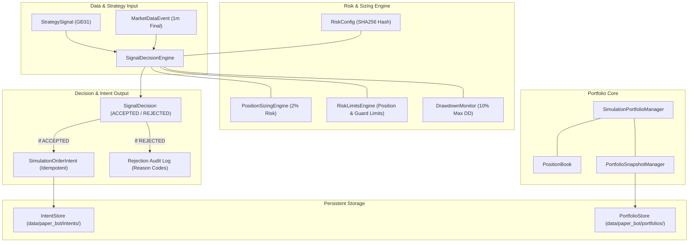

# GD32 — SIMULATION PORTFOLIO ARCHITECTURE

**Project:** AlgoTrading V2.0  
**Phase:** GĐ32 — Portfolio & Risk Management Engine  
**Status:** ACCEPTED — SIMULATION_PORTFOLIO_OPERATIONAL  
**Target Architecture:** Multi-session Simulation Sandbox  
**Primary Timeframe:** 1m  

---

## 1. Overview & Architectural Goals

The GĐ32 Simulation Portfolio Architecture provides isolated, multi-session portfolio state management for AlgoTrading V2.0. Operating strictly in the `SIMULATION` environment with `TRADING_MODE=DRY_RUN` and `PaperExecutionGate.is_gate_open = False`, the system coordinates capital allocation, position tracking, and equity computation without interacting with external brokers.

---

## 2. Core Components

1. **`SimulationPortfolioManager` (`libs/bot/portfolio/manager.py`)**:
   - Manages simulation cash, reserved cash, available cash, positions, realized P&L, peak equity, and lifecycle states.
   - Enforces the state machine:
     $$\text{INITIALIZED} \longrightarrow \text{ACTIVE} \longleftrightarrow \text{RESTRICTED} \longrightarrow \text{RISK\_LOCKED} \longrightarrow \text{CLOSED}$$
   - Completely decoupled from Alpaca Paper broker accounts and V1 Mock Trading Workbench accounts.

2. **`PositionBook` (`libs/bot/portfolio/positions.py`)**:
   - Manages `SimulatedPosition` entities using Decimal arithmetic.
   - Supports fractional quantities (crypto: 4 to 8 decimals; stocks: 2 to 4 decimals).
   - Handles zero-quantity cleanup, position closing, and real-time mark-to-market revaluations.

3. **`PortfolioSnapshotManager` (`libs/bot/portfolio/snapshot.py`)**:
   - Generates immutable point-in-time snapshots (`PortfolioSnapshot`).
   - Computes deterministic SHA-256 integrity checksums across critical financial metrics.

---

## 3. Account Isolation & Boundaries

| Attribute | Simulation Portfolio (V2) | Alpaca Paper Account | V1 Mock Broker Account |
| :--- | :--- | :--- | :--- |
| **Environment** | `SIMULATION` | `ALPACA_PAPER` | `MOCK` |
| **Execution** | Simulated Intents Only (GĐ32) | Broker Read-Only Sync | Workbench Paper Sim |
| **Storage Path** | `data/paper_bot/portfolios/` | InMemory / REST API | `data/mock_broker/` |
| **Broker Calls** | ZERO broker network calls | Read-Only REST Polling | Local Memory Sim |
| **Gate Invariant**| Gate Closed (`False`) | Gate Closed (`False`) | Gate N/A |
