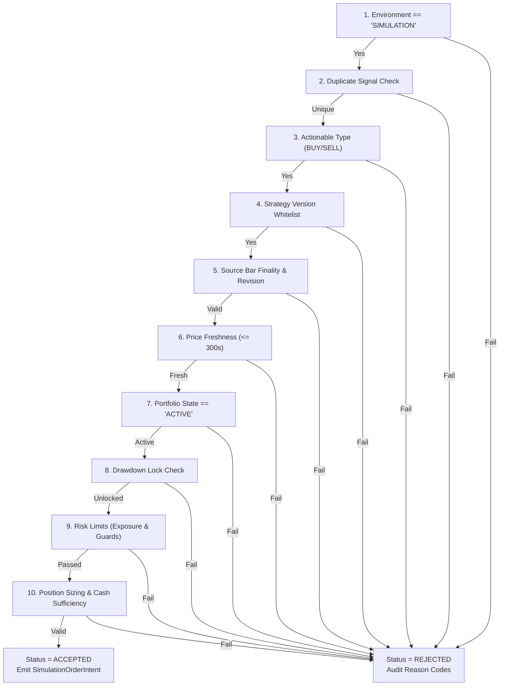

# GD32 — SIGNAL DECISION ENGINE SPECIFICATION

**Project:** AlgoTrading V2.0  
**Phase:** GĐ32 — Portfolio & Risk Management Engine  
**Module:** `libs/bot/risk/decision_engine.py`  
**Inputs:** `StrategySignal` (GĐ31)  
**Outputs:** `SignalDecision` + Optional `SimulationOrderIntent` (GĐ32)  

---

## 1. Ten-Step Verification Pipeline

Every incoming `StrategySignal` traverses a 10-step fail-closed evaluation pipeline in `SignalDecisionEngine`:



---

## 2. Decision Status Semantics

- **`ACCEPTED`:** The signal satisfies all risk, portfolio, pricing, and sizing constraints. An associated `SimulationOrderIntent` is emitted. Note: `ACCEPTED` does NOT imply an order has been submitted or filled!
- **`REJECTED`:** One or more risk constraints were breached. Contains explicit `reason_codes` and `rejection_reason`. No order intent is emitted.
- **`DEFERRED`:** Signal evaluation is deferred pending arrival of finalized bar or missing pricing reference.
- **`NOT_EVALUABLE`:** Critical input corruption or non-simulation environment encountered.

---

## 3. SignalDecision Contract

```python
@dataclass
class SignalDecision:
    decision_id: str
    signal_id: str
    portfolio_id: str
    symbol: str
    status: str  # ACCEPTED, REJECTED, DEFERRED, NOT_EVALUABLE
    rejection_reason: Optional[str]
    reason_codes: List[str]
    timestamp: datetime
    evaluated_by: str  # "PORTFOLIO_MANAGER"
    calculated_qty: float
    risk_snapshot: Dict[str, Any]
    sizing_snapshot: Dict[str, Any]
    configuration_hash: str
    trace_id: str
    environment: str = "SIMULATION"
```
