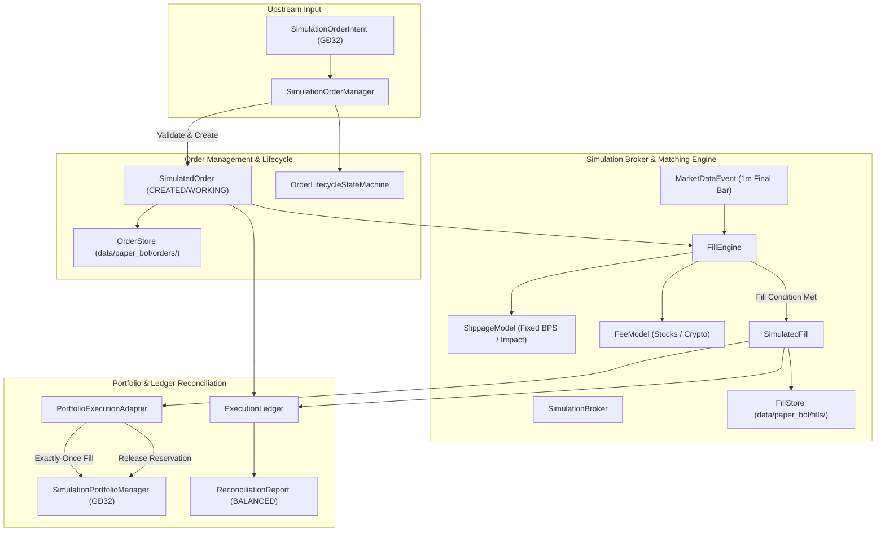

# GD33 — ORDER MANAGEMENT & SIMULATION BROKER ARCHITECTURE

**Project:** AlgoTrading V2.0  
**Phase:** GĐ33 — Order Management & Simulation Broker Engine  
**Status:** ACCEPTED — SIMULATION_BROKER_OPERATIONAL  
**Target Environment:** Sandbox Simulation (`environment="SIMULATION"`)  
**Primary Execution Timeframe:** 1-Minute Bars (`1m`)  
**Safety Gate:** `is_gate_open = False` | `TRADING_MODE=DRY_RUN`  

---

## 1. Architectural Overview

The GĐ33 Order Management and Simulation Broker Engine forms the trade execution core of AlgoTrading V2.0. It receives approved `SimulationOrderIntent` entities from GĐ32, transitions orders through an auditable state machine, evaluates execution against 1m finalized market bars, calculates adverse slippage and fees, produces reproducible `SimulatedFill` records, and updates the `SimulationPortfolioManager` using exact Decimal accounting.

---

## 2. Component Directory

| Component | Module Path | Purpose |
| :--- | :--- | :--- |
| **`OrderLifecycleStateMachine`** | `libs/bot/execution/lifecycle.py` | Enforces valid transitions and terminal restrictions |
| **`SlippageModel`** | `libs/bot/execution/slippage.py` | Models Zero, Fixed BPS, and Market Impact slippage |
| **`FeeModel`** | `libs/bot/execution/fees.py` | Models per-share (stocks) and notional BPS (crypto) fees |
| **`FillEngine`** | `libs/bot/execution/fill_engine.py` | Evaluates MARKET, LIMIT, STOP, STOP_LIMIT, TRAILING_STOP |
| **`SimulationOrderManager`** | `libs/bot/execution/order_manager.py` | Transforms intents, manages cancellations & replacements |
| **`PortfolioExecutionAdapter`** | `libs/bot/execution/portfolio_adapter.py` | Exactly-once updates to GĐ32 SimulationPortfolioManager |
| **`ExecutionLedger`** | `libs/bot/execution/ledger.py` | Correlation ID logging and mathematical reconciliation |
| **`SimulationBroker`** | `libs/bot/execution/simulation_broker.py` | Central broker coordinating matching, fills, and ledger |
| **`OrderStore` & `FillStore`** | `libs/bot/execution/order_store.py`, `fill_store.py` | Atomic persistence in `data/paper_bot/` |

---

## 3. Strict Sandbox Decoupling

The GĐ33 Simulation Broker is completely isolated:
1. **Zero External Broker Calls:** No connection to Alpaca Broker REST endpoints (zero submit, replace, cancel calls).
2. **Zero Shared State:** Does not touch `data/mock_broker/` or V1 Trading Workbench tables.
3. **Fail-Closed Guard:** Rejects any configuration or endpoint associated with live trading.
