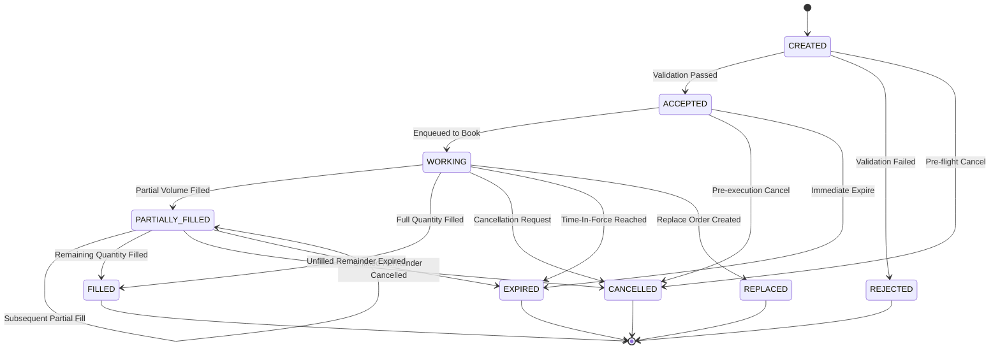

# GD33 — ORDER LIFECYCLE STATE MACHINE SPECIFICATION

**Project:** AlgoTrading V2.0  
**Phase:** GĐ33 — Order Management & Simulation Broker Engine  
**Module:** `libs/bot/execution/lifecycle.py`  

---

## 1. Lifecycle States & Semantics

The order lifecycle is governed by a strict deterministic finite state machine with 10 states:

### State Classification:
- **Active States:** `CREATED`, `NEW` (alias), `ACCEPTED`, `WORKING`, `PARTIALLY_FILLED`.
- **Terminal States:** `FILLED`, `CANCELLED`, `REJECTED`, `EXPIRED`, `REPLACED`.

---

## 2. Invariants & Rules

1. **Terminal State Immutability:** Once an order transitions to a terminal state (`FILLED`, `CANCELLED`, etc.), it cannot transition to any other state. Any attempted transition raises `InvalidOrderStateTransitionError`.
2. **Fill Protection:** Terminal orders can NEVER receive subsequent fills.
3. **Quantity Conservation:**
   $$\text{filled\_quantity} \le \text{quantity}$$
   $$\text{remaining\_quantity} = \text{quantity} - \text{filled\_quantity}$$
4. **Completion Invariant:** An order with status `FILLED` must have $\text{remaining\_quantity} == 0.0$.
5. **Partial Cancellation Integrity:** An order cancelled after a partial fill (`PARTIALLY_FILLED` $\rightarrow$ `CANCELLED`) preserves its historical `filled_quantity` and all associated fill records.
6. **Replacement Audit Links:** When replacing an order, the old order transitions to `REPLACED` with `replaced_by_order_id` pointing to the new order, and the new order records `replaces_order_id`.
