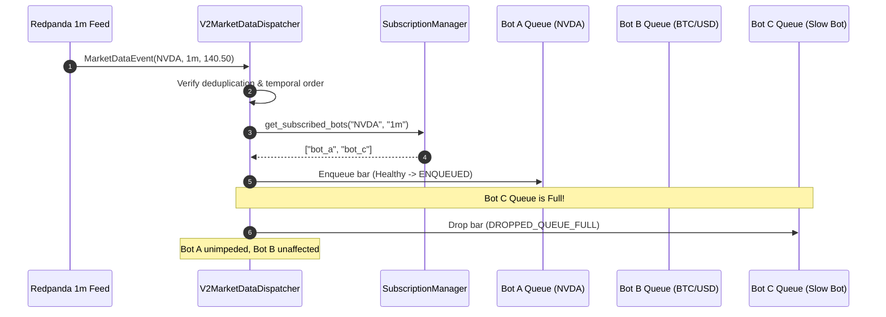

# GĐ37 — SHARED MARKET DATA FAN-OUT & BACKPRESSURE ISOLATION

**Dự án:** AlgoTrading V2.0  
**Giai đoạn:** GĐ37  
**Module:** `libs/bot/multibot/dispatcher.py` & `libs/bot/multibot/subscriptions.py`

---

## 1. Nguyên lý Hoạt động của Fan-Out Dispatcher

Thay vì mỗi bot duy trì một Kafka/Redpanda consumer riêng gây nghẽn kết nối và lãng phí băng thông:
- **`V2MarketDataDispatcher`** đóng vai trò là single consumer nhận nến 1m hoàn nguyên từ Redpanda/Fixtures.
- Dữ liệu được định tuyến thông qua **`SubscriptionManager`** theo symbol và timeframe.
- Mỗi bot sở hữu một hàng đợi FIFO giới hạn (`collections.deque(maxlen=max_queue_size)`).

---

## 2. Kiến trúc Fan-Out & Luồng Dữ liệu

---

## 3. Cơ chế Bảo đảm Toàn vẹn Dữ liệu

1. **Deduplication Check (`event_id`)**:
   - Duy trì set các `event_id` đã xử lý per-bot (`_bot_seen_events`). Nếu trùng lặp, trả về trạng thái `"DUPLICATE"` và bỏ qua.
2. **Temporal Ordering Verification (`event_time`)**:
   - Duy trì timestamp cuối cùng của từng symbol trên từng bot (`_bot_symbol_timestamps`).
   - Nếu nến đến có `event_time < last_ts`, nến bị loại bỏ với trạng thái `"OUT_OF_ORDER"`.
3. **Non-Blocking Backpressure Isolation**:
   - Khi một bot bị chậm hoặc paused khiến hàng đợi đầy (`len(q) >= max_queue_size`), bar mới bị loại bỏ (`"DROPPED_QUEUE_FULL"`).
   - Dispatcher ghi log cảnh báo và cập nhật telemetry.
   - **Tuyệt đối không block thread dispatcher**, các bot khỏe mạnh khác tiếp tục nhận và xử lý nến bình thường.
4. **Durable Cursor Tracking (`ack_event`)**:
   - Khi bot hoàn thành xử lý nến qua Orchestrator, nó gửi ACK về dispatcher để cập nhật `_bot_cursors[bot_id] = event_id`.

---

## 4. Chỉ số Đo lường Dispatcher Telemetry

Dispatcher cung cấp báo cáo đo lường thời gian thực:
- `total_received`: Tổng số bar nạp vào hệ thống.
- `total_dispatched`: Tổng số lượt bar gửi thành công tới các bot.
- `total_dropped`: Số lượt bar bị drop do tràn queue hoặc sai thứ tự.
- `total_duplicates`: Số bar trùng lặp bị chặn.
- `queue_depths`: Độ sâu hàng đợi hiện thời của từng bot.
