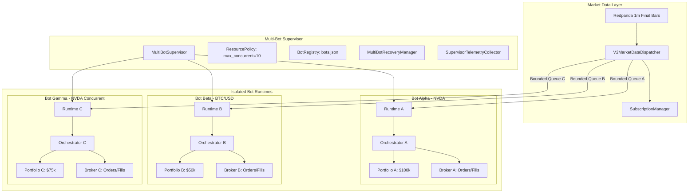

# GĐ37 — MULTI-BOT SYSTEM ARCHITECTURE & SUPERVISOR

**Dự án:** AlgoTrading V2.0  
**Giai đoạn:** GĐ37 — Multi-Bot Management, Resource Isolation & Supervisor  
**Trạng thái:** ACCEPTED  
**Bảo mật:** `TRADING_MODE=DRY_RUN` | `PaperExecutionGate.is_gate_open = False` | `environment="SIMULATION"`  
**Đường dẫn hệ thống:** `D:\AlgoTrading`

---

## 1. Mục tiêu & Nguyên lý Thiết kế

GĐ37 xây dựng hệ thống quản lý nhiều Paper Trading Bot mô phỏng chạy đồng thời, kế thừa toàn bộ nền tảng GĐ29–GĐ36:
- Tách bạch hoàn toàn giữa **BotDefinition** (cấu hình bền vững) và **BotSession** (phiên runtime tạm thời).
- Điều phối tập trung qua **MultiBotSupervisor** với kiểm soát giới hạn tài nguyên và concurrency.
- Cách ly 100% về Portfolio, Risk Limits, Order Books, Fill Logs, Checkpoints, và Event Journals.
- Phân phối Market Data 1m qua **V2MarketDataDispatcher** theo cơ chế non-blocking backpressure isolation (bot chậm không làm nghẽn bot khác).

---

## 2. Kiến trúc Tổng thể Multi-Bot

---

## 3. Các Thành phần Cốt lõi

1. **`ResourcePolicy` (`libs/bot/multibot/resource_policy.py`)**:
   - `max_concurrent_bots`: Giới hạn tối đa bot chạy đồng thời (mặc định 10).
   - `max_queue_size_per_bot`: Hàng đợi giới hạn (mặc định 1000).
   - `max_processing_lag_seconds`: 300.0s.
   - `shutdown_timeout_seconds`: 5.0s.
   - `max_memory_budget_mb`: 1024.0 MB.

2. **`BotRegistry` (`libs/bot/multibot/registry.py`)**:
   - Lưu trữ `BotDefinition` tại `data/paper_bot/registry/bots.json`.
   - Quản lý định danh `bot_id`, danh sách symbol, timeframe, cấu hình rủi ro và mã hash SHA-256.
   - Cho phép cập nhật, tra cứu lịch sử session, và soft-archiving (không xóa dữ liệu giao dịch).

3. **`SubscriptionManager` (`libs/bot/multibot/subscriptions.py`)**:
   - Đăng ký và chỉ mục hóa subscription theo cặp `(symbol, timeframe)`.
   - Cho phép tra cứu $O(1)$ danh sách bot cần nhận dữ liệu khi bar đến.

4. **`V2MarketDataDispatcher` (`libs/bot/multibot/dispatcher.py`)**:
   - Tiếp nhận nến 1m, lọc trùng lặp (`event_id`), kiểm tra thứ tự thời gian (`event_time`).
   - Phân phối vào bounded queue của từng bot; nếu hàng đợi bot A đầy thì drop với cảnh báo, không làm chậm bot B.

5. **`BotSandboxFactory` (`libs/bot/multibot/isolation.py`)**:
   - Khởi tạo sandbox độc lập tuyệt đối với thư mục riêng: `data/paper_bot/bots/{bot_id}/sessions/{session_id}/`.

6. **`MultiBotSupervisor` (`libs/bot/multibot/supervisor.py`)**:
   - Master lifecycle controller: `start_bot`, `pause_bot`, `resume_bot`, `stop_bot`, `stop_all_bots`.
   - Heartbeat monitoring và cô lập lỗi fail-closed.

7. **`MultiBotRecoveryManager` (`libs/bot/multibot/recovery.py`)**:
   - Tự động phục hồi, kiểm tra tính toàn vẹn checkpoint checksum SHA-256 sau khi khởi động lại.

8. **`SupervisorTelemetryCollector` (`libs/bot/multibot/telemetry.py`)**:
   - Tổng hợp trạng thái toàn hệ thống và hiển thị tuyên bố miễn trừ vốn ảo độc lập:
     $$\text{Capital} = \text{Virtual Independent Simulation Only}$$
