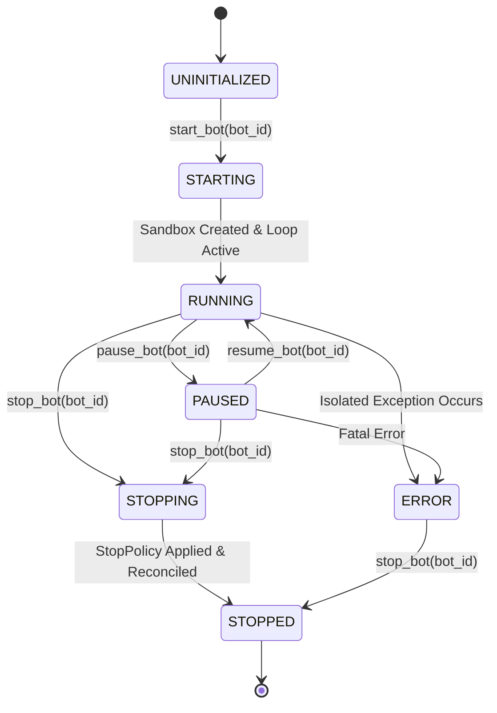

# GĐ37 — BOT REGISTRY & SESSION LIFECYCLE MANAGEMENT

**Dự án:** AlgoTrading V2.0  
**Giai đoạn:** GĐ37  
**Module:** `libs/bot/multibot/registry.py` & `libs/bot/multibot/supervisor.py`

---

## 1. Phân biệt BotDefinition và BotSession

Hệ thống phân tách rành mạch hai khái niệm:

| Thuộc tính | BotDefinition (Cấu hình bền vững) | BotSession (Phiên Runtime tạm thời) |
| :--- | :--- | :--- |
| **Bản chất** | Danh tính chiến lược, bộ symbol, vốn ban đầu, hạn mức rủi ro | Phiên thực thi cụ thể từ START đến STOP |
| **Định danh** | `bot_id` (ví dụ: `bot_alpha_nvda`) | `bot_session_id` (ví dụ: `sess_bot_alpha_12ab34cd`) |
| **Thời gian sống** | Vĩnh viễn (tồn tại qua nhiều lần khởi động lại) | Tạm thời (kết thúc khi STOP hoặc ERROR) |
| **Lưu trữ** | `data/paper_bot/registry/bots.json` | `data/paper_bot/sessions/{session_id}.json` |
| **Tái sử dụng** | Có (1 BotDefinition tạo ra nhiều BotSession nối tiếp) | Không (mỗi session mang một ID duy nhất) |

---

## 2. BotDefinition Schema & Configuration Hash

Mỗi `BotDefinition` được định danh bảo mật bằng mã hash SHA-256 xác định:

$$\text{Hash} = \text{SHA-256}\Big(\text{bot\_id} : \text{strategy\_id} : \text{version} : \text{symbols} : \text{tf} : \text{cash} : \text{risk\_json} : \text{exec\_json} : \text{env} : \text{mode}\Big)$$

Khi bot definition được sửa đổi hợp lệ (ví dụ: đổi danh sách symbols hoặc ngưỡng rủi ro), mã hash sẽ được tự động tính lại và lưu trữ.

---

## 3. Vòng đời BotSession qua Supervisor

### Quy tắc Vòng đời:
1. **Start Bot**:
   - Kiểm tra `len(active_runtimes) < max_concurrent_bots`. Nếu đạt giới hạn, ném `ConcurrencyLimitExceededError`.
   - Nếu bot đang `RUNNING`, trả về session hiện tại (tính chất idempotent).
   - Nếu bot đang `PAUSED`, tự động `resume`.
   - Đăng ký subscription vào `SubscriptionManager` và mở hàng đợi trong `V2MarketDataDispatcher`.
2. **Pause Bot**:
   - Chuyển `event_loop.is_paused = True`. Các lệnh đang chờ khớp (`WORKING`) được giữ nguyên, không bị hủy.
3. **Resume Bot**:
   - Tái kích hoạt event loop để tiếp tục nhận bar 1m.
4. **Stop Bot**:
   - Áp dụng `StopPolicy` (mặc định `CANCEL_REMAINDER` sẽ hủy toàn bộ lệnh chưa khớp).
   - Thực hiện đối soát tài khoản (`reconcile()`).
   - Lưu checkpoint cuối cùng và giải phóng tài nguyên trong supervisor.

---

## 4. Cơ chế Soft-Archiving

Khi một bot không còn sử dụng, lệnh archive sẽ đánh dấu `archived=True` và `enabled=False`:
- Ngăn không cho supervisor khởi động session mới.
- **TUYỆT ĐỐI KHÔNG XÓA** lịch sử session, sổ lệnh (`OrderStore`), sổ fill (`FillStore`), hoặc checkpoint quá khứ, đảm bảo khả năng kiểm toán 100%.
