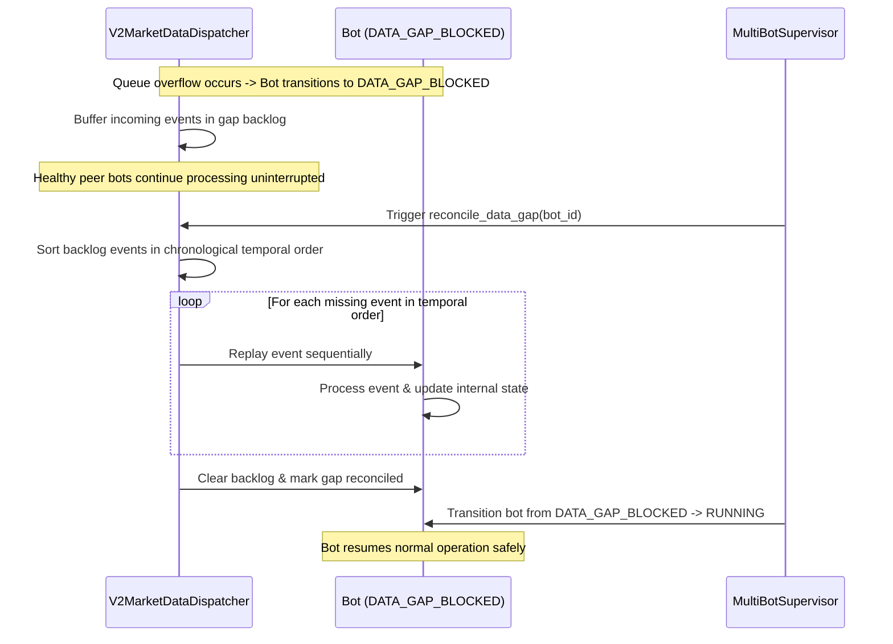

# GĐ39 — QUEUE OVERFLOW & DATA GAP RECOVERY

**Dự án:** AlgoTrading V2.0  
**Giai đoạn:** GĐ39 — End-to-End Integration, Short Soak & Reliability Verification  
**Môi trường:** SIMULATION ONLY  

---

## 1. Cơ chế Phát hiện Tràn Hàng đợi (Queue Overflow Detection)

Để bảo vệ tính toàn vẹn của mô phỏng và ngăn chặn giao dịch trên dữ liệu thị trường bị trễ hoặc thiếu hụt, hệ thống triển khai cơ chế giám sát hàng đợi theo nguyên tắc **Fail-Closed**:

- Mỗi Bot có một hàng đợi sự kiện cục bộ do `V2MarketDataDispatcher` quản lý.
- Khi số lượng sự kiện chờ xử lý vượt quá giới hạn an toàn (`queue_limit`, mặc định 100 sự kiện trong kịch bản kiểm thử, 1000 trong cấu hình vận hành):
  1. Hàng đợi đánh dấu cờ tràn `overflow_detected`.
  2. Bot lập tức chuyển trạng thái sang `DATA_GAP_BLOCKED`.
  3. Mọi hoạt động sinh tín hiệu và khớp lệnh bị tạm ngừng ngay lập tức.

---

## 2. Quy trình Khắc phục Thất thoát Dữ liệu (Data Gap Reconciliation Pipeline)

---

## 3. Các Đảm bảo Về Độ tin cậy (Reliability Guarantees)

1. **Cách ly Đồng đẳng (Peer Isolation):** Việc Bot A bị tràn hàng đợi và chuyển sang `DATA_GAP_BLOCKED` hoàn toàn không làm gián đoạn luồng xử lý của các Bot đồng đẳng khác đang hoạt động tốt.
2. **Tái lập Trình tự Thời gian Tuyệt đối (Temporal Invariance):** Các sự kiện trong khoảng hở dữ liệu được phát lại theo đúng thứ tự thời gian tăng dần (`event_time`), bảo toàn tính đúng đắn của chuỗi nến OHLCV và các chỉ báo kỹ thuật phụ thuộc thời gian (SMA, EMA, RSI).
3. **Xác thực Định danh Sự kiện:** Trong quá trình replay, mỗi sự kiện được kiểm tra trùng lặp qua `event_id` và `bar_revision`, ngăn chặn tình trạng xử lý trùng nến.
4. **Cân bằng Tài chính Hậu Phục hồi:** Sau khi phục hồi từ `DATA_GAP_BLOCKED` về `RUNNING`, báo cáo kiểm toán tài chính `ReconciliationReport` xác nhận hệ thống hoàn toàn cân bằng (`is_balanced == True`).
